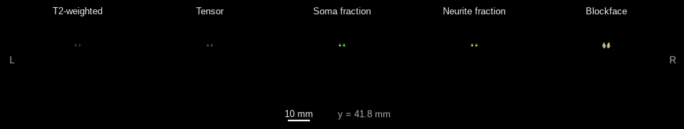

# fiber_template



*The template's six channels, sweeping from the plane with the largest brain area to the back, then to the front: T2-weighted; b0, the diffusion image without diffusion weighting; the tensor, colored by its principal direction (red left-right, green front-back, blue up-down); the soma and neurite fractions, from 0 to 1; and blockface.
The y value under the grid is the plane's coordinate in NMT v2, in mm.*


*Charted tracer-labeled fiber bundles and injection sites from four cases, carried into the template: MR243 (MM1), MR252 (MM2) and MR256 (MM3) on the left, and MF191 (MF8) on the right, mirrored from the left hemisphere.
Each case is named with its injection site; MM3's site was not annotated.
The gray planes are two T2-weighted sections of the template, at the midline and in one coronal plane.*

This is the code for the paper "A multimodal macaque template for aligning ex vivo MRI and microscopy" (Gonzales et al., in preparation).
It builds a macaque brain template from ex vivo MRI and blockface photographs, aligns new brains to it, and carries histology sections, and the labels drawn on them, into it.

## What you can do with it

- Move images between the template and NMT v2, INIA19 or CIVM-R ([01, Step B3](docs/tutorials/01_mri.md#step-b3-bring-images-into-the-template)).
- Align a brain's MRI to the template through its b0 ([01, part B](docs/tutorials/01_mri.md#b-a-new-brains-b0)).
- Reconstruct a 3D blockface volume from blockface photographs ([02, Step 1](docs/tutorials/02_blockface.md#step-1-reconstruct-the-volume)).
- Register a blockface volume to the brain's own b0 or, if the brain has no MRI, to the blockface template ([02, Steps 3 and 4](docs/tutorials/02_blockface.md#step-3-register-the-volume-to-the-brains-own-b0-a-brain-with-mri)).
- Synthesize the tissue that a brain's photographs do not cover ([02, Step 5](docs/tutorials/02_blockface.md#step-5-synthesize-the-tissue-that-was-never-photographed)).
- Register histology sections to their blockface photographs and carry their labels into the template ([03](docs/tutorials/03_histology.md)).
- Make brain masks of MRI images and blockface photographs ([code/shared/segment](code/shared/segment/README.md)).
- Rerun the paper's steps, each checked against the paper's results, and remake its numbers and figures ([00](docs/tutorials/00_start_here.md#two-ways-to-run-a-step), [code/figures](code/figures/README.md)).

## Quick start

You need Linux, a GPU, FSL, ANTs and TIRL, at the versions listed in [settings/env](settings/env/README.md).
TIRL (Tensor Image Registration Library) is not public yet, so ask its authors for the sources.

```bash
export LINC_TIRL_SRC=<folder with the TIRL sources>
bash install.sh                  # the Python environments: about 25 minutes and 23 GB
bash tests/selftest.sh           # a few minutes, no data, no GPU

export LINC_DATA=<your copy of the data folder>   # the folder that holds brains/, template/, models/ and paper/
source settings/roots.sh         # in every new shell
$PY run.py --plan                # every step of the paper and what it needs; runs nothing
```

Then continue with [docs/tutorials/00_start_here.md](docs/tutorials/00_start_here.md).

## Documentation

The [tutorials](docs/tutorials/00_start_here.md) walk through the method on the paper's brains, and the [overview](docs/overview.md) explains how the parts fit together.
[docs/README.md](docs/README.md) lists every other page, including the [how-to](docs/how-to/new_brain.md) for a new brain, [troubleshooting](docs/troubleshooting.md) and the [FAQ](docs/faq.md).

## The data

The template is in LINC dataset 000059, under `derivatives/template/`, and the histology sections are in 000003.
Every brain's inputs and results, the template and the trained networks are in the data folder, which stays with the laboratory ([overview](docs/overview.md#the-data-folder)).

## Cite and license

If you use this code or the template, please cite the paper ([CITATION.cff](CITATION.cff)):

> Gonzales RA, Habte E, Gong T, Huszar IN, Dey N, Wu J, Maffei C, Celestine MR, Lehman JF, Haber SN,
> Balbastre Y, Yendiki A. A multimodal macaque template for aligning
> ex vivo MRI and microscopy. In preparation.

The code is under the Apache License 2.0 ([LICENSE](LICENSE), [NOTICE](NOTICE)), and the template (LINC dataset 000059) is under CC BY 4.0.

## Contact

Ricardo A. Gonzales, Athinoula A. Martinos Center for Biomedical Imaging, Massachusetts General
Hospital (rgonzalesvera@mgh.harvard.edu).
