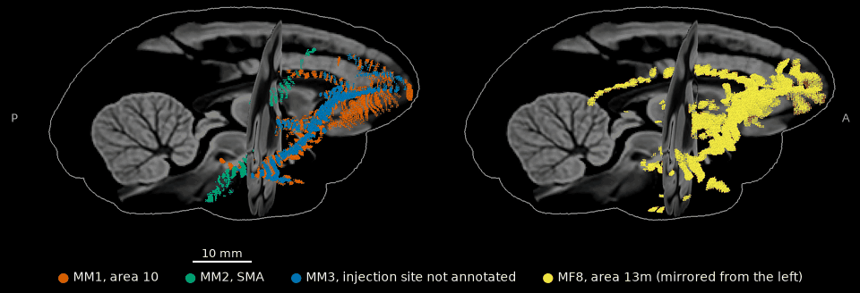

# fiber_template


*The template's six channels, T2-weighted, b0, tensor, soma fraction, neurite fraction and blockface, in coronal planes from front to back.*



*The tracer labels charted in MM1, MM2 and MM3 (left) and in MF8 (right), carried into the template.*

Code for the paper "A multimodal macaque template for aligning ex vivo MRI and microscopy" (Gonzales et
al., in preparation). It builds a macaque brain template from ex vivo MRI and blockface photographs,
brings new brains into it, and carries histology sections and the labels drawn on them into it.

## What it can do

- Look at the template, or move images between it and NMT v2, INIA19 and CIVM-R:
  [spaces and transforms](docs/tutorials/00_start_here.md#spaces-and-transforms),
  [01, Step B3](docs/tutorials/01_mri.md#step-b3-bring-images-into-the-template)
- Bring a brain's MRI into the template through its b0: [01, part B](docs/tutorials/01_mri.md#b-a-new-brains-b0)
- Reconstruct a 3D blockface volume from blockface photographs:
  [02, Steps 1 and 2](docs/tutorials/02_blockface.md#step-1-reconstruct-the-volume)
- Register a blockface volume to its own MRI, or, without MRI, to the blockface template:
  [02, Steps 3 and 4](docs/tutorials/02_blockface.md#step-3-register-the-volume-to-the-brains-own-b0-a-brain-with-mri)
- Predict the tissue that was never photographed, and mark it:
  [02, Step 5](docs/tutorials/02_blockface.md#step-5-predict-the-tissue-that-was-never-photographed)
- Register histology sections to the photographs of their own sections, and carry the labels drawn on
  them (tracers, LGN, STN) into the template: [03](docs/tutorials/03_histology.md)
- Make the brain mask of one MRI image, or of a folder of blockface photographs:
  [code/shared/segment](code/shared/segment/README.md)
- Rerun the paper's steps, each checked against the paper's files, and rewrite its numbers and
  figures: [two ways to run a step](docs/tutorials/00_start_here.md#two-ways-to-run-a-step),
  [code/figures](code/figures/README.md)

## Quick start

You need Linux, a GPU, FSL, ANTs and TIRL, at the versions in [settings/env](settings/env/README.md).
TIRL (Tensor Image Registration Library) is not yet public: ask its authors for the sources.

```bash
export LINC_TIRL_SRC=<folder with the TIRL sources>
bash install.sh                  # the Python environments: about 25 minutes and 23 GB
bash tests/selftest.sh           # a few minutes, no data, no GPU

export LINC_DATA=<your copy of the data>
source settings/roots.sh         # in every new shell
$PY run.py --plan                # every step of the paper and what it needs; runs nothing
```

Then start with the tutorials: [docs/tutorials/00_start_here.md](docs/tutorials/00_start_here.md).

## Documentation

| Kind | Where |
|---|---|
| Tutorials | Learn the method step by step, on the paper's brains: [00 start here](docs/tutorials/00_start_here.md), [01 MRI](docs/tutorials/01_mri.md), [02 blockface](docs/tutorials/02_blockface.md), [03 histology](docs/tutorials/03_histology.md) |
| How-to | [Bring a new brain into the template](docs/how-to/new_brain.md) |
| Reference | Each folder's README (below), [steps.yaml](steps.yaml) for every step of the paper, and `--help` of every command |
| Explanation | The paper (in preparation); [tests/README.md](tests/README.md) on what decides whether a rerun matches the paper |

## Repository layout

| | |
|---|---|
| [install.sh](install.sh) | builds the Python environments |
| [run.py](run.py) | runs the paper's steps and checks each against the paper's files |
| [steps.yaml](steps.yaml) | every step: what it reads and writes, its command, its check and what it needs |
| [code/](code/README.md) | the pipeline, one folder per stage |
| [settings/](settings/README.md) | every parameter: one file per brain and one per stage |
| [tests/](tests/README.md) | checks of the installation and of the results |
| [docs/](docs/README.md) | the tutorials and the how-to |

## The data

- **LINC dataset 000059**: the template, with its MRI channels and its blockface channel, its mappings
  to NMT v2, INIA19 and CIVM-R, and the MRI brain-mask network, under `derivatives/template/` (the
  blockface channel in `micr/`). With these files alone, apply a mapping's parts yourself, as
  `derivatives/template/xfms/README.txt` in the dataset says: the code's commands read files that stay
  local.
- **LINC dataset 000003**: the histology sections.
- **The data folder**: every brain's inputs and results, the template, and the trained networks. It
  stays local, with the laboratory; [00](docs/tutorials/00_start_here.md#what-the-package-is)
  describes its layout.
- **Published templates**: their images are not included. [settings/targets.yaml](settings/targets.yaml)
  says where to get NMT v2 and CIVM-R; CIVM-R's license does not allow its images to be redistributed.
- **Sharing**: a brain's MRI results do not go to 000059. If they are shared at all, they go to that
  brain's own LINC dataset.

## Cite and license

If you use this code or the template, cite the paper ([CITATION.cff](CITATION.cff)):

> Gonzales RA, Habte E, Gong T, Huszar IN, Dey N, Wu J, Maffei C, Celestine MR, Lehman JF, Haber SN,
> Balbastre Y, Yendiki A. A multimodal macaque template for aligning
> ex vivo MRI and microscopy. In preparation.

The code is under the Apache License 2.0 ([LICENSE](LICENSE), [NOTICE](NOTICE)). The data are under
CC BY 4.0.

## Contact

Ricardo A. Gonzales, Athinoula A. Martinos Center for Biomedical Imaging, Massachusetts General
Hospital (rgonzalesvera@mgh.harvard.edu).
