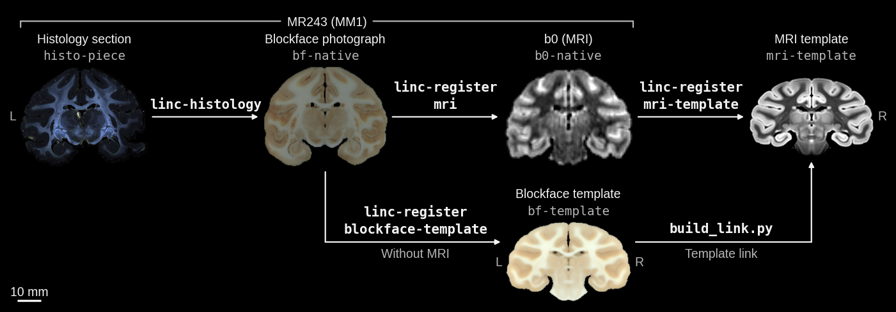

# Overview

Every part of the package in one place: the data, the spaces and transforms, the templates, the networks, the data folder, the settings, the checks and the environments.
The commands are in the [tutorials](tutorials/00_start_here.md), single tasks in the [how-to](how-to/new_brain.md), [troubleshooting](troubleshooting.md) and the [FAQ](faq.md), and the terms in the [glossary](#glossary).

## The package

The package builds a macaque brain template from ex vivo MRI and blockface photographs, aligns new brains to it, and carries histology sections and the labels drawn on them into it.
It has three parts: the template (in the data folder's `template/outputs/` and in LINC dataset 000059), the code (this repository) and the data folder (`fiber_template_data`, which stays with the laboratory).



*Figure 1. The whole chain, drawn with MR243 (MM1): each tile is titled by what it shows, with its space below in gray, and each arrow by the command that makes the transform: a histology section to the blockface photograph of its own section ([03](tutorials/03_histology.md)), the blockface volume to the brain's own b0 ([02](tutorials/02_blockface.md)), and the b0 to the MRI template ([01](tutorials/01_mri.md)).
Without MRI, a blockface volume bypasses the b0: it is registered to the blockface template, which the template link carries into the MRI template (02).*

## The data

Each brain's inputs are in the data folder's `brains/sub-<ID>/inputs/`: `mri/`, `photographs/` (one per section), `histology/` (the scanned sections and the tracer labels drawn from their charts) and `manual_annotations/` (what a person drew or corrected: brain masks, marker tubes, match tables, the LGN and STN).

Four brains with MRI only (MF283 to MF286) built the MRI template ([01](tutorials/01_mri.md)).
The 21 photographed brains built the blockface template ([02](tutorials/02_blockface.md)): 13 have a b0, such as MR243, and 8 have no MRI, such as MF191.
Six of them have histology sections (MR243, MR252, MR256, MF275, MF278, MF191), four have tracer labels (MR243, MR252, MR256, MF191) and three the LGN and STN (MR243, MR252, MR256) ([03](tutorials/03_histology.md)).
Files name a brain by its Specimen ID, such as MR243, which the paper calls MM1; [brain_identifiers.md](brain_identifiers.md) lists all 25 with their names and roles.
MR brains are *Macaca mulatta*, MF brains *Macaca fascicularis*.

## Spaces and transforms

Every image lives in a named space, and every registration writes one transform from one space to another.

| Space | What it is | Its transform toward the template |
|---|---|---|
| `histo-piece:<piece>` | one component of a histology section | to `bf-native`: `linc-histology all` (03) |
| `bf-native` | a brain's blockface volume | to `b0-native`: `linc-register mri`; or to `bf-template`: `linc-register blockface-template` (02) |
| `b0-native` | a brain's b0, as acquired | to `mri-template`: `linc-register mri-template` (01) |
| `t2-native`, `micro-native` | the other MRI acquisitions of the four MRI-template brains | to `b0-native`: `build_mri_channels.py` (01) |
| `bf-template` | the blockface template, in its own space | to `mri-template`, the template link: `build_link.py` (02) |
| `mri-template` | the template: 0.25 mm, in the symmetric frame of NMT v2 | to each published template: `build_link.py` |
| `atlas:<name>` | a published template: `atlas:NMT_v2.0_sym`, `atlas:INIA19`, `atlas:CIVM-R` | |

A brain without MRI also has a transform from `bf-native` straight to `mri-template`, the cross-modal alignment (`linc-register direct-placement`), which gives it a stand-in b0; a chain uses it only when nothing else connects the two spaces.

A transform is a folder, `$LINC_DATA/sub-<ID>/xfm/<from>__to__<to>/`, with its files and a `meta.json` holding its check's verdict; coordinates are RAS, in millimeters.
`shared.xfm` chains the transforms between two spaces and applies the chain in one resampling:

```bash
$PY -m shared.xfm chain --from bf-native --to mri-template --subject <ID>      # lists the links it uses
$PY -m shared.xfm apply --from bf-native --to mri-template --subject <ID> \
    --ref $LINC_DATA_TREE/template/outputs/template_T2w.nii.gz <image> <output>   # add --nearest for a label image
```

An inverted link is solved at every voxel of the target grid, so give it a grid of 0.3 mm or coarser.
For the paper's brains, the data folder also keeps each whole transform as one file, such as `brains/sub-MR243/outputs/MR243_blockface_to_template.nii.gz`, and that folder's `README.txt` shows how to apply it with ANTs alone.

## The templates

**The MRI template** was built from MF283 to MF286 and their mirror images, eight members, by one symmetric groupwise registration (MMORF 1.0.1, through the template-construction driver of Arthofer et al. with [our edits](../code/template/patches/README.md)).
The T2-weighted image, the diffusion tensor and the soma and neurite fractions of SANDI drove it together.
The mirror images make the template symmetric about the midsagittal plane ([01, part A](tutorials/01_mri.md#a-the-mri-template-on-the-papers-four-brains)).

**The blockface template** was built by the same method from the 21 photographed brains, each with its synthesized tissue, and their mirror images.
Each member had two channels, its blockface grayscale and its b0 (its own or the stand-in b0); the MRI template's b0 joined as one more, b0-only member.
In the average, photographed tissue counts more than synthesized tissue, and tissue synthesized from a stand-in b0 not at all.
The construction gives the template the mean shape of its members, so it has a space of its own ([02, Step 7](tutorials/02_blockface.md#step-7-the-blockface-template-and-its-link-to-the-mri-template)).

**The template link** registers the blockface template's b0 to the MRI template's b0.
The blockface template moved through it is the template's blockface channel, `template/outputs/template_blockface_*`.
`build_link.py` also registers the template to NMT v2, INIA19 and CIVM-R.

Adding a brain into a template means building it again, which is not the same as aligning a brain to it: see [Adding a new brain: two different things](tutorials/00_start_here.md#adding-a-new-brain-two-different-things).

## The networks

| Network | What it makes | Used by |
|---|---|---|
| `mri_brainmask` | the brain mask of an ex vivo b0 or T2-weighted image | `linc-mri prep`; `linc-register` when no mask is given |
| `bf_mask2d` | the brain mask of each blockface photograph | `linc-reconstruct photos` |
| `bf_mask3d` | the brain mask of a blockface volume | `linc-reconstruct mask` |
| `bf_holes` | the marker tubes of a blockface volume | `linc-reconstruct tubes` |
| `d3_full_A_s0` | the synthesis network: blockface grayscale from a brain's own b0 | `linc-complete` |
| `d3p_full_A_s0` | the same, from a stand-in b0 | `linc-complete --stand-in` |

The weights are in this repository's `models/segment/` and `models/completion/`; the latter also holds `d3_lso_A_s0` and `d3p_lso_A_s0`, the leave-slab-out networks of the paper's evaluation.
Each segmentation network's card (its training data, held-out results and limits) is `card.txt` in the data folder's `models/<network>/`.
The deformable registrations also use anatomix, a pretrained feature network.
Retraining: [code/shared/segment](../code/shared/segment/README.md), [code/blockface/synthesis](../code/blockface/synthesis/README.md).

## The data folder

| In the data folder | What it is |
|---|---|
| `brains/sub-<ID>/` | one folder per brain |
| `template/` | the template |
| `models/` | the trained networks, with their cards |
| `paper/` | files only the paper's numbers and figures read |
| `brains.tsv` | every brain: its ID, its name in the paper, its species and its data |
| `MRI_INPUTS.txt` | each MRI input, what the code applies to it and what comes out |
| `checksums.md5` | checksums of the inputs |

A brain's folder and the template's have the same three parts: `inputs/` (what an instrument or a person made), `outputs/` (the finished files) and `intermediate/` (everything else).
Each of these folders, and each brain's three parts, has a `README.txt` saying what is in it.

The code reads the data folder and never writes into it.
`settings/files.tsv` has one row per file of the data folder: where it is, and the name the code knows it by.
`source settings/roots.sh` turns each row into a link under the repository's `outputs/in/`, and sets these variables:

| Variable | Folder | What is there |
|---|---|---|
| `$LINC_DATA_TREE` | the data folder you gave as `LINC_DATA` | the paper's files |
| `$LINC_DATA` | `outputs/local_data/data` | each brain's working folder, `sub-<ID>/`, with `blockface/`, `mri/`, `xfm/`, `histology/` and `labels/`: what the commands read and write |
| `$LINC_TEMPLATE`, `$LINC_RAW` | `outputs/local_data/template`, `outputs/local_data/raw` | the template's files and the raw inputs, under the names the code uses |
| `$LINC_WORK` | `outputs/work` | working results: registrations' working files and checks, completions, template builds, images moved into the template |
| `$LINC_MODELS` | `outputs/models` | the networks' weights, joined and checked |
| `$LINC_REBUILD_DATA`, `$LINC_MRI_DATA` | `outputs/local_rebuild/data`, `outputs/local_mri/data` | reruns of the paper's reconstructions and of the MRI template's build |

A `run.py` run writes each step's command, log and check to `outputs/build_everything/`.
To keep a new brain's results, copy them into the data folder: [how-to, step 5](how-to/new_brain.md#5-keep-the-results).

## Settings and steps

Every parameter is in [settings/](../settings/README.md), with a comment naming the Methods section it comes from: one file per brain (`settings/brains/<ID>.yaml`) and one per stage (`settings/<stage>.yaml`).
The code does not repeat their values.

[steps.yaml](../steps.yaml) lists every step of the paper: its command, what it reads and writes, its check, the steps it needs, its GPU memory, RAM, cores, disk and time, and a note.
`run.py` runs it ([00, Two ways to run a step](tutorials/00_start_here.md#two-ways-to-run-a-step)).

## How reruns are checked

On the paper's brains, each step's check compares the rerun with the paper's file.
A CPU step must be identical.
A GPU registration must be within a set distance of the paper's, for most a median of 0.05 or 0.1 mm and a 99th percentile of 0.5 mm, because GPU results differ slightly from one session to the next.
A histology registration must be identical or within 3 pixels of TIRL's grid.
[tests/README.md](../tests/README.md) says what decides whether a rerun matches bit for bit, and which optional steps were rerun only in part.
`bash tests/selftest.sh` checks the installation without data, and `make -C code/figures check` the paper's numbers.

## The environments

`install.sh` builds the Python environments, and `settings/roots.sh` points to them ([settings/env](../settings/env/README.md)):

| Variable | Environment | Runs |
|---|---|---|
| `$PY` | `linc.yml` | MRI preparation, registration, the MRI template, the labels after `push`, the numbers and figures |
| `$PY_DEEP` | `deep.yml` | the segmentation networks and the synthesis |
| `$PY_TIRL` | `tirl.yml` | the blockface reconstruction, the histology registration and `linc-labels push` (TIRL 3.6.3) |
| (called by `linc-register`) | `anatomix.yml` | the deformable registration: anatomix features and FireANTs |
| `$PY_VIZ3D` | `viz3d.yml` | optional: the 3D tracer figure |

Other programs: FSL 6.0.7.4, ANTs 2.5.4, MRtrix3 3.0.2 (only to rebuild the MRI template), and MMORF 1.0.1, which comes with `linc.yml`.
TIRL is not yet public: without its sources, `install.sh` builds the TIRL environment without TIRL, and the steps that need it refuse to run.

## What the package cannot do

- **MRI.** A brain's MRI reaches the template only through its b0; another contrast follows only if it is already aligned with the b0. A new brain's T2-weighted image can be prepared (`linc-mri prep --modality t2`), but nothing registers it.
- **Tensors.** `shared.xfm apply` resamples images; it does not rotate a tensor (the template's own build does, in `code/template/channels.py`).
- **Networks.** They were trained on this collection's brains, cameras and MRI: check their masks on other data.
- **Camera.** A camera that moves on nearly every frame cannot be corrected as camera jumps; MF191 and MF196 replay a recorded alignment to an external series instead.
- **Synthesized tissue.** It is estimated from the b0, not measured, and every file that has it marks it. From a stand-in b0 it shows the template's anatomy: in MR244 the cerebellar folia stop at the junction plane.
- **Histology.** A section is registered only through the photograph of its own section. Between sections, the histology and the labels are interpolated (`provenance_L2.nii.gz` marks the slices; interpolated labels end in `_demons`). A component that fails its check stays in, flagged.
- **Labels.** The single-fiber strokes (`Fibers`) are too sparse for the template's solid-label rule; MR243's template file is empty.
- **Reruns.** `run.py` reruns only the paper's brains; a new brain is run one command at a time.
- **Templates.** Aligning a brain leaves the template unchanged. Adding one into it is a rebuild, and everything aligned to or carried into the old template must be derived again.
- **Sharing.** The photographs, the blockface volumes and everything computed from them stay local.

What has been tested on a brain treated as new: [FAQ](faq.md#what-has-been-tested-on-a-brain-that-is-not-one-of-the-papers).

## Glossary

| Term | Meaning |
|---|---|
| b0 | the diffusion MRI volume without diffusion weighting; the one MRI contrast all sectioned brains share |
| blockface photograph | a photograph of the frozen block from a fixed camera, taken as each section is cut |
| blockface volume | a brain's photographs stacked into 3D (`bf-native`) |
| blockface template | the average of the 21 photographed brains (`bf-template`) |
| blockface-based alignment | blockface volume to the blockface template, then the template link |
| camera jump | a shift of the camera between two sections, corrected in the reconstruction |
| completion | joining the synthesized tissue to the photographs (`linc-complete`), which makes the completed volume |
| component | the part of a histology section registered on its own, a hemisphere or the cerebellum with the brainstem; the code calls it a piece |
| cross-modal alignment | a blockface volume registered straight to the template's b0 (`linc-register direct-placement`) |
| data folder | `fiber_template_data`: the inputs, results, template and networks; it stays local |
| junction plane | where a brain's photographs end and its synthesized tissue begins |
| manual annotations | what a person drew or corrected; a corrected file replaces the network's |
| marker tubes | holes drilled into the block as fiducials (files named `tubes` or `holes`) |
| match table | which photograph each histology component goes with |
| member | one input of a template: a brain or its mirror image |
| MRI-based alignment | blockface volume to the brain's own b0, then the b0 to the template |
| outline check | how far a moved brain outline lies from the target's, in six directions: PASS, WARN or FAIL |
| published templates | NMT v2, INIA19 and CIVM-R (`atlas:<name>` in the code) |
| regions volume | the template's left, right and cerebellum regions on a brain's blockface volume, plus its marker tubes |
| section step | the distance between two photographs (`vz`) |
| stand-in b0 | for a brain without MRI, the template's b0 moved into the brain by the cross-modal alignment |
| synthesized tissue | tissue the photographs do not cover, predicted from the b0 by the synthesis network (`_synthesized_mask`) |
| template | the MRI template with its blockface channel, in `mri-template` |
| template link | the registration of the blockface template to the MRI template |
