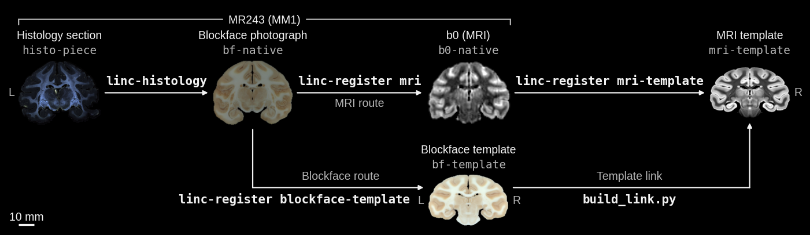

# Start here

These tutorials show how the multimodal macaque template was made and how to bring a new brain into it, step by step.
They go with the paper "A multimodal macaque template for aligning ex vivo MRI and microscopy" (Gonzales et al., in preparation).
Read this page first, then the tutorial for the data you have.

| Tutorial | What it covers |
|---|---|
| [01_mri.md](01_mri.md) | The MRI template: how it was built and what is in it. Aligning a new brain's MRI to it. |
| [02_blockface.md](02_blockface.md) | From blockface photographs to a 3D volume, the tissue that was never photographed, the blockface template, and registering a blockface volume to its own MRI or to the blockface template. |
| [03_histology.md](03_histology.md) | Histology sections registered to their blockface photographs, and labels drawn on the sections carried into the template. |

## What the package is

The package has three parts.

**The template.**
A 3D reference brain in the symmetric frame of NMT v2, on a 0.25 mm grid.
Its MRI channels (T2-weighted, b0, the diffusion tensor and its maps, two SANDI fractions) come from the ex vivo MRI of four *Macaca fascicularis* brains and their mirror images.
Its blockface channel is the average of the blockface photographs of 21 brains.
It also holds a brain mask, a white matter mask, left, right and cerebellum regions, and the lateral geniculate nucleus (LGN) and subthalamic nucleus (STN).
All of it is in `template/outputs/` of the data folder.
You can open any of these files in a viewer such as FSLeyes or ITK-SNAP without running any code.

**The code.**
The repository `fiber_template` (https://github.com/lincbrain/fiber_template).
It builds the templates, brings new brains into them, and rewrites the paper's numbers and figures.

| In the code folder | What it is |
|---|---|
| `install.sh` | builds the Python environments |
| `run.py` | reruns the paper's steps on the paper's brains and checks each result against the paper's file |
| `steps.yaml` | every step: what it reads and writes, its command, its check, and what it needs (GPU memory, RAM, time) |
| `code/` | the pipeline, one folder per stage |
| `settings/` | every parameter, one file per brain and one per stage |
| `models/` | the trained networks' weights; a file over 100 MB is kept in two parts, which `settings/roots.sh` joins and checks |
| `tests/` | checks of the installation and of the results |

**The data folder.**
`fiber_template_data`, a folder of its own, beside the code.

| In the data folder | What it is |
|---|---|
| `brains/sub-<ID>/` | one folder per brain |
| `template/` | the template |
| `models/` | the trained networks, with each one's card (its training data, held-out results and limits) |
| `paper/` | files only the paper's numbers and figures read |
| `brains.tsv` | every brain: its ID, its name in the paper, its species and its data |
| `MRI_INPUTS.txt` | each MRI input, what the code applies to it and what comes out |
| `checksums.md5` | checksums of the inputs |

A brain's folder and the template's folder are organized the same way:
`inputs/` holds what an instrument or a person made, `outputs/` holds the finished files, and `intermediate/` holds everything else.
A brain's ID is its Specimen ID, such as MR243; `brains.tsv` gives its name in the paper, such as MM1.
[brain_identifiers.md](../brain_identifiers.md) lists all 25 brains with their names in the paper and on LINC.
MR brains are *Macaca mulatta* and MF brains are *Macaca fascicularis*.

Two LINC datasets hold parts of it in the cloud.
Dataset 000059 holds the template and the MRI brain-mask network.
Dataset 000003 holds the histology sections.
The blockface photographs, the blockface volumes and everything computed from them stay local, with the laboratory.

## The brains

| Brains | Data | Used in |
|---|---|---|
| MF283, MF284, MF285, MF286 | MRI only: high-resolution diffusion, microstructure diffusion, T2-weighted | the MRI template (01) |
| 13 brains, such as MR243 | blockface photographs and a b0 | the blockface template and the MRI-based registration (02) |
| 8 brains, such as MF191 | blockface photographs, no MRI | the blockface template and the registration without MRI (02) |
| MR243, MR252, MR256, MF275, MF278, MF191 | histology sections, as well | histology registration (03) |
| MR243, MR252, MR256, MF191 | tracer labels drawn on the sections | labels carried into the template (03) |
| MR243, MR252, MR256 | LGN and STN drawn on the sections | labels carried into the template (03) |

`brains.tsv` lists all 25.

## How the three tutorials fit together

Each tutorial builds on the one before it.

1. **MRI (01).**
   The MRI template is built first, from the four MRI brains.
   Any brain with a b0 is then registered to it.
   This b0-to-template transform is the last link of every chain below.
2. **Blockface (02).**
   A brain's photographs become a 3D blockface volume.
   A brain with MRI registers its volume to its own b0, then follows its b0 into the template.
   A brain without MRI registers its volume to the blockface template, which is itself registered to the MRI template.
   The tissue below the last photograph is predicted and marked.
3. **Histology (03).**
   Each histology section is registered to the blockface photograph of its own section.
   From there it follows the blockface volume's chain into the template, and so do the labels drawn on it.



*Figure 1. The whole chain, drawn with MR243 and the template, each tile titled by its space.
Section 36 of MR243 as scanned (the JPEG 2000, brightened for display) is registered to the blockface photograph of its own section (03).
The blockface volume is registered to MR243's own b0 (02), and the b0 to the MRI template, shown by its T2-weighted channel (01).
A brain without MRI goes from its blockface volume to the blockface template, and from there through the link between the two templates (02); the blockface template is shown here on the MRI template's grid (`template/outputs/template_blockface_rgb.nii.gz`).
Each arrow names the command that makes the transform.*

## Adding a new brain: two different things

"Adding a new brain to the template" can mean two things.

**(a) Aligning a new brain to the template.**
This is the normal use.
The new brain's images are registered to the template and moved into its space, where they can be compared with every other brain.
The template does not change.
Each tutorial shows how, for its kind of data.

**(b) Adding a brain into the template.**
This means building the template again, with the new brain among its members.
The result is a new template, with its own links to the blockface template and to the published templates.
A new MRI template also means a new blockface template, because the MRI template's b0 is one of the blockface template's members.
Everything aligned to the current template would then have to be derived again: each brain's transform to the template, the template's blockface channel, and the labels carried into it.
It also takes long:

| Rebuild | Time |
|---|---|
| The MRI template's groupwise construction | 3.5 days on one 48 GB card (the paper's run) |
| The blockface template's first stage | about 8.5 hours on a free card |
| The blockface template's last step, at 0.25 mm | about 17 hours on one card (estimated), plus about 2.5 hours of CPU steps |

The code can do this (01 and 02 show the drivers; the members are listed in `settings/mri_construction.yaml` and `settings/blockface_template.yaml`), but it is a decision, not a routine step.

## Spaces and transforms

Every image lives in a named space, and every registration writes one transform from one space to another.

| Space | What it is |
|---|---|
| `histo-piece:<piece>` | one part of a histology section (a hemisphere, or the cerebellum with the brainstem) |
| `bf-native` | a brain's blockface volume |
| `b0-native` | a brain's b0, as acquired |
| `t2-native`, `micro-native` | the other MRI acquisitions of the four MRI brains |
| `bf-template` | the blockface template, in its own space |
| `mri-template` | the template, 0.25 mm, in the NMT v2 frame |
| `atlas:<name>` | a published template: `atlas:NMT_v2.0_sym`, `atlas:INIA19`, `atlas:CIVM-R` |

The code finds the transforms between two spaces, chains them, and applies the chain with one interpolation:

```bash
$PY -m shared.xfm chain --from bf-native --to mri-template --subject <ID>      # lists the links it uses
$PY -m shared.xfm apply --from bf-native --to mri-template --subject <ID> \
    --ref $LINC_DATA_TREE/template/outputs/template_T2w.nii.gz <image> <output>   # add --nearest for a label image
```

For the paper's brains, the data folder also keeps each whole transform as one file, such as `brains/sub-MR243/outputs/MR243_blockface_to_template.nii.gz`.
`brains/sub-<ID>/outputs/README.txt` shows how to apply it with ANTs, without this code.

## Before you start

You need Linux, a GPU, FSL 6.0.7.4 and ANTs 2.5.4.
TIRL (Tensor Image Registration Library), which the blockface and histology steps use, is not yet public: ask its authors for the sources.

Once, from the top of the code folder:

```bash
export LINC_TIRL_SRC=<folder with the TIRL sources>
bash install.sh                  # about 25 minutes and 23 GB
bash tests/selftest.sh           # a few minutes, no data, no GPU
```

In every new shell, from the top of the code folder:

```bash
export LINC_DATA=<the data folder>
source settings/roots.sh
```

This sets `$PY`, `$PY_TIRL` and `$PY_DEEP`, the three Python environments that `install.sh` built.
Every tutorial command assumes this shell.

After it, `$LINC_DATA_TREE` is the data folder you gave.
`$LINC_DATA` itself now points to the code's own working folder, `outputs/local_data/data` inside the code folder.
The code reads the data folder and never writes into it.

The code does not find files by their names in the data folder.
`settings/files.tsv` has one row per file of the data folder: where it is, and the name the code knows it by.
`settings/roots.sh` turns each row into a link under the code folder's `outputs/in/`.
So a new file that the code must find by name needs its row in `settings/files.tsv`, or a link where the code looks for it.
[02_blockface.md](02_blockface.md) shows this for a new brain's photographs.

## Two ways to run a step

**On the paper's brains, with checks.**
`run.py` runs the steps in `steps.yaml` and checks each result against the paper's file.

```bash
$PY run.py --plan --only register-mri-template-MR243      # prints the step, its exact command and its check; runs nothing
$PY run.py --run --only register-mri-template-MR243       # runs it, then its check
$PY run.py --status                                       # one line per step: passed, differs or failed
```

`--run` also runs the steps that a step needs, when they have not passed yet; `--plan` lists them.

To rerun everything (the plan lists the GPUs it needs: 48 GB for the templates):

```bash
mkdir -p outputs
nohup $PY run.py --run > outputs/build_everything.log 2>&1 &
$PY run.py --status                                       # one line per step
```

Optional steps (building the MRI template, training the networks) run only when you name them with `--only`.

`--only` takes a step (such as `histology-MR243`), a group (`setup`, `mri-template`, `blockface`, `registration`, `synthesis`, `blockface-template`, `link`, `histology`, `labels`, `paper`, `training`), or a brain.
Each step's log is in `outputs/build_everything/steps/<step>/`.

**On a new brain, one command at a time.**
Each tutorial gives the commands, which are the same programs `run.py` runs.
Every command prints what it needs, what it does and what it writes with `--help`.
`run.py` does not run a new brain: its plan covers only the paper's brains.

The paper's numbers and figures have their own commands (`make -C code/figures numbers`, `figures` and `check`); [code/figures](../../code/figures/README.md) explains them.

## Where everything lands

| What | Where |
|---|---|
| The paper's finished files, for each brain | `brains/sub-<ID>/outputs/` in the data folder |
| The finished template | `template/outputs/` in the data folder |
| The trained networks | `models/` in the code folder, joined into `outputs/models/` (`$LINC_MODELS`) |
| What you run: a brain's MRI, blockface volume, transforms, histology and labels | `$LINC_DATA/sub-<ID>/` (that is, `outputs/local_data/data/sub-<ID>/` in the code folder) |
| What you run: working results, such as an image moved into the template | `$LINC_WORK/` (`outputs/work/` in the code folder) |
| A `run.py` run: each step's command, log and check | `outputs/build_everything/` in the code folder |

Each tutorial ends with its own table.
To keep a new brain's results in the data folder, follow [Bring a new brain into the template](../how-to/new_brain.md#5-keep-the-results).

## What the package cannot do

- It aligns a brain's MRI to the template through its b0.
  Another contrast follows the b0 only if it is already aligned with it.
- It registers a histology section only through the blockface photograph of its own section.
  Sections without photographs cannot be used.
- The tissue below the last photograph is predicted, not measured.
  It is marked in every file that has it.
- `run.py` reruns only the paper's brains.
  A new brain is run one command at a time.
- Aligning a new brain to the template leaves the template unchanged.
  Adding a brain into the template makes a new template, and everything aligned to the current one would have to be derived again (see "Adding a new brain: two different things" above).
