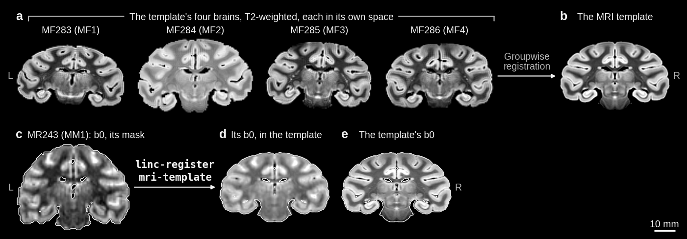

# 01. MRI

How the MRI template was built from four brains (part A), and how a new brain's b0 is registered to it (part B).
The examples are MF283 (MF1 in the paper), one of the template's four brains, and MR243 (MM1), a brain with a b0.
Read [00_start_here.md](00_start_here.md) first: every command runs from the top of the repository, in its shell.

## 1. What this part does

One symmetric groupwise registration aligned MF283 to MF286 and their mirror images, driven by the T2-weighted image, the tensor and the soma and neurite fractions together ([overview](../overview.md#the-templates)).
Any other brain with MRI reaches the template through its b0: registered to the template's b0, it carries every image on the b0 into the template.



*Figure 1. (a) The T2-weighted images of MF283 (MF1) to MF286 (MF4) (`brains/sub-<ID>/outputs/<ID>_t2_T2w.nii.gz`), each in its own space, and (b) the template's, made by their groupwise registration (`template/outputs/template_T2w.nii.gz`).
(c) MR243 (MM1)'s b0 with its brain mask (`brains/sub-MR243/inputs/mri/MR243_b0.nii.gz`), registered by `linc-register mri-template`; (d) the same b0 moved into the template (`outputs/MR243_b0_to_template.nii.gz`), to compare with (e) the template's b0 (`template/outputs/template_b0.nii.gz`).
The white line is MR243's brain mask in (c), the template's in (d) and (e).*

## 2. Inputs

**The template's four brains** each have three acquisitions, each in its own space, preprocessed before this code (denoising, eddy-current and motion correction, a first bias correction, the SANDI fit); `MRI_INPUTS.txt`, at the top of the data folder, says how, and where each file's public copy is.

| File, in `brains/sub-MF283/inputs/` | What it is |
|---|---|
| `mri/MF283_tensor_dwi_biascorr.nii.gz` | the 0.25 mm diffusion series (171 volumes, b up to 20,000 s/mm²), bias-corrected; its volume 0 is the b0 |
| `mri/MF283_tensor_dwi_eddycorrect.nii.gz`, `.ecclog`, `MF283_tensor.bval`, `.bvec`, `MF283_tensor_fit_mask.nii.gz` | the same series before the bias correction, its motion-correction matrices, b-values, b-vectors and the tensor fit's mask: the tensor is fitted on these |
| `mri/MF283_t2_msme_denoised.nii.gz` | the 0.5 mm multi-echo spin-echo series (32 echoes, 6 ms apart), denoised |
| `mri/MF283_micro_dwi_biascorr.nii.gz`, `MF283_micro_SANDI_fracs_mean.nii.gz`, `_std.nii.gz` | the 0.5 mm multi-shell series (184 volumes, b up to 43,000 s/mm²) and its SANDI fit: soma, neurite and dot fractions |
| `manual_annotations/MF283_tensor_brain_mask.nii.gz`, `_t2_brain_mask`, `_micro_brain_mask`, `_final_brain_mask` | each acquisition's brain mask and the final one, each manually corrected |

**A new brain** needs one b0 as NIfTI. MR243's:

| File, in `brains/sub-MR243/inputs/` | What it is |
|---|---|
| `mri/MR243_b0.nii.gz` | the b0, 0.7 mm isotropic; already masked to the brain and bias-corrected, so it has no background |
| `manual_annotations/MR243_b0_brain_mask.nii.gz` | its brain mask, manually corrected |


*Figure 2. (a-c) MF283's T2-weighted image (the echo the build uses), FA and soma fraction (`outputs/MF283_t2_T2w.nii.gz`, `_tensor_dti`, `_micro_soma_fraction`), each in its own space; (d) MR243's b0.*

## 3. Steps

### A. The MRI template, on the paper's four brains

Part A rebuilds the paper's template; a new brain does not need it.
Its driver, `code/template/build_mri_channels.py`, has one step per stage and brain (`--plan` lists them; `$PY run.py --plan --only mri-template` prints the exact commands and checks).
It works in its own folder, so its commands set `LINC_DATA=$LINC_MRI_DATA`, and a step whose outputs exist runs again only with `--force`.

Steps A1 to A7 run once per brain (MF283, MF284, MF285, MF286):

```bash
LINC_DATA=$LINC_MRI_DATA $PY code/template/build_mri_channels.py --step stage-MF283
```

| Step | `--step` | What it does | Runs on | Writes |
|---|---|---|---|---|
| A1 | `stage-<ID>` | copies each acquisition into the build's folder and corrects its bias with N4 inside the brain mask; takes the T2-weighted echo and the SANDI fractions | CPU, 8 cores, 8 GB; about 4 min | `$LINC_MRI_DATA/sub-<ID>/mri/{dwi,t2,micro}/` and `dwi/raw/` |
| A2 | `tensor-<ID>` | fits the tensor (FSL dtifit) on the 43 volumes with b up to 4800 s/mm², the b-vectors rotated by each volume's motion correction and checked with `dwigradcheck` | CPU, 8 cores, 12 GB; about 8 min | `$LINC_WORK/build_mri_channels/tensor_d9/<ID>/` |
| A3 | `nmt-<ID>` | registers NMT v2 to the b0 and carries NMT's SARM labels onto it | GPU, 16 GB free; 16 GB of RAM; 3.5 to 8 min | `$LINC_MRI_DATA/sub-<ID>/mri/landmarks/` |
| A4 | `t2reg-<ID> --force` | registers the T2-weighted image to the b0, deformably: the b0 is an echo-planar image with its own distortion, so the two are never in the same space | GPU, 16 GB free; 16 GB of RAM; 3.5 to 7 min | `$LINC_MRI_DATA/sub-<ID>/xfm/t2-native__to__b0-native/` |
| A5 | `microreg-<ID> --force` | registers the multi-shell session's b0 to the high-resolution b0, deformably, carrying the SANDI fractions | GPU, a 48 GB card (it uses 22 GB); 16 GB of RAM; about 6 min | `$LINC_MRI_DATA/sub-<ID>/xfm/micro-native__to__b0-native/` |
| A6 | `--from landmarks-<ID> --to frames-<ID>` | finds the anterior and posterior commissures from the SARM labels, then the canonical frame: the midsagittal plane and the AC-PC line | CPU, 2 cores; about 2 min | `$LINC_MRI_DATA/sub-<ID>/mri/landmarks/landmarks.json`, `canonical.json` |
| A7 | `prepare-<ID>` | resamples every channel once onto the canonical grid (the tensor with its rotation), cuts it to the final brain mask and makes its mirror image | CPU, 4 cores, 16 GB; about 3 min | `$LINC_WORK/build_mri_channels/prep/<ID>/` |

Steps A8 to A11 run through `run.py`:

| Step | Command | What it does | Runs on | Writes |
|---|---|---|---|---|
| A8 | `$PY run.py --run --only mri-assemble` | writes the MMORF run folder: its parameter files, the list of the eight inputs and the standard space | CPU; seconds | `$LINC_WORK/mri_construction/runs/rb_final/` |
| A9 | `$PY run.py --run --only mri-construction-step1`, or `mri-construction-full` (optional) | the symmetric groupwise registration with MMORF 1.0.1, through the driver of Arthofer et al. with [our edits](../../code/template/patches/README.md); `step1` stops after the first of eight nonlinear steps | step 1: 6 GB of GPU, 32 GB of RAM, about 2 h; all eight: a 48 GB card to itself, 64 GB of RAM, 100 GB of disk, 3.5 days | `.../rb_final/out/`; the full run in `$LINC_WORK/mri_construction_full/runs/rb_final/out/`, whose `nln_step_08/iteration_03` holds the final warps |
| A10 | `$PY run.py --run --only mri-channels` | moves each brain's images into the template in one resampling (the tensor rotated with its warp) and averages them: T2-weighted, b0, the tensor and its maps, the soma and neurite fractions, the masks | CPU, 8 cores, 32 GB; about 15 min | `$LINC_WORK/mri_paper_run/channels/linc_mri_*.nii.gz`, which are `template/outputs/template_*.nii.gz` in the data folder |
| A11 | `$PY run.py --run --only mri-links-MF283` | writes the brain's two transforms: from its b0 to its canonical frame, and from that frame to the template | CPU; under half a minute | `$LINC_WORK/mri_links/<ID>/xfm/` |

A9 starts from the paper's own construction inputs, so that its result can be compared with the paper's file by file; to build from your own A7 outputs, point `$LINC_WORK/mri_construction/prep/<ID>` at them.
The data folder keeps each template brain's whole transforms as single files: `brains/sub-MF283/outputs/MF283_b0_to_template.nii.gz`, `_t2_to_template` and `_micro_to_template`.


*Figure 3. The template's channels in one coronal plane (`template/outputs/`): (a) T2-weighted, with the brain mask's outline, (b) b0, (c) FA, (d) the principal direction, colored as the key shows, (e) neurite fraction, (f) soma fraction.*

### B. A new brain's b0

These steps bring any brain with a b0 into the template, and leave the template unchanged.

#### Step B1. Prepare the b0

```bash
$PY code/mri/linc-mri prep --subject <ID> --image <b0.nii.gz>
```

- **What it does:** takes one 3D volume (volume 0 of a 4D series, or `--volume N`), makes its brain mask with the MRI brain-mask network (or uses yours, `--mask <file>`), corrects the bias with N4 inside the mask, and rescales the masked image. It ends by printing the next command.
- **Runs on:** CPU, 4 cores, 4 GB of RAM; under a minute. The mask network runs on a GPU with 5 GB free, or on the CPU with `--device cpu`.
- **Writes:** `$LINC_DATA/sub-<ID>/mri/dwi/` (`b0.nii.gz`, `b0_brain.nii.gz`, `b0_brain_n4.nii.gz` and its bias field), `$LINC_DATA/sub-<ID>/mri/masks/dwi_brain_mask.nii.gz`, and a provenance file listing every step with its tool and version.

On MF283, with its paper's mask, this step reproduces the paper's three files voxel for voxel (`$PY run.py --run --only mri-prep-MF283`); without it, the network's mask had a Dice coefficient of 0.980 with the paper's.


*Figure 4. What `linc-mri prep` makes, on MF283's b0 (`brains/sub-MF283/intermediate/prepare/dwi/`; MR243's b0 is already masked and corrected): (a) `b0.nii.gz`, (b) its brain mask, (c) `b0_brain.nii.gz`, (d) the bias field N4 found, (e) the masked b0 divided by it.*

#### Step B2. Register the b0 to the template

```bash
M=$LINC_DATA/sub-<ID>/mri
$PY code/blockface/registration/linc-register mri-template --subject <ID> \
    --b0 $M/dwi/b0_brain_n4.nii.gz --mask $M/masks/dwi_brain_mask.nii.gz \
    --place-b0 $LINC_TEMPLATE/frames/mri_template_0p5.nii.gz \
    --template-b0 $LINC_TEMPLATE/mri/linc_mri_b0.nii.gz \
    --template-mask $LINC_TEMPLATE/mri/linc_mri_brainmask.nii.gz
```

- **What it does:** places the b0 rigidly on the template's 0.5 mm frame, fits a similarity and then an affine transform to the template's b0, then a deformable registration of image features (anatomix and MIND-SSC) on a 0.35 mm grid. Every input is masked to the brain. It ends with the outline check (section 4) and records the verdict.
- **Runs on:** GPU, 15 GB free, 8 cores, 4 GB of RAM; about 12 minutes on an RTX 4000 Ada, 4 on an RTX 6000 Ada.
- **Writes:** the transform, `$LINC_DATA/sub-<ID>/xfm/b0-native__to__mri-template/` (the warp, the start affine, and `meta.json` with the verdict); the b0 and its mask moved into the template, and the check's numbers, in `$LINC_WORK/b0_to_template/<ID>/`.

For a paper brain, `$PY run.py --run --only register-mri-template-MR243` runs it with the paper's mask and placement and compares the result with the paper's transform.


*Figure 5. (a) MR243 (MM1)'s b0 moved into the template (`brains/sub-MR243/outputs/MR243_b0_to_template.nii.gz`); (b) the template's b0. The white line is the template brain's outline, the same on both rows; the sagittal plane is 6 mm left of the midline; axial views: anterior is up.*

#### Step B3. Bring images into the template

```bash
$PY -m shared.xfm apply --from b0-native --to mri-template --subject <ID> \
    --ref $LINC_TEMPLATE/mri/linc_mri_b0.nii.gz <image on the b0> <output>      # add --nearest for a label image
```

This moves any image on the brain's b0 into the template in one resampling (CPU, seconds).
The same command moves images between the template and a published template (with your own copy of it as `--ref`) or the blockface template (`bf-template`):

```bash
$PY -m shared.xfm apply --from mri-template --to atlas:NMT_v2.0_sym --ref <NMT image> \
    <image in the template> <output>
$PY -m shared.xfm apply --from atlas:NMT_v2.0_sym --to mri-template \
    --ref $LINC_TEMPLATE/mri/linc_mri_b0.nii.gz <image in NMT> <output>
```

The published templates are `atlas:NMT_v2.0_sym`, `atlas:INIA19` and `atlas:CIVM-R`.

## 4. Checks

**The outline check** ends step B2.
It moves the b0's brain mask into the template and measures, in six directions, how far the moved outline lies outside the template brain's (overshoot) or inside it (undershoot).

| Verdict | Rule | Counts as |
|---|---|---|
| PASS | every 99th percentile of the distance at most 2.5 mm | pass |
| WARN | a 99th percentile over 2.5 mm | pass |
| FAIL | a 99th percentile over 3.5 mm, or a largest distance over 5.0 mm | fail |

Tissue below the template brain's lowest axial slice is reported but does not count: the template's brainstem ends in a flat cut, and a brain's own often goes further.


*Figure 6. On the template's b0, with the lines named in the key.
(a) MR243 (MM1): PASS; its brainstem reaches below the dotted line, which is reported but not counted.
(b) MR253 (MM7): WARN, a ventral overshoot of 2.95 mm (99th percentile) under the cerebellum.*

The verdict and its reasons are in the transform's `meta.json`, under `qc`, and `$PY -m shared.xfm list --subject <ID>` lists every transform of a brain with its verdict.
Of the paper's 13 brains with a b0, 9 passed and 4 warned: MR250 (posterior overshoot, 2.57 mm), MR251 (anterior overshoot, 2.56 mm), MR253 (ventral overshoot, 2.95 mm) and MR261 (anterior undershoot, 2.70 mm).

A warning asks for a look, not a rerun: open the moved b0 (`$LINC_WORK/b0_to_template/<ID>/`) over the template's b0 at the side the warning names, and check whether the brain's own anatomy explains it (a brainstem cut at another level, olfactory tissue the template lacks, a b0 that does not reach that far).
A FAIL means the registration should not be used as it is (section 5).

**`run.py`'s checks** compare a rerun with the paper's files.
B2: the start affine identical and the warp within a median of 0.1 mm and a 99th percentile of 0.5 mm inside the brain (the lab's rerun of all 13: medians 0.002 to 0.060 mm, 99th percentiles 0.04 to 0.47 mm).
Part A: staging, the tensor, the assembly, the construction's first step and the channels identical; A3 to A5 within tolerances (at least 93 % of the SARM labels; the T2 field within 0.05 mm median and 0.3 mm 99th percentile, the microstructure field within 0.05 and 0.5 mm); the canonical frame within 1 degree and a mean move of 0.5 mm.

## 5. When something goes wrong

What you may see in this part, why, and what to do: [troubleshooting, mri](../troubleshooting.md#mri).
What it cannot do: [overview](../overview.md#what-the-package-cannot-do).
