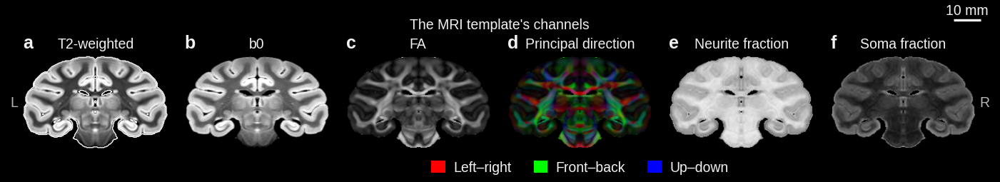
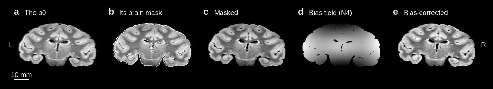
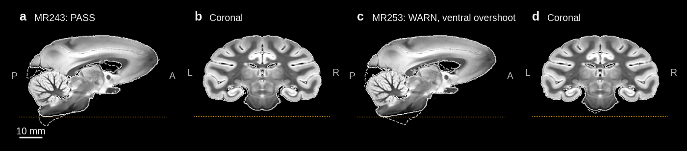

# 01. MRI

This tutorial covers the MRI side: how the MRI template was built from four brains, and how a new brain's b0 is registered to it.
The template's example brain is MF283 (MF1 in the paper), one of its four brains; the new-brain example is MR243 (MM1 in the paper).
From here on, the brains are named by their IDs, as every folder and file is.

Read [00_start_here.md](00_start_here.md) first: it covers the installation, `settings/roots.sh`, `run.py` and the transform commands.

## 1. What this part does

The MRI template is built from the ex vivo MRI of four *Macaca fascicularis* brains (MF283, MF284, MF285, MF286) and their mirror images.
One symmetric groupwise registration (MMORF) aligns them, driven by four channels together: the T2-weighted image, the diffusion tensor, and two SANDI fractions (soma and neurite).
The template lies in the frame of NMT v2 (symmetric), on a 0.25 mm grid.
Any other brain with MRI reaches the template through its b0, the diffusion volume with no diffusion weighting.
Its b0 is registered to the template's b0 channel, and that one transform carries every image on the b0 into the template.
In the whole chain (00, Figure 1), this b0-to-template transform is the last link for every brain with MRI.


*Figure 1. Top: the T2-weighted images of MF283, MF284, MF285 and MF286 (`brains/sub-<ID>/outputs/<ID>_t2_T2w.nii.gz`), each in its own space, and the template's (`template/outputs/template_T2w.nii.gz`).
Bottom: MR243's b0 with its brain mask (`brains/sub-MR243/inputs/mri/MR243_b0.nii.gz`, `inputs/manual_annotations/MR243_b0_brain_mask.nii.gz`), the same b0 moved into the template through `outputs/MR243_b0_to_template.nii.gz`, and the template's b0 (`template/outputs/template_b0.nii.gz`).
The white line is each brain mask's outline: MR243's own on the left, the template's on the right two.*

## 2. Inputs

**The four brains of the template** each have three acquisitions, each in its own native space.
`MRI_INPUTS.txt`, at the top of the data folder, says what each file is, how it was made upstream, and where its public copy is.
The upstream preprocessing (denoising, eddy-current and motion correction, the first bias correction, the SANDI fit) was done before this code, which runs none of it.

| File | Where in the data tree | What it is |
|---|---|---|
| `MF283_tensor_dwi_biascorr.nii.gz` | `brains/sub-MF283/inputs/mri/` | the 0.25 mm diffusion series (171 volumes, b up to 20,000 s/mm²), bias-corrected; its volume 0 is the b0 |
| `MF283_tensor_dwi_eddycorrect.nii.gz`, `.ecclog`, `MF283_tensor.bval`, `.bvec`, `MF283_tensor_fit_mask.nii.gz` | `brains/sub-MF283/inputs/mri/` | the same series before the bias correction, its motion-correction matrices, b-values and b-vectors, and the tensor fit's mask; the tensor is fitted on these |
| `MF283_t2_msme_denoised.nii.gz` | `brains/sub-MF283/inputs/mri/` | the 0.5 mm multi-echo spin-echo series (32 echoes, 6 ms apart), denoised |
| `MF283_micro_dwi_biascorr.nii.gz`, `MF283_micro_SANDI_fracs_mean.nii.gz`, `_std.nii.gz` | `brains/sub-MF283/inputs/mri/` | the 0.5 mm multi-shell series (184 volumes, b up to 43,000 s/mm²) and its SANDI fit: soma, neurite and dot fractions |
| `MF283_tensor_brain_mask.nii.gz`, `_t2_brain_mask`, `_micro_brain_mask`, `_final_brain_mask` | `brains/sub-MF283/inputs/manual_annotations/` | the brain mask of each acquisition and the final one, each corrected by hand |

**A new brain** needs one b0 as NIfTI.
The example is MR243's:

| File | Where in the data tree | What it is |
|---|---|---|
| `MR243_b0.nii.gz` | `brains/sub-MR243/inputs/mri/` | MR243's b0, 0.7 mm isotropic; already masked to the brain and bias-corrected when the collection was curated, so it has no background |
| `MR243_b0_brain_mask.nii.gz` | `brains/sub-MR243/inputs/manual_annotations/` | its brain mask, corrected by hand |


*Figure 2. The inputs, coronal planes through each brain's center.
(a-c) MF283: the T2-weighted image (`outputs/MF283_t2_T2w.nii.gz`, the echo the build uses), FA computed from its tensor (`outputs/MF283_tensor_dti.nii.gz`) and the soma fraction (`outputs/MF283_micro_soma_fraction.nii.gz`), each in its own space.
(d) MR243's b0 (`inputs/mri/MR243_b0.nii.gz`).*

## 3. Steps

Every command runs from the top of the code folder, in the shell of [00_start_here.md](00_start_here.md).

### A. The MRI template, on the paper's four brains

The template's build has one driver, `code/template/build_mri_channels.py`, with one step per stage and brain.
`$PY code/template/build_mri_channels.py --plan` lists every step and runs nothing.
`run.py` runs the same steps and checks each against the paper's file: `$PY run.py --plan --only mri-template` prints the exact commands.
The per-brain steps are named `<step>-<ID>`, such as `mri-stage-MF283`.
The build works in its own folder, `$LINC_MRI_DATA`, which `settings/roots.sh` prepares for the four brains, so the commands set `LINC_DATA=$LINC_MRI_DATA`.
A step whose outputs exist is not run again: add `--force` to redo it.

#### Step A1. Stage the inputs

```bash
LINC_DATA=$LINC_MRI_DATA $PY code/template/build_mri_channels.py --step stage-MF283
```

- **What it does:** copies each acquisition's images into the build's folder and corrects their bias with N4 inside the brain mask; takes the T2-weighted echo and the SANDI fractions.
- **Runs on:** CPU, 8 cores; about 4 minutes, 8 GB of RAM.
- **Writes:** `$LINC_MRI_DATA/sub-MF283/mri/{dwi,t2,micro}/` and `dwi/raw/` (the tensor's inputs).

#### Step A2. Fit the diffusion tensor

```bash
LINC_DATA=$LINC_MRI_DATA $PY code/template/build_mri_channels.py --step tensor-MF283
```

- **What it does:** fits the tensor (FSL dtifit) on the 43 volumes with b up to 4800 s/mm², with the b-vectors rotated by each volume's motion correction and checked with `dwigradcheck`.
- **Runs on:** CPU, 8 cores; about 8 minutes, 12 GB of RAM.
- **Writes:** `$LINC_WORK/build_mri_channels/tensor_d9/MF283/tensor_d9_dwigrid.nii.gz`.

#### Step A3. Register NMT v2 to the b0

```bash
LINC_DATA=$LINC_MRI_DATA $PY code/template/build_mri_channels.py --step nmt-MF283
```

- **What it does:** registers NMT v2 to the brain's b0 and carries NMT's SARM labels onto it; the next step finds the anterior and posterior commissures (AC and PC) from them.
- **Runs on:** GPU, 16 GB free (11 to 15 GB used); 3.5 to 8 minutes, 16 GB of RAM.
- **Writes:** `$LINC_MRI_DATA/sub-MF283/mri/landmarks/nmt_affine_0GenericAffine.mat` and `SARM6_in_subject.nii.gz`.

#### Step A4. Register the T2-weighted image to the b0

```bash
LINC_DATA=$LINC_MRI_DATA $PY code/template/build_mri_channels.py --step t2reg-MF283 --force
```

- **What it does:** one deformable registration of the T2-weighted image to the b0 of the same brain.
  The two are never in the same space: the b0 is an echo-planar image, with its own distortion.
- **Runs on:** GPU, 16 GB free; 3.5 to 7 minutes, 16 GB of RAM.
- **Writes:** `$LINC_MRI_DATA/sub-MF283/xfm/t2-native__to__b0-native/`.

#### Step A5. Register the microstructure session to the b0

```bash
LINC_DATA=$LINC_MRI_DATA $PY code/template/build_mri_channels.py --step microreg-MF283 --force
```

- **What it does:** one deformable registration of the multi-shell session's b0 to the high-resolution b0, which carries the SANDI fractions with it.
- **Runs on:** GPU, a 48 GB card (it uses 22 GB, more than a 20 GB card holds); about 6 minutes, 16 GB of RAM.
- **Writes:** `$LINC_MRI_DATA/sub-MF283/xfm/micro-native__to__b0-native/`.

#### Step A6. Find the canonical frame

```bash
LINC_DATA=$LINC_MRI_DATA $PY code/template/build_mri_channels.py --from landmarks-MF283 --to frames-MF283
```

- **What it does:** finds the AC and PC from the carried labels, then the brain's canonical frame: its midsagittal plane and the AC-PC line.
- **Runs on:** CPU, 2 cores; about 2 minutes, 4 GB of RAM.
- **Writes:** `$LINC_MRI_DATA/sub-MF283/mri/landmarks/landmarks.json` and `canonical.json`.

#### Step A7. Prepare the construction inputs

```bash
LINC_DATA=$LINC_MRI_DATA $PY code/template/build_mri_channels.py --step prepare-MF283
```

- **What it does:** resamples every channel once onto the canonical grid (the tensor with its rotation), cuts it to the final brain mask, and makes the mirror image of each.
- **Runs on:** CPU, 4 cores; about 3 minutes, 16 GB of RAM.
- **Writes:** `$LINC_WORK/build_mri_channels/prep/MF283/` (the inputs and their `_flip` mirrors).

Steps A1 to A7 run once per brain, for MF283, MF284, MF285 and MF286.

#### Step A8. Assemble the construction run

```bash
$PY run.py --plan --only mri-assemble      # prints the step's exact command
$PY run.py --run --only mri-assemble
```

- **What it does:** writes the MMORF run folder: its parameter files, the list of the eight inputs (four brains and their mirrors) and the standard space.
- **Runs on:** CPU; seconds.
- **Writes:** `$LINC_WORK/mri_construction/runs/rb_final/` (`config/`, `subject_ids.csv`, `standardspace.nii.gz`, `run_spec.json`).

The release starts the construction from the paper's own construction inputs, not from step A7's, so that its result can be compared with the paper's file by file.
To build from your own step A7 outputs, point `$LINC_WORK/mri_construction/prep/<ID>` at them instead.

#### Step A9. Run the groupwise construction

```bash
$PY run.py --run --only mri-construction-step1      # the affine stage and the first nonlinear step
$PY run.py --run --only mri-construction-full       # all eight steps (optional: named only)
```

- **What it does:** the symmetric groupwise registration of the eight inputs with MMORF 1.0.1, through the template-construction driver of Arthofer et al. with our edits ([code/template/patches](../../code/template/patches/README.md)).
  `mri-construction-step1` stops after the first nonlinear step; `mri-construction-full` runs all eight.
- **Runs on:** GPU, the card to itself.
  Step 1: 6 GB, about 2 hours, 32 GB of RAM.
  The whole construction: a 48 GB card (46 GB), 3.5 days, 64 GB of RAM, 100 GB of disk.
- **Writes:** `$LINC_WORK/mri_construction/runs/rb_final/out/` (the full run: `$LINC_WORK/mri_construction_full/runs/rb_final/out/`; its last step, `nln_step_08/iteration_03`, holds the warps the channels read).

#### Step A10. Make the template's channels

```bash
$PY run.py --run --only mri-channels
```

- **What it does:** moves each brain's native images into the template in one resampling (the tensor rotated with its warp) and averages them: T2-weighted, b0, the tensor and its maps (FA, MD, the eigenvalues and eigenvectors, the color-coded principal direction), the soma and neurite fractions, and the masks.
- **Runs on:** CPU, 8 cores; about 15 minutes, 32 GB of RAM.
- **Writes:** `$LINC_WORK/mri_paper_run/channels/linc_mri_*.nii.gz`, the files that are `template/outputs/template_*.nii.gz` in the data folder.



*Figure 3. The template's channels in one coronal plane (`template/outputs/`): (a) T2-weighted, with the brain mask's outline, (b) b0, (c) FA, (d) the principal direction, color-coded (red left-right, green front-back, blue up-down), (e) neurite fraction, (f) soma fraction.*

#### Step A11. Each brain's link to the template

```bash
$PY run.py --run --only mri-links-MF283
```

- **What it does:** writes each template brain's two transforms: from its b0 to its canonical frame, and from that frame to the template (the construction's warp).
- **Runs on:** CPU; under half a minute.
- **Writes:** `$LINC_WORK/mri_links/MF283/xfm/b0-native__to__mri-canonical/` and `mri-canonical__to__mri-template/`.

The data folder keeps each brain's three acquisitions' whole transforms as single files: `brains/sub-MF283/outputs/MF283_b0_to_template.nii.gz`, `_t2_to_template` and `_micro_to_template`.

### B. A new brain's b0

These steps bring any brain with a b0 into the template.
They leave the template unchanged.

#### Step B1. Prepare the b0

```bash
$PY code/mri/linc-mri prep --subject <ID> --image <b0.nii.gz>
```

- **What it does:** takes one 3-D volume (volume 0 of a 4-D series, or `--volume N`), makes its brain mask with the MRI brain-mask network (or uses yours, `--mask <file>`), corrects the bias with N4 inside the mask, and rescales the masked image.
  It ends by printing the next command.
- **Runs on:** CPU, 4 cores, 4 GB of RAM; under a minute.
  The mask network runs on a GPU (5 GB free) or, with `--device cpu`, on the CPU.
- **Writes:** `$LINC_DATA/sub-<ID>/mri/dwi/` (`b0.nii.gz`, `b0_brain.nii.gz`, `b0_brain_n4.nii.gz` and its bias field), `$LINC_DATA/sub-<ID>/mri/masks/dwi_brain_mask.nii.gz`, and a provenance file listing every step with its tool and version.

On the paper's brain MF283, with its mask of record, this step reproduces the paper's three files voxel for voxel (`$PY run.py --run --only mri-prep-MF283`).
Without a mask, the network's mask had a Dice coefficient of 0.980 with MF283's mask of record.



*Figure 4. What `linc-mri prep` makes, on MF283's b0 (`brains/sub-MF283/intermediate/prepare/dwi/`): (a) the b0 (`b0.nii.gz`), (b) its brain mask (`inputs/manual_annotations/MF283_tensor_brain_mask.nii.gz`), (c) the masked b0 (`b0_brain.nii.gz`), (d) the bias field N4 found (`b0_brain_n4_bias.nii.gz`), (e) the masked b0 divided by that field.
MR243's b0 in the data folder is already masked and bias-corrected, so MF283's files show the steps.*

#### Step B2. Register the b0 to the template

```bash
M=$LINC_DATA/sub-<ID>/mri
$PY code/blockface/registration/linc-register mri-template --subject <ID> \
    --b0 $M/dwi/b0_brain_n4.nii.gz --mask $M/masks/dwi_brain_mask.nii.gz \
    --place-b0 $LINC_TEMPLATE/frames/mri_template_0p5.nii.gz \
    --template-b0 $LINC_TEMPLATE/mri/linc_mri_b0.nii.gz \
    --template-mask $LINC_TEMPLATE/mri/linc_mri_brainmask.nii.gz
```

- **What it does:** places the b0 rigidly on the template's 0.5 mm frame, fits a similarity and then an affine transform to the template's b0, and then a deformable registration of image features (anatomix and MIND-SSC) on a 0.35 mm grid.
  Every input is masked to the brain.
  It ends with the outline check (section 4) and records its verdict.
- **Runs on:** GPU, 15 GB free; about 12 minutes on an RTX 4000 Ada (4 minutes on an RTX 6000 Ada), 4 GB of RAM, 8 cores.
- **Writes:** the transform, `$LINC_DATA/sub-<ID>/xfm/b0-native__to__mri-template/` (the warp, the start affine and `meta.json` with the check's verdict); the b0 and its mask moved into the template and the check's numbers, in `$LINC_WORK/b0_to_template/<ID>/`.

For the paper's brains, `$PY run.py --run --only register-mri-template-MR243` runs it with the brain's mask and placement of record, then compares the result with the paper's transform.


*Figure 5. The registration's result.
Top: MR243's b0 moved into the template through `brains/sub-MR243/outputs/MR243_b0_to_template.nii.gz`.
Bottom: the template's b0 (`template/outputs/template_b0.nii.gz`).
The white line is the template brain's outline (`template/outputs/template_brain_mask.nii.gz`), the same on both rows.
The sagittal plane is 6 mm left of the midline.*

#### Step B3. Bring images into the template

```bash
$PY -m shared.xfm apply --from b0-native --to mri-template --subject <ID> \
    --ref $LINC_TEMPLATE/mri/linc_mri_b0.nii.gz <image on the b0> <output>      # add --nearest for a label image
```

- **What it does:** moves any image that lies on the brain's b0 into the template, in one resampling.
- **Runs on:** CPU; seconds.
- **Writes:** `<output>`, on the template's grid.

To move an image between the template and a published template, bring your own copy of that template and use its name, `atlas:NMT_v2.0_sym`, `atlas:INIA19` or `atlas:CIVM-R` (add `--nearest` for a label image):

```bash
$PY -m shared.xfm apply --from mri-template --to atlas:NMT_v2.0_sym --ref <NMT image> \
    <image in the template> <output>
$PY -m shared.xfm apply --from atlas:NMT_v2.0_sym --to mri-template \
    --ref $LINC_TEMPLATE/mri/linc_mri_b0.nii.gz <image in NMT> <output>
```

`bf-template`, the blockface template in its own space, works the same way.
It takes seconds, with no GPU.

## 4. Checks

**The outline check** runs at the end of step B2.
It moves the b0's brain mask into the template and measures, in each of six directions (left, right, posterior, anterior, ventral, dorsal), how far the moved outline lies outside the template brain's outline (overshoot) or inside it (undershoot).

| Verdict | Rule | Counts as |
|---|---|---|
| PASS | every 99th percentile of the distance at most 2.5 mm | pass |
| WARN | a 99th percentile over 2.5 mm | pass |
| FAIL | a 99th percentile over 3.5 mm, or a largest distance over 5.0 mm | fail |

Tissue below the template brain's lowest axial slice is reported but does not count: the template's brainstem ends in a flat cut, and a brain's own brainstem often goes further.



*Figure 6. The outline check, a pass and a warning, on the template's b0 (`template/outputs/template_b0.nii.gz`).
The solid white line is the template brain's outline; the dashed gray line is the brain's own b0 mask (`inputs/manual_annotations/<ID>_b0_brain_mask.nii.gz`) moved into the template through `outputs/<ID>_b0_to_template.nii.gz`; the dotted orange line is the template brain's lowest axial slice.
(a, b) MR243: PASS. Its brainstem reaches below the dotted line, which the check reports but does not count.
(c, d) MR253: WARN, a ventral overshoot of 2.95 mm (99th percentile), under the cerebellum.
The sagittal planes are 2 mm left of the midline. The verdicts are those in each transform's `meta.json`.*

The verdict and its reasons are in the transform's `meta.json`, under `qc`; `$PY -m shared.xfm list --subject <ID>` lists every transform of a brain with its pass or fail.
Of the paper's 13 brains with a b0, 9 passed and 4 warned; none failed.
The warnings were MR250 (posterior overshoot, 2.57 mm), MR251 (anterior overshoot, 2.56 mm), MR253 (ventral overshoot, 2.95 mm) and MR261 (anterior undershoot, 2.70 mm).

A warning asks for a look, not a rerun.
Open the b0 moved into the template (`$LINC_WORK/b0_to_template/<ID>/`) over the template's b0, at the side the warning names, and check whether the brain's own anatomy explains it: a brainstem cut at another level, olfactory tissue the template does not have, or a b0 that does not reach that far.
A FAIL means the registration should not be used as it is; section 5 lists the causes we met.

**`run.py`'s check**, on the paper's brains, compares a rerun with the paper's transform: the start affine must be identical, and the warp within a median of 0.1 mm and a 99th percentile of 0.5 mm inside the brain.
GPU registrations are not identical from one session to the next, even on the same card model; in the lab's rerun of all 13, the medians were 0.002 to 0.060 mm and the 99th percentiles 0.04 to 0.47 mm.

**The new-brain route was tested once**, on the b0 of one of the paper's brains treated as a new brain (with the network's mask): its registration lay a median of 0.2 mm from the paper's.

**The template's own build** is checked step by step against the paper's files (steps A1 to A11, `run.py --run --only mri-template`).
Staging, the tensor, the assembly, the construction's first step and the channels reproduce the paper's files exactly.
The GPU registrations (A3 to A5) are checked against tolerances: at least 93 % agreement of the SARM labels, the T2 field within a median of 0.05 mm and a 99th percentile of 0.3 mm, the microstructure field within 0.05 mm and 0.5 mm.
The canonical frame must be within 1 degree and a mean move of 0.5 mm of the paper's.

## 5. When something goes wrong

| What you see | Why | What to do |
|---|---|---|
| `linc-mri prep` prints that N4 was skipped, and exits 0 | ANTs is not on the path; the step goes on without the bias correction, and the provenance file says "not found: skipped" | put ANTs 2.5.4 on the path (`settings/lab.sh` does it in the lab) and run the step again |
| `linc-mri prep` stops: the mask is "not on the image's grid", or has values other than 0 and 1 | `--mask` must be on the b0's own grid, with only 0 and 1 | resample or binarize the mask onto the b0's grid first |
| The mask from the network includes tissue outside the brain, or misses some | the network was trained on ex vivo b0 and T2-weighted images of this collection | correct the mask by hand, save it in `brains/sub-<ID>/inputs/manual_annotations/`, and rerun with `--mask` |
| Step B2 stops: the transform entry exists | a registration of this brain is already there | pass `--overwrite` (the old entry is backed up) or `--registry <folder>` |
| The outline check fails anteriorly, the frontal pole pushed forward | the b0's mask included the olfactory bulbs or tracts, which the template's mask does not have, and they pulled the frontal cortex with them. This happened on two of the paper's brains during development | remove the bulbs and tracts from the b0's mask and run step B2 again |
| `meta.json` shows `fallback_to_similarity: true` | the affine fit was rejected because it stretched the b0 too much (the ratio of its scales above 1.5); the registration then starts from the similarity transform. MR253, with the weakest b0 of the paper's brains, had a ratio of 1.80 | nothing: this is the rule working. Check the outline verdict as usual |
| A b0 with a strong leftover intensity gradient | the registration measures the remaining bias field and, when its range exceeds 1.5, corrects it again with N4 inside the mask, for the deformable stage only (MR253 needed it) | nothing; it is automatic |
| The construction (step A9) stops writing files for hours, with the GPU idle on repeated samples | MMORF can hang with a tensor channel at 8 inputs per batch on the fine steps | stop it, then resume at the step and iteration it reached (`-aff False -resume <step>:<iteration>` through the driver; [code/template](../../code/template/README.md)) with 4 inputs per batch for steps 6 to 8. The paper's run used 8 for steps 1 to 5, 4 for 6 and 7, and 4, then 3, for step 8; the batch size does not change the result |
| One GPU sample shows 0 % during the construction | normal: MMORF alternates between CPU and GPU work on the fine steps | sample several times over a few seconds before deciding anything |
| Step A5 runs out of GPU memory | it needs 22 GB | use a 48 GB card |
| Step A7's comparison shows low correlations (a T2 r near 0.88) | the canonical frame of step A6 can land on a slightly different plane (up to 0.8 degrees on MF286 from a rerun's own NMT registration), and every image goes through the frame | compare after undoing the frame; the images themselves agree |
| A build step does nothing | its outputs exist | add `--force` |

## 6. What it cannot do

- It aligns a brain's MRI through its b0 only.
  `linc-register mri-template` takes a b0 and registers it to the template's b0 channel; it has no route for a T2-weighted image of a new brain.
  `linc-mri prep --modality t2` prepares one, but nothing registers it.
  Another contrast follows the b0 only if it is already aligned with it, such as a map computed from the same diffusion series.
- `shared.xfm apply` resamples images.
  A tensor needs its rotation too; the template's own build rotates its tensors (`code/template/channels.py`), but `apply` does not.
- The brain-mask network was trained on ex vivo b0 and T2-weighted images of this collection.
  Check its mask on any other kind of image.
- The new-brain route was tested on one brain.
- The construction reproduces the paper's files exactly through its first nonlinear step.
  Its seven other steps were not rerun.
- Aligning a new brain to the template, as in part B, leaves the template unchanged.
  Adding a brain into the MRI template is a rebuild: a new groupwise construction, 3.5 days on one 48 GB card, and then a new blockface template, because the MRI template's b0 is one of its members.
  See "Adding a new brain: two different things" in [00_start_here.md](00_start_here.md).

## 7. Where everything lands

| What | Path |
|---|---|
| The template's channels and masks | `template/outputs/template_*.nii.gz` in the data folder |
| The template brains' acquisitions in their own spaces | `brains/sub-MF28<n>/outputs/` (`_t2_T2w`, `_tensor_b0`, `_tensor_dti`, `_micro_*`, `_SARM_b0`) |
| Their transforms to the template, one file each | `brains/sub-MF28<n>/outputs/<ID>_{b0,t2,micro}_to_template.nii.gz` |
| The paper's brains' b0-to-template transforms, one file each | `brains/sub-<ID>/outputs/<ID>_b0_to_template.nii.gz` |
| A build you run: staged inputs, fields, frames | `$LINC_MRI_DATA/sub-<ID>/` |
| A build you run: the tensor, the construction inputs, the construction, the channels | `$LINC_WORK/build_mri_channels/`, `$LINC_WORK/mri_construction*/`, `$LINC_WORK/mri_paper_run/channels/` |
| A new brain's prepared b0 and mask | `$LINC_DATA/sub-<ID>/mri/dwi/`, `$LINC_DATA/sub-<ID>/mri/masks/` |
| A new brain's transform to the template, with its check | `$LINC_DATA/sub-<ID>/xfm/b0-native__to__mri-template/` |
| Its b0 and mask moved into the template, the check's numbers | `$LINC_WORK/b0_to_template/<ID>/` |
