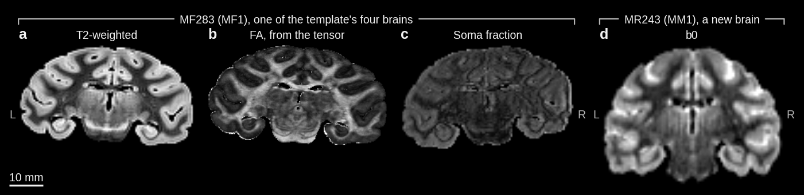
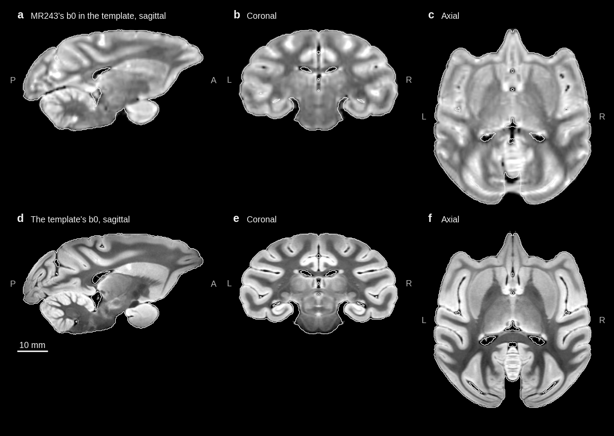

# 01. MRI

This part shows how the MRI template was built from four brains (part A) and how to register a new brain's b0 to it (part B).
The examples are MF283 (MF1), one of the template's four brains, and MR243 (MM1), a brain with a b0.
Run every command from the top of the repository, in a shell set up as in [00_start_here.md](00_start_here.md).

## 1. What this part does

One symmetric groupwise registration of MF283 to MF286 and their mirror images built the template ([overview](../overview.md#the-templates)).
Any other brain with MRI reaches the template through its b0: once the b0 is registered to the template's b0, every image on the b0 can follow it into the template.


*Figure 1. (a) The T2-weighted images of MF283 (MF1) to MF286 (MF4), each in its own space, and (b) the template's, made by their groupwise registration.
(c) MR243 (MM1)'s b0, (d) the same b0 moved into the template by `linc-register mri-template`, and (e) the template's b0.
The white line is MR243's brain mask in (c) and the template's in (d) and (e).*

## 2. Inputs

**The template's four brains** each have three acquisitions, each in its own space.
They were preprocessed before this code (denoising, eddy-current and motion correction, a first bias correction, the SANDI fit); `MRI_INPUTS.txt`, at the top of the data folder, describes how, and where each file's public copy is.

| File, in `brains/sub-MF283/inputs/` | What it is |
|---|---|
| `mri/MF283_tensor_dwi_biascorr.nii.gz` | the 0.25 mm diffusion series (171 volumes, b up to 20,000 s/mm²), bias-corrected; volume 0 is the b0 |
| `mri/MF283_tensor_dwi_eddycorrect.nii.gz`, `.ecclog`, `MF283_tensor.bval`, `.bvec`, `MF283_tensor_fit_mask.nii.gz` | what the tensor is fitted on: the same series before bias correction, its motion-correction matrices, b-values, b-vectors and the fit mask |
| `mri/MF283_t2_msme_denoised.nii.gz` | the 0.5 mm multi-echo spin-echo series (32 echoes, 6 ms apart), denoised |
| `mri/MF283_micro_dwi_biascorr.nii.gz`, `MF283_micro_SANDI_fracs_mean.nii.gz`, `_std.nii.gz` | the 0.5 mm multi-shell series (184 volumes, b up to 43,000 s/mm²) and its SANDI fit: soma, neurite and dot fractions |
| `manual_annotations/MF283_tensor_brain_mask.nii.gz`, `_t2_brain_mask`, `_micro_brain_mask`, `_final_brain_mask` | each acquisition's brain mask and the final one, all manually corrected |

**A new brain** needs just one b0, as NIfTI.
MR243's is `mri/MR243_b0.nii.gz` in `brains/sub-MR243/inputs/`, at 0.7 mm isotropic; it is already masked to the brain and bias-corrected, so it has no background.
Its manually corrected brain mask is `manual_annotations/MR243_b0_brain_mask.nii.gz`.

**What each part reads from the data folder.**
The whole data folder has all of it.
If yours holds less, this is what each part needs:

| Part | Reads |
|---|---|
| B, a new brain | the template: `template/outputs/` (its b0, brain mask and 0.5 mm frame) and `template/intermediate/construction/bridge_run113_to_canonical/` |
| A1 to A7 | the four brains' `inputs/`, and `template/inputs/` |
| A8 and A9 | the same; with `brains/sub-<ID>/intermediate/construction/` they start from the paper's construction inputs, and without it from your own A7 outputs |
| A10 and A11 | the paper's finished construction run, `template/intermediate/construction/`, with `template/` and `brains/sub-MF283` to `sub-MF286` whole |

After you add any of these to your data folder, run `source settings/roots.sh refresh` once ([00](00_start_here.md#before-you-start)).



*Figure 2. (a-c) MF283's T2-weighted image (the echo the build uses), FA and soma fraction (the data folder's `brains/sub-MF283/outputs/MF283_t2_T2w.nii.gz`, `_tensor_dti`, `_micro_soma_fraction`), each in its own space; (d) MR243's b0.*

## 3. Steps

For a new brain, go straight to [part B](#b-a-new-brains-b0): it needs the template, not part A.

### A. The MRI template, on the paper's four brains

Part A rebuilds the template; you do not need it for a new brain.
Its driver, `code/template/build_mri_channels.py`, has one step per stage and brain: `--plan` lists them, and `$PY run.py --plan --only mri-template` prints the exact commands and checks.
The driver works in its own folder, which is why its commands set `LINC_DATA=$LINC_MRI_DATA`, and it reruns a step whose outputs exist only with `--force`, which replaces them; a step that stopped partway needs it too.

Steps A1 to A7 run once for each of MF283, MF284, MF285 and MF286:

```bash
LINC_DATA=$LINC_MRI_DATA $PY code/template/build_mri_channels.py --step stage-MF283
```

| Step | `--step` | What it does | Runs on | Writes |
|---|---|---|---|---|
| A1 | `stage-<ID>` | copies each acquisition into the build's folder and corrects its bias with N4 inside the brain mask; takes the T2-weighted echo and the SANDI fractions | CPU, about 4 min | `$LINC_MRI_DATA/sub-<ID>/mri/{dwi,t2,micro}/` and `dwi/raw/` |
| A2 | `tensor-<ID>` | fits the tensor (FSL dtifit) on the 43 volumes with b up to 4800 s/mm², with the b-vectors rotated by each volume's motion correction and checked with `dwigradcheck` | CPU, about 8 min | `$LINC_WORK/build_mri_channels/tensor_d9/<ID>/` |
| A3 | `nmt-<ID>` | registers NMT v2 to the b0 and carries NMT's SARM labels onto it | GPU, 3.5 to 8 min | `$LINC_MRI_DATA/sub-<ID>/mri/landmarks/` |
| A4 | `t2reg-<ID> --force` | registers the T2-weighted image to the b0 deformably, since the b0 is an echo-planar image with its own distortion and the two are never in the same space | GPU, 3.5 to 7 min | `$LINC_MRI_DATA/sub-<ID>/xfm/t2-native__to__b0-native/` |
| A5 | `microreg-<ID> --force` | registers the multi-shell session's b0 to the high-resolution b0 deformably, carrying the SANDI fractions | GPU, a 48 GB card (it uses 22 GB); about 6 min | `$LINC_MRI_DATA/sub-<ID>/xfm/micro-native__to__b0-native/` |
| A6 | `--from landmarks-<ID> --to frames-<ID>` | finds the anterior and posterior commissures from the SARM labels, then the canonical frame: the midsagittal plane, the anterior-posterior axis from the rotation of A3's registration of NMT v2, and the anterior commissure moved onto NMT v2's | CPU, about 2 min | `$LINC_MRI_DATA/sub-<ID>/mri/landmarks/landmarks.json`, `canonical.json` |
| A7 | `prepare-<ID>` | resamples every channel once onto the canonical grid (the tensor with its rotation), cuts it to the final brain mask and makes its mirror image | CPU, about 3 min | `$LINC_WORK/build_mri_channels/prep/<ID>/` |

Steps A8 to A11 run through `run.py`.
The template itself comes out of two of them: the full run of A9 (the registration, 3.5 days) and A10 (the averaging, about 15 minutes).
You do not have to run the 3.5 days: the data folder holds the paper's finished run, and A10 and A11 use that one, never yours.
A9's first step (about 2 h) shows that the construction starts as the paper's did.

| Step | Command | What it does | Runs on | Writes |
|---|---|---|---|---|
| A8 | `$PY run.py --run --only mri-assemble` | writes the MMORF run folder: its parameter files, the list of the eight inputs and the standard space | CPU; seconds | `$LINC_WORK/mri_construction/runs/rb_final/` |
| A9 | `$PY run.py --run --only mri-construction-step1`, or `mri-construction-full` (optional; no step reads its result) | the symmetric groupwise registration with MMORF 1.0.1, through the driver of Arthofer et al. with [our edits](../../code/template/patches/README.md); `step1` stops after the first of eight nonlinear steps | GPU: about 2 h for step 1, and 3.5 days for all eight on a 48 GB card to itself | `.../rb_final/out/`; the full run in `$LINC_WORK/mri_construction_full/runs/rb_final/out/`, whose `nln_step_08/iteration_03` holds the final warps |
| A10 | `$PY run.py --run --only mri-channels` | moves each brain's images into the template in one resampling from their native grid (the tensor in a second resampling, from its canonical input of A7, rotated with its warp) and averages them: T2-weighted, b0, the tensor and its maps, the soma and neurite fractions, the masks | CPU, about 15 min | `$LINC_WORK/mri_paper_run/channels/linc_mri_*.nii.gz`, which are `template/outputs/template_*.nii.gz` in the data folder |
| A11 | `$PY run.py --run --only mri-links-MF283` | writes the brain's two transforms: from its b0 to its canonical frame, and from that frame to the template | CPU; under half a minute | `$LINC_WORK/mri_links/<ID>/xfm/` |

A8 and A9 start from the paper's own construction inputs, so that the result can be compared with the paper's file by file.
When your data folder does not hold them, A8 starts from your own A7 outputs and says so; its comparison then has nothing to compare with.
To build from your own A7 outputs although the data folder holds the paper's, point `$LINC_WORK/mri_construction/prep/<ID>` at them before A8: a link that already leads to construction inputs is left alone.
A10 and A11 do not read your own A9 run.
They remake the template's channels and each brain's transforms from the paper's finished run, so that the result can be compared with the paper's file by file.
When your data folder does not hold that run, each of them stops and says what to add.
The data folder keeps each template brain's whole transforms as single files: `brains/sub-MF283/outputs/MF283_b0_to_template.nii.gz`, `_t2_to_template` and `_micro_to_template`.


*Figure 3. The template's channels in one coronal plane (`template/outputs/`): (a) T2-weighted, with the brain mask's outline, (b) b0, (c) FA, (d) the principal direction, colored as the key shows, (e) neurite fraction, (f) soma fraction.*

### B. A new brain's b0

These steps bring any brain with a b0 into the template, without changing the template.

#### Step B1. Prepare the b0

```bash
$PY code/mri/linc-mri prep --subject MF278 --image $LINC_DATA_TREE/brains/sub-MF278/inputs/mri/MF278_b0.nii.gz \
    --mask $LINC_DATA_TREE/brains/sub-MF278/inputs/manual_annotations/MF278_b0_brain_mask.nii.gz
```

This is MF278, a paper brain, from the data folder; for your own brain, give `--subject <ID> --image <its b0>`.
It takes one 3D volume (volume 0 of a 4D series, or `--volume N`), makes its brain mask with the MRI brain-mask network (or uses yours, given with `--mask <its brain mask>`, a NIfTI mask on the b0's grid), corrects the bias with N4 inside the mask, and rescales the masked image.
When it finishes, it prints the next commands, with the brain's paths filled in: Step B2 for the b0 alone, and [02](02_blockface.md), Step 3, for a brain with blockface photographs; its provenance file keeps them too.
It takes under a minute on the CPU; the mask network runs on a GPU with 5 GB free, or on the CPU with `--device cpu`.

It writes `b0.nii.gz`, `b0_brain.nii.gz`, `b0_brain_n4.nii.gz` and its bias field to `$LINC_DATA/sub-<ID>/mri/dwi/`, the mask to `$LINC_DATA/sub-<ID>/mri/masks/dwi_brain_mask.nii.gz`, and a provenance file listing every step with its tool and version.

On MF283, given the paper's mask, this step reproduces the paper's three files voxel for voxel (`$PY run.py --run --only mri-prep-MF283`); without it, the network's mask had a Dice coefficient of 0.980 with the paper's mask.


*Figure 4. What `linc-mri prep` makes from MF283's b0 (`brains/sub-MF283/intermediate/prepare/dwi/`; MR243's b0 is already masked and corrected): (a) `b0.nii.gz`, (b) its brain mask, (c) `b0_brain.nii.gz`, (d) the bias field N4 found, (e) the masked b0 divided by it.*

#### Step B2. Register the b0 to the template

```bash
M=$LINC_DATA/sub-<ID>/mri
$PY code/blockface/registration/linc-register mri-template --subject <ID> \
    --b0 $M/dwi/b0_brain_n4.nii.gz --mask $M/masks/dwi_brain_mask.nii.gz \
    --frame $LINC_TEMPLATE/frames/mri_template_0p5.nii.gz \
    --template-b0 $LINC_TEMPLATE/mri/linc_mri_b0.nii.gz \
    --template-mask $LINC_TEMPLATE/mri/linc_mri_brainmask.nii.gz
```

This places the b0 rigidly on the template's 0.5 mm frame (`--frame`; its older name, `--place-b0`, is still accepted here), fits a similarity and then an affine transform to the template's b0, and finishes with a deformable registration of image features (anatomix and MIND-SSC) on a 0.35 mm grid.
Every input is masked to the brain.
The step ends with the outline check (section 4) and records its verdict.
It takes about 12 minutes on a GPU.
It reads four of the template's files, the three in the command and the frame bridge; if one is missing it stops before any work and names it (section 2 lists where they are in the data folder).

The transform goes to `$LINC_DATA/sub-<ID>/xfm/b0-native__to__mri-template/`, with the warp, the start affine and `meta.json` holding the verdict.
The b0 and its mask moved into the template, and the check's numbers, go to `$LINC_WORK/b0_to_template/<ID>/`.

For a paper brain, `$PY run.py --run --only register-mri-template-MR243` runs this step with the paper's mask and placement and compares the result with the original transform.



*Figure 5. (a) MR243 (MM1)'s b0 moved into the template (`brains/sub-MR243/outputs/MR243_b0_to_template.nii.gz`) and (b) the template's b0.
The white line is the template brain's outline, the same on both rows; the sagittal plane is 6 mm left of the midline, and in the axial views anterior is up.*

#### Step B3. Bring images into the template

```bash
$PY -m shared.xfm apply --from b0-native --to mri-template --subject MF278 \
    --ref $LINC_TEMPLATE/mri/linc_mri_b0.nii.gz \
    $LINC_DATA/sub-MF278/mri/dwi/b0_brain_n4.nii.gz $LINC_DATA/sub-MF278/mri/b0_in_template.nii.gz   # add --nearest for a label image
```

This moves MF278's b0, as Step B1 prepared it, into the template in one resampling, on the CPU in seconds.
The first file is the image to move: any NIfTI image on the grid of the brain's b0 as Step B1 prepared it, such as a FA map computed from the same scan or a label image drawn on that b0.
The second is the file it writes, the same image on the template's grid (`--ref`).
For another brain, give its ID, after Steps B1 and B2 for it, and its image.

The same command moves images between the template and a published template (give your own copy of it as `--ref`) or the blockface template (`bf-template`):

```bash
$PY -m shared.xfm apply --from mri-template --to atlas:NMT_v2.0_sym --ref <NMT image> \
    $LINC_DATA/sub-MF278/mri/b0_in_template.nii.gz $LINC_DATA/sub-MF278/mri/b0_in_nmt.nii.gz
$PY -m shared.xfm apply --from atlas:NMT_v2.0_sym --to mri-template \
    --ref $LINC_TEMPLATE/mri/linc_mri_b0.nii.gz <image in NMT> <output>
```

`<NMT image>` is any image from your own copy of NMT v2's symmetric template, such as its T1-weighted image; it sets the grid of what is written, and the package does not include NMT.
The first command moves MF278's b0 from the template into NMT v2.
In the second, `<image in NMT>` is any image on NMT v2's grid, such as one of its label images, and `<output>` is the file to write, that image on the template's grid.

The published templates are `atlas:NMT_v2.0_sym`, `atlas:INIA19` and `atlas:CIVM-R`.

## 4. Checks

**The outline check** runs at the end of step B2.
It moves the b0's brain mask into the template and measures, in six directions, how far the moved outline lies outside the template brain's outline (overshoot) or inside it (undershoot).
The verdict is PASS when every 99th percentile of the distance is at most 2.5 mm, and WARN, which still counts as a pass, when a 99th percentile is over 2.5 mm.
It is FAIL when a 99th percentile is over 3.5 mm or the largest distance is over 5.0 mm.
Tissue below the template brain's lowest axial slice is reported but not counted, because the template's brainstem ends in a flat cut and a brain's own brainstem often goes further.


*Figure 6. The outline check on the template's b0, with the lines named in the key.
(a) MR243 (MM1) passes; its brainstem reaches below the dotted line, which is reported but not counted.
(b) MR253 (MM7) warns of a ventral overshoot of 2.95 mm (99th percentile) under the cerebellum.*

The verdict and its reasons are in the transform's `meta.json`, under `qc`, and `$PY -m shared.xfm list --subject <ID>` lists all of a brain's transforms with their verdicts.
Of the paper's 13 brains with a b0, 9 passed and 4 warned: MR250 (posterior overshoot, 2.57 mm), MR251 (anterior overshoot, 2.56 mm), MR253 (ventral overshoot, 2.95 mm) and MR261 (anterior undershoot, 2.70 mm).

A warning asks you to look, not to rerun.
Open the moved b0 (`$LINC_WORK/b0_to_template/<ID>/`) over the template's b0 on the side the warning names, and check whether the brain's own anatomy explains it: a brainstem cut at another level, olfactory tissue the template lacks, or a b0 that does not reach that far.
A FAIL means the registration should not be used as it is (section 5).

**`run.py`'s checks** compare a rerun with the original files.
For B2, the start affine must be identical and the warp within a median of 0.1 mm and a 99th percentile of 0.5 mm over its grid; the lab's rerun of all 13 brains (6 Nov 2026) gave medians of 0.002 to 0.060 mm and 99th percentiles of 0.04 to 0.47 mm.
For part A, the staging, the tensor, the assembly, the construction's first step and the channels must be identical.
A3 to A5 must be within tolerances: at least 93 % of the SARM labels, the T2 field within 0.05 mm median and 0.3 mm 99th percentile, and the microstructure field within 0.05 and 0.5 mm.
The canonical frame must be within 1 degree and a mean move of 0.5 mm.

## 5. When something goes wrong

See [troubleshooting](../troubleshooting.md#mri), and the [overview](../overview.md#what-the-package-cannot-do) for what this part cannot do.
