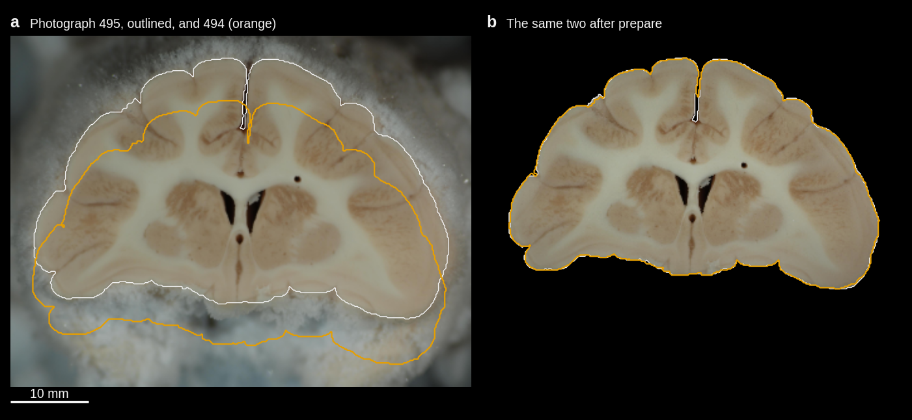
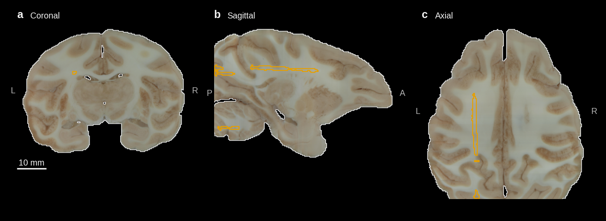
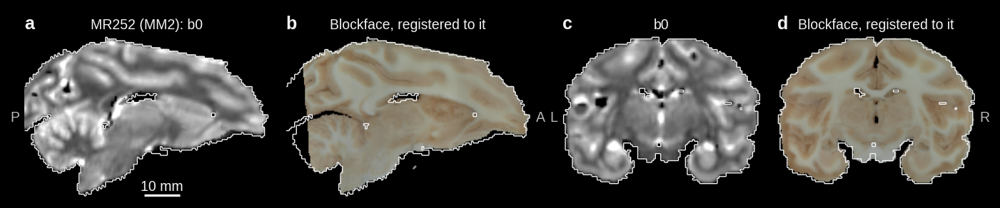

# 02. Blockface

This tutorial goes from a brain's blockface photographs to a 3D volume in the template.
It covers the reconstruction, the brain mask and the marker tubes, the registration to the brain's own MRI or to the blockface template, the tissue that was never photographed, and the blockface template itself.
The example brain is MR252 (MM2 in the paper), which has photographs and a b0.
For a brain without MRI, the example is MF191 (MF8 in the paper).
Read [00_start_here.md](00_start_here.md) first: it explains the shell every command needs.

Blockface photographs are pictures of the frozen tissue block, taken from a fixed camera as each section is cut.
They show each section in place, before it is cut, mounted and stained, so they give the brain's 3D shape that the histology sections lost.

## 1. What this part does

The photographs are put in cutting order and stacked into a 3D volume.
The camera jumps are corrected, missing sections are filled in, the illumination is evened out, and a network finds the brain in every photograph and in the volume.
The marker tubes, holes drilled into the block as fiducials, are found and filled.
A brain with MRI then registers its volume to its own b0, and follows the b0's transform into the template (01).
A brain without MRI registers its volume to the blockface template, which is registered to the MRI template.
No brain was photographed to its caudal end: a network predicts the missing tissue from the b0 and marks every predicted voxel.
The blockface template is the average of the 21 photographed brains, each used as reconstructed and mirrored.


*Figure 1. The steps of this tutorial, drawn with MR252: (a) one photograph, (b) the blockface volume, sagittal, (c) the volume registered onto its own b0, with the b0 brain's outline, (d) the completed brain.
Under each arrow are the commands that make the step.*

## 2. Inputs

| File | Where in the data folder | What it is |
|---|---|---|
| `MR252_slice0000.jpg` ... | `brains/sub-MR252/inputs/photographs/` | the photographs, one JPEG per section, in cutting order |
| `MR252_brain_mask_edited.nii.gz` | `brains/sub-MR252/inputs/manual_annotations/` | the 3D brain mask, corrected by hand |
| `MR252_tubes_edited.nii.gz` | `brains/sub-MR252/inputs/manual_annotations/` | the marker tubes, corrected by hand |
| `photograph_masks/` | `brains/sub-MR252/inputs/manual_annotations/` | the brain masks of the photographs |
| `MR252_b0.nii.gz` | `brains/sub-MR252/inputs/mri/` | the b0 (01 prepares it) |
| `MR252.yaml` | `settings/brains/` in the code folder | the brain's settings: the photographs' names, the pixel size, the section step, the camera jumps and the missing sections |

MR252 has 1,430 photographs, one every 50 µm; the numbers that are missing are sections without a photograph.
The hand-corrected masks are inputs because a person made them: the code uses them in place of the networks' masks.


*Figure 2. Photograph 700 of MR252 (`inputs/photographs/MR252_slice0700.jpg`) and its brain mask (`inputs/manual_annotations/photograph_masks/MR252_slice0700.png`).
The small dark hole in the tissue is a marker tube.*

## 3. Steps

Every command runs from the top of the code folder, in the shell of [00_start_here.md](00_start_here.md).

To rerun a step on one of the paper's brains, use `run.py` with the step's name (`$PY run.py --plan --only reconstruct-MR252`).
For the paper's brains, the reconstruction writes into a separate folder, `$LINC_REBUILD_DATA`, so that it is compared with the paper's volume and never replaces it.
That is why the paper's command starts with `LINC_DATA=$LINC_REBUILD_DATA`.
For a new brain, leave that part out.

### Step 1. Reconstruct the volume

```bash
LINC_DATA=$LINC_REBUILD_DATA $PY_TIRL code/blockface/linc-reconstruct all --subject MR252    # a paper brain
$PY_TIRL code/blockface/linc-reconstruct all --subject <ID>                                    # a new brain
```

`all` runs seven steps in order, and each can be run alone (`linc-reconstruct <step> --subject <ID>`):

| Step | What it does |
|---|---|
| `photos` | copies the photographs in cutting order, and the network makes their brain masks |
| `stack` | stacks the photographs and their masks |
| `prepare` | corrects each camera jump (registered with TIRL), fills the missing sections, crops the stack, evens out the illumination and brightness |
| `mask` | makes the 3D brain mask (the network's, or your corrected one) |
| `volume` | writes the volume (and fills hand-corrected marker tubes, if they exist already) |
| `tubes` | finds the 3D marker tubes with the network and fills them in the volume |
| `spacing` | writes the pixel size and section step of the settings file into the headers |

For a new brain, run `photos` and `stack` first, then look through the stacked photographs (`$LINC_DATA/sub-<ID>/blockface/00_slices/`).
Write the camera jumps and the missing or damaged sections into its settings file (Step 6 explains both), then run the other five steps.

`volume` and `tubes` delete the working folders (`_work/` and `nii/` in `$LINC_DATA/sub-<ID>/blockface/`) once they have read them, so the steps before them cannot be rerun afterwards.
Add `--keep-work` to keep them, when you may need to correct something and run again (Step 2).

- **Runs on:** a GPU with 10 GB free, for the networks only (1.5 GB for `photos`); about 90 GB of RAM for 1,400 photographs, 9 to 12 GB for 77.
- **Time:** about 10 hours for 1,400 photographs; `prepare` is the longest step, about 15 minutes per camera jump.
  MR252 was rebuilt in 9 h 10 min, identical to the paper's volume; MF191, with 77 photographs, in under an hour.
- **Writes:** in `$LINC_DATA/sub-<ID>/blockface/`: `<ID>_blockface.ome.zarr` (the volume, in color, at four resolutions), `<ID>_blockface_L2.nii.gz` (a lighter copy), `<ID>_mask.nii.gz` (the brain mask), `<ID>_holes.nii.gz` (the marker tubes) and `<ID>.info`.



*Figure 3. MR252's largest camera jump, between photographs 494 and 495 (5.3 mm).
(a) Photograph 495 with its outline (white), and the outline of photograph 494 (orange), as photographed.
(b) The same two after `prepare`: the outlines coincide.*



*Figure 4. MR252's blockface volume (`outputs/MR252_blockface_L2.nii.gz`), coronal, sagittal and axial, through one marker tube, with the outline of its brain mask (white) and its marker tubes (orange, `outputs/MR252_tubes.nii.gz`).
The tubes are filled in the volume itself, so the orange marks where they were.*

### Step 2. Correct the masks by hand (optional)

A mask corrected by hand always wins over a network's.
Save it under the name the code looks for, then run the steps that follow it again.
To be able to do that, run the reconstruction one step at a time, not with `all`, and with `--keep-work` on `volume` and `tubes`.

| Mask | When | Save the corrected one as | Then run again |
|---|---|---|---|
| the photographs' masks | before `prepare` | `linc-reconstruct edit-photo-masks export`, edit, then `import` | `prepare` and the steps after it |
| the 3D brain mask | after `mask`, before `volume` | `curated/<ID>_mask_edited.nii.gz`: edit `curated/<ID>_mask.nii.gz`, over `curated/<ID>_bg.nii.gz` | `volume`, `tubes`, `spacing` |
| the marker tubes | after `tubes` | `curated/<ID>_holes_edited.nii.gz`, edited on `curated/<ID>_holes.nii.gz` | `volume` and `tubes` (this needs the working folders, so `--keep-work`), then `spacing` |

A corrected tube file saved after `tubes` is not applied by running `tubes` again alone: `tubes` sees the file and leaves the filling to `volume`.
So run `volume` again, which fills the corrected tubes, and it needs the working folders that `--keep-work` kept.
The paper's brains are not affected: their corrected files existed before `volume` ran.

The `curated/` folder is in `$LINC_DATA/sub-<ID>/blockface/`.
Its grid is the hand-edit grid: the photographs' resolution in plane, and 0.40 mm between slices.
When you keep the brain, copy the corrected masks into the data folder's `inputs/manual_annotations/`.

### Step 3. Register the volume to the brain's own b0 (a brain with MRI)

```bash
$PY code/blockface/registration/linc-register mri --subject MR252 --overwrite        # a paper brain: its masks and start pose of record
M=$LINC_DATA/sub-<ID>/mri                                                            # a new brain, its b0 prepared as in 01
$PY code/blockface/registration/linc-register mri --subject <ID> --new-brain \
    --place-b0 $M/dwi/b0_brain_n4.nii.gz $M/masks/dwi_brain_mask.nii.gz
$PY code/blockface/registration/linc-register mri-template --subject <ID> \
    --template-b0 $LINC_TEMPLATE/mri/linc_mri_b0.nii.gz \
    --template-mask $LINC_TEMPLATE/mri/linc_mri_brainmask.nii.gz                     # the b0 to the template (01)
```

- **What it does:** `mri` registers the blockface volume to the brain's own b0.
  It starts with a linear registration (FSL FLIRT), then a deformable one (FireANTs) on features that a pretrained network (anatomix) computes from both images, so that the two contrasts can be compared.
  For a new brain, `--place-b0` first places the b0 rigidly on the template's grid; without a mask, the MRI brain-mask network makes one.
  `--new-brain` matters only for a paper brain, which it makes ignore its start pose of record; a new brain has none and gets an estimated start pose either way.
  `mri-template` then registers the b0 to the template, as in 01.
- **Tested:** on a paper brain, the whole command, identical to the paper's.
  On a brain treated as new (MR257), the placement, the estimated start pose and the linear stage; the deformable stage has not yet been run on a brain treated as new.
- **Runs on:** a GPU with 15 to 25 GB free for `mri`, depending on the brain, and 12 to 14 GB for `mri-template`; one at a time on a card.
  About 15 minutes each.
  MR252's took 9 min 57 s and 13 GB of RAM, identical to the paper's.
- **Writes:** `$LINC_DATA/sub-<ID>/xfm/bf-native__to__b0-native/` and `b0-native__to__mri-template/`, each with its warp, its linear parts and `meta.json`; working files in `$LINC_WORK/register/<ID>/`.

A transform folder that already exists stops the run, unless you give `--overwrite`, which backs up the old one.



*Figure 5. (a, c) MR252's b0, sagittal and coronal, and (b, d) its blockface volume registered onto it (`paper/brains/sub-MR252/mri/`), with the b0 brain's outline (white) on all four.
The blockface volume covers only the photographed part of the brain, so its caudal end is missing in (b).*

### Step 4. Register the volume to the blockface template (a brain without MRI)

```bash
$PY code/blockface/registration/linc-register blockface-template --subject MF191
$PY code/blockface/registration/linc-register direct-placement --subject MF191 \
    --template-b0 $LINC_TEMPLATE/mri/linc_mri_b0.nii.gz \
    --template-mask $LINC_TEMPLATE/mri/linc_mri_brainmask.nii.gz
```

- **What it does:** `blockface-template` registers the blockface volume to the blockface template.
  This is the route a brain without MRI takes into the template: the transform chain then goes through the link between the two templates.
  `direct-placement` registers the blockface volume directly to the MRI template's b0.
  Its result is used for one thing: it gives the brain a stand-in b0, the template's b0 moved into the brain, which Step 5 needs.
- **Runs on:** a GPU with about 19 GB free for `blockface-template` and 15 to 17 GB for `direct-placement`.
  MF191's took 6 min 10 s and 7 min 40 s.
- **Writes:** `$LINC_DATA/sub-<ID>/xfm/bf-native__to__bf-template/` and `bf-native__to__mri-template/`; the stand-in b0 in `$LINC_DATA/sub-<ID>/mri/stand_in/`.

To see which links the chain into the template uses:

```bash
$PY -m shared.xfm chain --from bf-native --to mri-template --subject MF191
```

It should go through the blockface template.
The direct placement is used only when nothing else connects the two.

### Step 5. Predict the tissue that was never photographed

```bash
$PY_DEEP code/blockface/synthesis/linc-complete prepare --subject <ID> --out $LINC_WORK/prepared
$PY_DEEP code/blockface/synthesis/linc-complete --brain $LINC_WORK/prepared/<ID> --out $LINC_WORK/complete              # a brain with MRI
$PY_DEEP code/blockface/synthesis/linc-complete --brain $LINC_WORK/prepared/<ID> --stand-in --out $LINC_WORK/complete   # a brain without MRI
```

- **What it does:** `prepare` gathers the brain's inputs on its 0.25 mm grid.
  The second command runs a 3D network that predicts blockface grayscale over the whole brain from the b0 (the stand-in b0 for a brain without MRI).
  It fits one monotonic brightness map from the prediction to the photographs, on the 8 mm of fully photographed tissue next to the junction plane, the plane where the photographs end.
  It cross-fades from the photographs into the mapped prediction over the 2 mm on the photographed side of that plane, so that no seam shows.
  It colors the predicted tissue with the photographs' mean color, the same everywhere.
  The two networks, one for a brain with its own b0 and one for the stand-in b0, are in the data folder's `models/synthesis/own_b0/` and `models/synthesis/stand_in_b0/`.
- **Runs on:** `prepare` on a CPU, about a minute (5 GB of RAM for MR252); the prediction on a GPU with 2 GB free, about 20 seconds.
- **Writes:** in `$LINC_WORK/complete/<ID>/`, on the brain's 0.25 mm grid: `<ID>_bf_completed.nii.gz` (the whole brain; `_rgb` in color), `<ID>_bf_synth` (the prediction), `<ID>_bf_real` (the photographs used), `<ID>_photo_fraction` (the photographed fraction of each voxel), `<ID>_synth_mask` (the predicted voxels), `<ID>_seam_ramp` and `<ID>_seam_depth` (the cross-fade's weight, and the distance from the junction plane), and `<ID>_b0_input_0p5` (the network's input).


*Figure 6. MR252's completed volume (`MR252_completed.nii.gz` in the data folder): (a) sagittal, 4.5 mm left of the brain's center, and (b) coronal, 5 mm caudal of the junction plane, where all the tissue is predicted.
(c, d) The same planes, photographed tissue gray and predicted tissue orange (`MR252_synthesized_mask.nii.gz`); in (c) the border between the two is the junction plane.
The thin orange line along the brain's surface is real: the mask also holds the surface voxels that the photographs did not cover.*

### Step 6. Adding a new brain: its settings file

Every brain has one settings file, `settings/brains/<ID>.yaml` in the code folder.
For a new brain, copy the template and fill in the required fields:

```bash
cp settings/brains/TEMPLATE.yaml settings/brains/<ID>.yaml
```

The paper's 21 brain files have more fields than `TEMPLATE.yaml`, and `TEMPLATE.yaml` has fields that most of them leave out.
This table lists every field, so you can tell which ones a new brain needs.

| Field | Required? | Default | When to set it |
|---|---|---|---|
| `subject` | required | | the brain's ID, as in the file's name and in `sub-<ID>` |
| `raw` | required | | the folder of the photographs, relative to `$LINC_RAW` |
| `raw_glob` | required | | the photographs' file pattern, such as `'*.JPG'` |
| `raw_regex` | required | | a regular expression whose first group is the photograph's number, such as `'Img(\d+)\.JPG'` |
| `vx` | required | | the photographs' pixel size, in µm |
| `vz` | required | | the section step, the distance between two photographs, in µm |
| `idx_range` | optional | every photograph found | the first and last photograph numbers to use; a number missing in the range becomes a black frame, so the order is kept |
| `rotate180` | optional | `false` | `true` if the photographs are upside down: the brain must end up dorsal side up |
| `reduce` | optional | `mean` | how the coarser resolutions are computed; leave it |
| `jumps` | optional | none | the camera jumps, found by looking through the stack: each `[before, after]` is the last section before the jump and the first after it, counted from 0 in `00_slices/` |
| `missing` | optional | none | sections handled by hand: `[before, after]` around missing or damaged sections, which are filled in between; `[-1, k]` drops frames 0 to k-1 that are not brain (a name card, a calibration grid); `[n, -1]` is the caudal cutoff, keeping sections 0 to n |
| `stack_pad` | optional | 200 pixels | the stack's margin on each side; raise it when a large camera jump pushes a photograph off the canvas |
| `jump_mode` | optional | `affine` | the only mode released |
| `ccs`, `cce` | optional | `0`, `0` | the first and last histology section where the corpus callosum joins the hemispheres (03); `0`, `0` when there is none or no histology |
| `native_end_crop_mm` | optional | `0` | drops the last photographed sections, this many mm, before `linc-register mri` resamples; set it only when a brain's own last sections are darker |
| `curation_f` | optional | from the hand-edit grid | sections per slice of the 0.40 mm hand-edit grid; see below |
| `reconstruction_spacing_um` | the paper's brains | `vx`, `vz` | the spacing the paper's volumes were reconstructed at, before the spacing calibrated against each brain's MRI was written into the headers |
| `registration_to_own_mri` | the paper's brains | | the b0 mask, fixed b0 and start pose of record of the 13 brains with MRI; without it, `linc-register mri` estimates the start pose |
| `series_alignment` | the paper's brains | | MF191 and MF196 only: a camera that moved on nearly every frame, corrected by replaying a recorded alignment to an external series |
| `shading` | the paper's brains | `poly2` | MR263 only: the illumination correction its volume was made with |
| `stack_origin_frames` | the paper's brains | the stack's own count | MR261 only: its stack of record held frames that are not its photographs |
| `reconstruction_mask` | the paper's brains | the final mask | MR254 only: the earlier mask its volume was reconstructed with |
| `mri` | record only | | the name of the MRI file an earlier analysis used; no code reads it |
| `masks_of_record` | record only | | which of the paper's masks were corrected by hand; the code finds the corrected files by name |
| `histo_vx`, `histo_vz`, `histo_divisor` | record only | | records of the histology; no code reads them |

Three of these come up often.

- **`mri`** is a record of the paper's brains only.
  No code reads it, so a new brain leaves it out.
- **`curation_f`** is optional.
  If it is set, the code uses it.
  If not, it reads it from the header of the hand-edit grid, if one exists; otherwise it takes round(400 µm / `vz`), at least 1.
  The paper's brains pin it so that a rebuild lines up with their hand edits: 13 brains have 8 (50 µm sections) and 8 brains have 1 (400 µm or more).
  A new brain leaves it out.
- **`native_end_crop_mm`** is optional, with a default of 0.
  It is set only for the three brains whose own last photographed sections are darker: MF282 (MF7) 3.0 mm, MF204 (MF10) 1.62 mm, MR263 (MM14) 3.5 mm.
  The other brains leave it out because 0 is their value.
  Only `linc-register mri` reads it, so it acts only on a brain registered to its own b0, and from there on that brain's completion too.
  Of the three, only MF282 has MRI; for MF204 and MR263 the value is a record: it acted when the paper's blockface template was built, and its effect is inside their files of record.

The smallest settings file a new brain needs:

```yaml
subject: <ID>
raw: <ID>                         # the photographs' folder, relative to $LINC_RAW
raw_glob: '*.jpg'                 # the photographs' names, here as the data folder names them: <ID>_slice0000.jpg ...
raw_regex: '<ID>_slice(\d+)\.jpg' # the first group is the photograph's number
vx: 20.0                          # pixel size, µm
vz: 50.0                          # section step, µm
```

If the photographs keep the camera's names, such as `Img8527.JPG`, use `raw_glob: '*.JPG'` and `raw_regex: 'Img(\d+)\.JPG'`, as MR252's file does.

After `stack`, add `jumps` and `missing` if the stack has any, and `rotate180: true` if the photographs are upside down.
Look at `00_slices/` before you set `rotate180`: on photographs that are already upright, it turns the volume upside down, and the marker tubes are then lost, because only tubes on the brain's left are kept (they were drilled on the left).

**The spacing.**
For a new brain, `vx` and `vz` are what you measure, and they are used as they are: no step of the code calibrates them against the brain's MRI.
The paper's brains were calibrated against their own MRI in an earlier analysis; before it, every stack was about 10 % too long along the section axis.
Their files keep the calibrated values as `vx` and `vz` and the nominal ones as `reconstruction_spacing_um`, and the `spacing` step only rewrites the headers from one to the other.
For a new brain the two are the same, and `spacing` changes nothing.
A wrong spacing shows up in the registration to the brain's own b0: its linear stage takes up the scale error, and `linc-register qc` fails a scale outside 0.9 to 1.1 (Section 4).

**How the photographs reach the code.**
The code reads the photographs from `$LINC_RAW/<raw>`.
For the paper's brains, `settings/files.tsv` and `settings/roots.sh` make them visible there; for a new brain, one link does: see [Bring a new brain into the template](../how-to/new_brain.md#2-make-them-visible-to-the-code).

What has been tested, and what has not:
- Tested: the reconstruction of the paper's brains from their photographs, through the folders that `settings/roots.sh` prepares (`outputs/local_rebuild`); MR252 and MF191 came out identical to the paper's volumes.
  The registration to the blockface template of MF191 treated as a new brain passed its check.
  The registration to the own b0 of MR257 treated as a new brain ran through its placement and linear stage.
- Not tested yet: a brain that is not one of the paper's, with its own settings file and its photographs made visible through a new link or new rows in `settings/files.tsv`; and the deformable stage of `linc-register mri` on a brain treated as new.

### Step 7. The blockface template and its link to the MRI template

These rebuild the paper's templates.
A new brain does not need them (see "Adding a new brain: two different things" in [00_start_here.md](00_start_here.md)).

```bash
$PY code/template/build_blockface_template.py --plan                               # every step, its time, inputs and outputs; runs nothing
$PY code/template/build_blockface_template.py --from prep-frame --to tpl-costmask-0p5   # the members
$PY code/template/build_blockface_template.py --from run-plan-a --to plan-a-mmorf       # the first stage
$PY code/template/build_blockface_template.py --from s8-frame --to member-warps         # the last step, at 0.25 mm
$PY code/template/build_link.py --plan                                             # the link between the two templates
```

- **What it does:** the members are the 21 brains, each as reconstructed and mirrored, with two channels each: the blockface grayscale and the b0 (the stand-in b0 for a brain without MRI); the MRI template's b0 joins as one more, b0-only member.
  For a brain without MRI, only its photographed sections count fully in the registration, with a smooth ramp at their end; at the last step its stand-in b0 also counts less where the tissue was not photographed.
  One symmetric groupwise registration (MMORF) runs seven nonlinear steps at 0.5 mm and an eighth at 0.25 mm.
  The template is the average of every member moved once through its final warp.
  `build_link.py` registers the blockface template's b0 to the MRI template's b0, checks it against the registrations composed through each brain, and registers the MRI template to NMT v2, INIA19 and CIVM-R.
- **Runs on:** the members on a CPU, about 5 minutes.
  The first stage on a GPU with 10 GB free (it peaked at 8.2 GB) and 64 GB of RAM, about 8.5 hours on a free card, with 120 GB on disk.
  The last step on a GPU with 12 GB free and 96 GB of RAM, about 17 hours on one card (estimated), plus about 2.5 hours of CPU steps, with about 200 GB on disk.
  Both stages need the card to themselves.
  The link on a GPU with 6 GB free, about 13 minutes.
- **Writes:** under `$LINC_WORK/build_blockface_template/` and `$LINC_WORK/build_link/`.
  The finished template's blockface channel is in the data folder's `template/outputs/template_blockface_*`.


*Figure 7. (a-c) The template's blockface channel (`template/outputs/template_blockface_rgb.nii.gz`), sagittal, coronal and axial, through the center of its mask.
(d-f) The same planes, photographed tissue gray and predicted tissue orange (`template_blockface_synthesized_mask.nii.gz`): the occipital pole is the tissue that no brain photographed.*

## 4. Checks

**Look through the volume.**
Open `<ID>_blockface_L2.nii.gz` in FSLeyes or ITK-SNAP and go through it from front to back.
A good volume has no jumps between sections and the brain dorsal side up, and its mask and tubes follow the tissue.
A jump that is left shows as a step in the outline of the brain from one section to the next.

**Check each registration.**
`linc-register qc` checks one registration and records pass or fail in its folder:

```bash
$PY code/blockface/registration/linc-register qc --help
```

Its presets set the paper's settings for each kind of registration: `bf2b0` (blockface to its own b0), `direct`, `bf2bftemplate`, `b02template` and `template2template`.
It fails a registration when:
- a scale of its linear part is outside 0.9 to 1.1 (for a registration between two animals, an isotropic scale outside 0.80 to 1.25);
- the correlation of the two images is below 0.6 (0.25 for the inverted contrast of a blockface volume against a b0);
- the warp folds any voxel inside the brain;
- the 95th percentile of the warp's displacement is above 8 mm (flagged above 6 mm);
- the outline of the moved brain is more than 3.5 mm from the target's at its 99th percentile, or more than 5 mm anywhere (a warning above 2.5 mm, which passes).

It also writes a picture in three planes and a JSON row with every measure.

**Compare with the paper's file.**
On a paper brain, `run.py` runs each step's check: the reconstruction must be identical to the paper's volume, mask and tubes, and each registration identical or within a median of 0.05 mm and a 99th percentile of 0.5 mm of the paper's.
`tests/compare/compare_reconstruction.py` compares any two reconstructions.

## 5. When something goes wrong

| What you see | Why | What to do |
|---|---|---|
| A step between two sections in the volume | a camera jump that is not listed | add it to `jumps` and run `prepare` and the later steps again |
| A smeared or empty section | a damaged or missing photograph | add `[before, after]` to `missing` |
| The brain upside down | the photographs were taken upside down | `rotate180: true` |
| The brain upside down, and no marker tubes found | `rotate180: true` was set on photographs that were already upright, so the tubes ended up on the right and were dropped (only tubes on the brain's left are kept) | look at `00_slices/`, set `rotate180` to match, and reconstruct again |
| A photograph pushed off the canvas | a large camera jump | raise `stack_pad` |
| The mask or the tubes wrong | the network missed or added tissue | correct them by hand (Step 2) |
| Corrected tubes do not show in the volume | the corrected file was saved after `tubes`, and `tubes` alone does not fill it again | run `volume` and `tubes` again, which needs the working folders (`--keep-work`; Step 2) |
| `prepare`, `mask` or `volume` cannot be run again | `volume` and `tubes` deleted the working folders | run the steps one at a time with `--keep-work`, or start again from `photos` |
| Corrected masks no longer line up after a change of `vz` | the hand-edit grid follows round(400 µm / `vz`) | pin `curation_f` to the value the corrections were made with |
| A run is killed with no Python error | out of memory: the full-resolution steps need about 90 GB for 1,400 photographs | run on a machine with more free memory; if you cap it, cap the resident memory, never with `ulimit -v`, which kills every TIRL run |
| The last sections darker than the rest | the illumination of those sections | `native_end_crop_mm` |
| The registration stops before it starts | the GPU has less memory free than it needs | it prints what it needs; use a card with more free memory, one registration at a time |
| "already exists" | a transform folder from an earlier run | `--overwrite` (the old one is backed up) |
| The qc fails on scales | the pixel size or section step in the settings file is off | check `vx` and `vz` |
| `linc-complete prepare` stops: "no plane from which the photographs are complete over ... mm" | the last photographed sections are torn or missing | for a brain with MRI, drop them with `native_end_crop_mm` and register again; otherwise move the caudal cutoff before them (`missing: [n, -1]`) and reconstruct again; then run `prepare` again |
| A brightness step at the junction plane of the completed brain | the 8 mm next to the junction holds damaged or darker sections | drop those sections as in the row above, then run the completion again |
| The template build's cost turns to `-nan` | a member has an image or a mask that is all zero, which MMORF cannot take | check that every member's channels and cost masks are not empty |
| MMORF fails to allocate its memory | other jobs on the same card | run the template build alone on its card |
| "No space left on device" during the template build | the run folders are large | check the free disk before you start (120 GB for the first stage alone) |

## 6. What it cannot do

- Aligning a new brain to the template leaves the template unchanged.
  Adding a brain into the blockface template means building a new template and link (Step 7), and deriving again everything aligned to the old one.
- The predicted tissue is not measured tissue.
  It is a network's estimate from the b0, and every file that has it marks it.
- For a brain without MRI, the predicted tissue comes from the stand-in b0, so it shows the template's anatomy, not the brain's own.
  In MR244 (MM11), for example, the cerebellar folia stop at the junction plane.
- Registration to the blockface template gives a brain without MRI a place in the template, but through two templates instead of its own MRI.
- A camera that moves on nearly every frame cannot be corrected as camera jumps: MF191 and MF196 replay a recorded alignment to an external series instead.
- Two parts of the route for a new brain have not been tried yet (Step 6): photographs made visible to the code through a new link or new rows in `settings/files.tsv`, and the deformable stage of `linc-register mri` on a brain that is not one of the paper's.
- The photographs, the volumes and everything computed from them stay local.

## 7. Where everything lands

| What | Path |
|---|---|
| The volume, its mask and tubes | `$LINC_DATA/sub-<ID>/blockface/` (`$LINC_REBUILD_DATA/sub-<ID>/blockface/` for a paper brain) |
| The hand-edit grid and your corrections | `$LINC_DATA/sub-<ID>/blockface/curated/` |
| The transforms | `$LINC_DATA/sub-<ID>/xfm/<from>__to__<to>/` |
| The registrations' working files and checks | `$LINC_WORK/register/<ID>/`, `$LINC_WORK/qc/` |
| The completed brain | `$LINC_WORK/complete/<ID>/` |
| The templates' builds | `$LINC_WORK/build_blockface_template/`, `$LINC_WORK/build_link/` |
| The paper's finished files | `brains/sub-<ID>/outputs/` and `template/outputs/` in the data folder |
