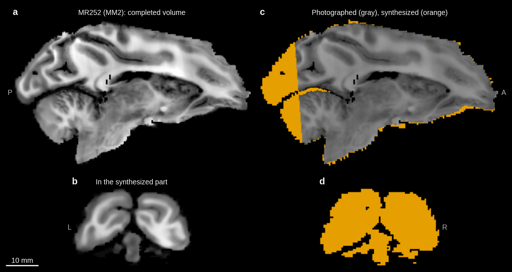
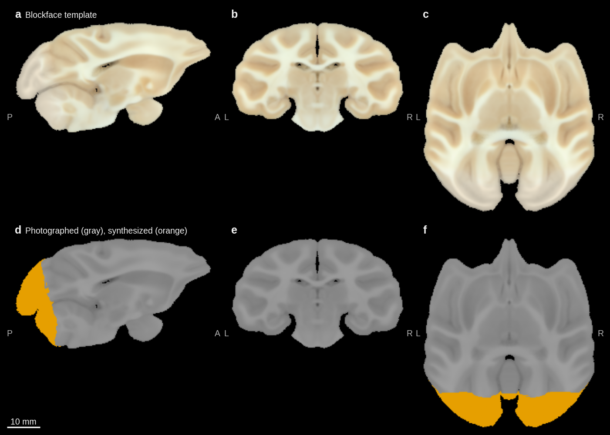

# 02. Blockface

From a brain's blockface photographs to a 3D volume in the template.
The examples are MR252 (MM2 in the paper), which has a b0, and MF191 (MF8), which has no MRI.
Read [00_start_here.md](00_start_here.md) first: every command runs from the top of the repository, in its shell.

## 1. What this part does

The photographs are stacked in cutting order into a 3D volume, with camera jumps corrected, missing sections filled, the illumination evened out, and the brain and marker tubes found by networks.
A brain with MRI registers its volume to its own b0 and follows the b0 into the template (the MRI-based alignment); a brain without MRI registers it to the blockface template and follows the template link (the blockface-based alignment).
No brain was photographed to its caudal end, so a network synthesizes the missing tissue from the b0 and marks it ([overview](../overview.md#the-templates)).


*Figure 1. The steps of this tutorial, drawn with MR252 (MM2): (a) photograph 700, (b) the blockface volume, sagittal, (c) the volume registered onto its own b0, with the b0 brain's outline, (d) the completed brain; under each arrow, the commands that make the step.
In Figures 1 to 3, the photographs are shown mirrored left-right into the neurological convention: the camera sees the brain's left on the image's right.*

## 2. Inputs

| File | Where in the data folder | What it is |
|---|---|---|
| `MR252_slice0000.jpg` ... | `brains/sub-MR252/inputs/photographs/` | the photographs, one JPEG per section, in cutting order; MR252 has 1,430, one every 50 µm, and a missing number is a section without a photograph |
| `MR252_brain_mask_edited.nii.gz` | `brains/sub-MR252/inputs/manual_annotations/` | the 3D brain mask, manually corrected |
| `MR252_tubes_edited.nii.gz` | `brains/sub-MR252/inputs/manual_annotations/` | the marker tubes, manually corrected |
| `photograph_masks/` | `brains/sub-MR252/inputs/manual_annotations/` | the photographs' brain masks |
| `MR252_b0.nii.gz` | `brains/sub-MR252/inputs/mri/` | the b0 (01 prepares it) |
| `MR252.yaml` | `settings/brains/` in the repository | the brain's settings: the photographs' names, pixel size, section step, camera jumps and missing sections (Step 6) |

A manually corrected file is used in place of the network's.


*Figure 2. (a) Photograph 700 of MR252 (MM2) and (b) its brain mask (`inputs/manual_annotations/photograph_masks/MR252_slice0700.png`); the small dark hole in (a) is a marker tube.*

## 3. Steps

To rerun a step on a paper brain, give `run.py` its name (`$PY run.py --plan --only reconstruct-MR252`).
A paper brain's reconstruction writes into `$LINC_REBUILD_DATA` (hence `LINC_DATA=$LINC_REBUILD_DATA` in its command), so that it never replaces the paper's volume; for a new brain, leave that part out.

### Step 1. Reconstruct the volume

```bash
LINC_DATA=$LINC_REBUILD_DATA $PY_TIRL code/blockface/linc-reconstruct all --subject MR252    # a paper brain
$PY_TIRL code/blockface/linc-reconstruct all --subject <ID>                                    # a new brain
```

`all` runs seven steps in order; each also runs alone, as `linc-reconstruct <step> --subject <ID>`:

| Step | What it does |
|---|---|
| `photos` | copies the photographs in cutting order; a network makes their brain masks |
| `stack` | stacks the photographs and their masks |
| `prepare` | corrects each camera jump (registered with TIRL), fills the missing sections, crops the stack, evens out the illumination and brightness |
| `mask` | makes the 3D brain mask (the network's, or your corrected one) |
| `volume` | writes the volume, and fills the manually corrected marker tubes if they exist already |
| `tubes` | finds the marker tubes with a network and fills them in the volume |
| `spacing` | writes the settings file's pixel size and section step into the headers |

For a new brain, run `photos` and `stack` first and look through the stacked photographs (`$LINC_DATA/sub-<ID>/blockface/00_slices/`).
Write its camera jumps and missing or damaged sections into its settings file (Step 6), then run the other five steps.

`volume` and `tubes` delete the working folders (`_work/` and `nii/`) once they have read them, so the steps before them cannot be rerun afterwards.
Add `--keep-work` when you may need to correct something and run again (Step 2).

- **Runs on:** a GPU with 10 GB free, for the networks only (1.5 GB for `photos`); about 90 GB of RAM for 1,400 photographs, 9 to 12 GB for 77.
- **Time:** about 10 hours for 1,400 photographs, of which `prepare` takes about 15 minutes per camera jump. MR252 was rebuilt in 9 h 10 min, identical to the paper's volume; MF191, with 77 photographs, in under an hour.
- **Writes:** in `$LINC_DATA/sub-<ID>/blockface/`: `<ID>_blockface.ome.zarr` (the volume, in color, at four resolutions), `<ID>_blockface_L2.nii.gz` (a lighter copy), `<ID>_mask.nii.gz` (the brain mask), `<ID>_holes.nii.gz` (the marker tubes) and `<ID>.info`.


*Figure 3. MR252 (MM2)'s largest camera jump (5.3 mm): the outlines of photograph 495 (white) and of 494 before it (orange), (a) as photographed and (b) after `prepare`.*


*Figure 4. MR252 (MM2)'s blockface volume (`outputs/MR252_blockface_L2.nii.gz`) through one marker tube, with its brain mask's outline (white) and where its tubes were before they were filled (orange, `outputs/MR252_tubes.nii.gz`).
Axial views: anterior is up; (c) ends flat at the back, where the photographed slab ends.*

### Step 2. Correct the masks manually (optional)

Save a corrected mask under the name the code looks for, then run the steps after it again.
For that, run the reconstruction one step at a time, with `--keep-work` on `volume` and `tubes`.
The `curated/` folder is in `$LINC_DATA/sub-<ID>/blockface/`; its grid is the manual-edit grid: the photographs' resolution in plane, 0.40 mm between slices.

| Mask | When | Save the corrected one as | Then run again |
|---|---|---|---|
| the photographs' masks | before `prepare` | `linc-reconstruct edit-photo-masks export`, edit, then `import` | `prepare` and the steps after it |
| the 3D brain mask | after `mask`, before `volume` | `curated/<ID>_mask_edited.nii.gz`, from `curated/<ID>_mask.nii.gz`, over `curated/<ID>_bg.nii.gz` | `volume`, `tubes`, `spacing` |
| the marker tubes | after `tubes` | `curated/<ID>_holes_edited.nii.gz`, from `curated/<ID>_holes.nii.gz` | `volume` and `tubes` (with the working folders that `--keep-work` kept), then `spacing` |

Corrected tubes saved after `tubes` are filled by `volume`, not by `tubes` alone, which is why `volume` runs again.
When you keep the brain, copy the corrected masks into the data folder's `inputs/manual_annotations/`.

### Step 3. Register the volume to the brain's own b0 (a brain with MRI)

```bash
$PY code/blockface/registration/linc-register mri --subject MR252 --overwrite        # a paper brain: its masks and start pose
M=$LINC_DATA/sub-<ID>/mri                                                            # a new brain, its b0 prepared as in 01
$PY code/blockface/registration/linc-register mri --subject <ID> --new-brain \
    --place-b0 $M/dwi/b0_brain_n4.nii.gz $M/masks/dwi_brain_mask.nii.gz
$PY code/blockface/registration/linc-register mri-template --subject <ID> \
    --template-b0 $LINC_TEMPLATE/mri/linc_mri_b0.nii.gz \
    --template-mask $LINC_TEMPLATE/mri/linc_mri_brainmask.nii.gz                     # the b0 to the template (01)
```

- **What it does:** `mri` registers the blockface volume to the brain's own b0, linearly (FSL FLIRT), then deformably (FireANTs) on features that a pretrained network (anatomix) computes from both images, so that the two contrasts can be compared. For a new brain, `--place-b0` first places the b0 on the template's grid (the MRI brain-mask network makes a mask if none is given), and the start pose is estimated; `--new-brain` makes a paper brain do the same. `mri-template` then registers the b0 to the template (01).
- **Tested:** on a paper brain, identical to the paper's. On MR257 treated as new: the placement, the estimated start pose and the linear stage; the deformable stage not yet.
- **Runs on:** a GPU with 15 to 25 GB free for `mri`, depending on the brain, and 12 to 14 GB for `mri-template`, one at a time on a card; about 15 minutes each. MR252's took 9 min 57 s and 13 GB of RAM.
- **Writes:** `$LINC_DATA/sub-<ID>/xfm/bf-native__to__b0-native/` and `b0-native__to__mri-template/`, each with its warp, its linear parts and `meta.json`; working files in `$LINC_WORK/register/<ID>/`.

An existing transform folder stops the run unless you add `--overwrite`, which backs up the old one.


*Figure 5. (a, c) MR252's b0 and (b, d) its blockface volume registered onto it (`paper/brains/sub-MR252/mri/`), with the b0 brain's outline; the volume's caudal end, never photographed, is missing in (b).*

### Step 4. Register the volume to the blockface template (a brain without MRI)

```bash
$PY code/blockface/registration/linc-register blockface-template --subject MF191
$PY code/blockface/registration/linc-register direct-placement --subject MF191 \
    --template-b0 $LINC_TEMPLATE/mri/linc_mri_b0.nii.gz \
    --template-mask $LINC_TEMPLATE/mri/linc_mri_brainmask.nii.gz
```

- **What it does:** `blockface-template` registers the volume to the blockface template, so that the brain's chain into the template goes through the template link. `direct-placement`, the cross-modal alignment, registers it straight to the template's b0, only to give the brain the stand-in b0 that Step 5 needs.
- **Runs on:** a GPU with about 19 GB free for `blockface-template` and 15 to 17 GB for `direct-placement`; MF191's took 6 min 10 s and 7 min 40 s.
- **Writes:** `$LINC_DATA/sub-<ID>/xfm/bf-native__to__bf-template/` and `bf-native__to__mri-template/`; the stand-in b0 in `$LINC_DATA/sub-<ID>/mri/stand_in/`.

`$PY -m shared.xfm chain --from bf-native --to mri-template --subject MF191` lists the links the chain uses: it should go through the blockface template.

### Step 5. Synthesize the tissue that was never photographed

```bash
$PY_DEEP code/blockface/synthesis/linc-complete prepare --subject <ID> --out $LINC_WORK/prepared
$PY_DEEP code/blockface/synthesis/linc-complete --brain $LINC_WORK/prepared/<ID> --out $LINC_WORK/complete              # a brain with MRI
$PY_DEEP code/blockface/synthesis/linc-complete --brain $LINC_WORK/prepared/<ID> --stand-in --out $LINC_WORK/complete   # a brain without MRI
```

- **What it does:** `prepare` gathers the brain's inputs on its 0.25 mm grid. The second command predicts blockface grayscale over the whole brain from the b0 (or the stand-in b0) with the synthesis network, maps its brightness to the photographs' on the 8 mm of fully photographed tissue next to the junction plane, cross-fades into it over the last 2 mm of photographs so that no seam shows, and colors it with the photographs' mean color. The networks are `models/completion/d3_full_A_s0/` (own b0) and `d3p_full_A_s0/` (stand-in b0).
- **Runs on:** `prepare` on a CPU, about a minute (5 GB of RAM for MR252); the prediction on a GPU with 2 GB free, about 20 seconds.
- **Writes:** in `$LINC_WORK/complete/<ID>/`, on the brain's 0.25 mm grid: `<ID>_bf_completed.nii.gz` (the whole brain; `_rgb` in color) and `<ID>_synth_mask` (the synthesized voxels), with the prediction, the photographs used, each voxel's photographed fraction, the cross-fade and the network's input (`linc-complete --help` lists them).



*Figure 6. MR252's completed volume (`MR252_completed.nii.gz` in the data folder), (a) sagittal and (b) coronal 5 mm caudal of the junction plane, where all the tissue is synthesized; (c, d) the same planes, photographed tissue gray, synthesized orange (`MR252_synthesized_mask.nii.gz`).
The thin orange line along the surface is real: the mask also holds the surface voxels the photographs did not cover.*

### Step 6. Adding a new brain: its settings file

Every brain has one settings file, `settings/brains/<ID>.yaml`.
For a new brain, copy the template and fill in the required fields:

```bash
cp settings/brains/TEMPLATE.yaml settings/brains/<ID>.yaml
```

The smallest file a new brain needs:

```yaml
subject: <ID>
raw: <ID>                         # the photographs' folder, relative to $LINC_RAW
raw_glob: '*.jpg'                 # the photographs' names, here as the data folder names them: <ID>_slice0000.jpg ...
raw_regex: '<ID>_slice(\d+)\.jpg' # the first group is the photograph's number
vx: 20.0                          # pixel size, µm
vz: 50.0                          # section step, µm
```

If the photographs keep the camera's names, such as `Img8527.JPG`, use `raw_glob: '*.JPG'` and `raw_regex: 'Img(\d+)\.JPG'`, as MR252's file does.
After `stack`, add `jumps` and `missing` if the stack has any, and `rotate180: true` if the photographs are upside down.

Every field, with its default and when to set it, is in [settings/brains](../../settings/brains/README.md#every-field), and `TEMPLATE.yaml` explains each in a comment.
Before you set `rotate180`, look at `00_slices/`: on upright photographs it turns the volume upside down, and the marker tubes are then lost, because only tubes on the brain's left, where they were drilled, are kept.

**The spacing.**
For a new brain, `vx` and `vz` are used as you measured them: no step calibrates them against the brain's MRI (the paper's brains were calibrated in an earlier analysis; see `reconstruction_spacing_um`).
A wrong spacing shows in the registration to the brain's own b0: `linc-register qc` fails a scale outside 0.9 to 1.1 (section 4).

**The photographs** are read from `$LINC_RAW/<raw>`; for a new brain, one link makes them visible there ([how-to, step 2](../how-to/new_brain.md#2-make-them-visible-to-the-code)).
That route has not been tried yet on a brain that is not one of the paper's ([FAQ](../faq.md#what-has-been-tested-on-a-brain-that-is-not-one-of-the-papers)).

### Step 7. The blockface template and its link to the MRI template

These rebuild the paper's templates; a new brain does not need them ([00](00_start_here.md#adding-a-new-brain-two-different-things)).

```bash
$PY code/template/build_blockface_template.py --plan                                    # every step, its time, inputs and outputs; runs nothing
$PY code/template/build_blockface_template.py --from prep-frame --to tpl-costmask-0p5   # the members
$PY code/template/build_blockface_template.py --from run-plan-a --to plan-a-mmorf       # the first stage
$PY code/template/build_blockface_template.py --from s8-frame --to member-warps         # the last step, at 0.25 mm
$PY code/template/build_link.py --plan                                                  # the template link
```

- **What it does:** prepares the members ([overview](../overview.md#the-templates)), runs the groupwise registration (seven nonlinear steps at 0.5 mm, an eighth at 0.25 mm), and averages every member moved once through its final warp. For a brain without MRI, only the photographed sections count fully, with a smooth ramp at their end, and at the last step its stand-in b0 also counts less where the tissue was not photographed. `build_link.py` registers the blockface template's b0 to the MRI template's b0, checks it against the registrations composed through each brain, and registers the template to NMT v2, INIA19 and CIVM-R.
- **Runs on:** the members on a CPU, about 5 minutes. The first stage on a GPU with 10 GB free and 64 GB of RAM, about 8.5 hours on a free card, 120 GB of disk. The last step on a GPU with 12 GB free and 96 GB of RAM, about 17 hours on one card (estimated) plus about 2.5 hours of CPU steps, 200 GB of disk. Both stages need the card to themselves. The link on a GPU with 6 GB free, about 13 minutes.
- **Writes:** under `$LINC_WORK/build_blockface_template/` and `$LINC_WORK/build_link/`; the finished blockface channel is `template/outputs/template_blockface_*` in the data folder.



*Figure 7. (a-c) The template's blockface channel (`template/outputs/template_blockface_rgb.nii.gz`); (d-f) the same planes, photographed tissue gray, synthesized orange (`template_blockface_synthesized_mask.nii.gz`): no brain photographed the occipital pole.
Axial views: anterior is up.*

## 4. Checks

**Look through the volume** (`<ID>_blockface_L2.nii.gz`, in FSLeyes or ITK-SNAP) from front to back.
A good volume has the brain dorsal side up, no step in the brain's outline from one section to the next (a camera jump left uncorrected), and a mask and tubes that follow the tissue.

**Check each registration** with `linc-register qc`, which records pass or fail in the transform's folder, with a picture in three planes and a JSON row of every measure.
Its presets (`bf2b0`, `direct`, `bf2bftemplate`, `b02template`, `template2template`) set the paper's settings for each kind of registration.
It fails a registration when:
- a scale of its linear part is outside 0.9 to 1.1 (between two animals, an isotropic scale outside 0.80 to 1.25);
- the correlation of the two images is below 0.6 (0.25 for a blockface volume against a b0, whose contrast is inverted);
- the warp folds any voxel inside the brain;
- the 95th percentile of the warp's displacement is above 8 mm (flagged above 6 mm);
- the moved brain's outline is more than 3.5 mm from the target's at its 99th percentile, or more than 5 mm anywhere (a warning above 2.5 mm, which passes).

**Compare with the paper's file.**
On a paper brain, `run.py` checks that the reconstruction is identical to the paper's, and each registration identical or within a median of 0.05 mm and a 99th percentile of 0.5 mm; `tests/compare/compare_reconstruction.py` compares any two reconstructions.

## 5. When something goes wrong

What you may see in this part, why, and what to do: [troubleshooting, blockface](../troubleshooting.md#blockface).
What it cannot do: [overview](../overview.md#what-the-package-cannot-do).
