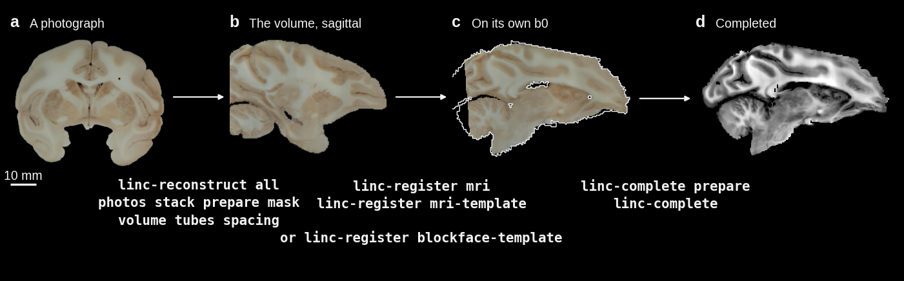
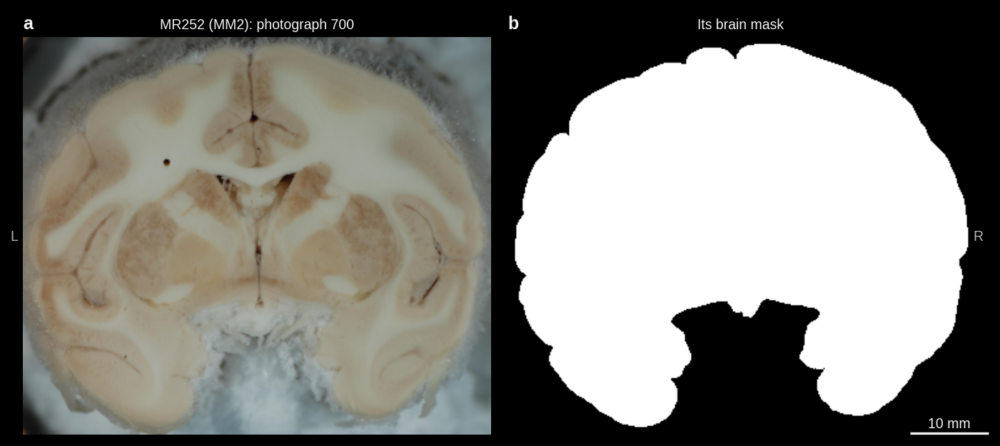

# 02. Blockface

This part takes a brain's blockface photographs to a 3D volume in the template.
The examples are MR252 (MM2), which has a b0, and MF191 (MF8), which has no MRI.
Run every command from the top of the repository, in a shell set up as in [00_start_here.md](00_start_here.md).

## 1. What this part does

The photographs are stacked in cutting order into a 3D volume, with camera jumps corrected, missing sections filled in and the illumination evened out; networks find the brain and the fiducial markers (the round holes in the block face).
A brain with MRI then registers its volume to its own b0 and follows the b0 into the template (the MRI-based alignment); a brain without MRI registers it to the blockface template and follows the template link (the blockface-based alignment).
A new brain with histology takes the blockface-based alignment too, MRI or not: its labels reach the template that way ([03](03_histology.md)).
The paper's own brains are already in the blockface template, so their labels follow the transforms that built it (`code/labels/route.py`).
No brain was photographed to its caudal end, so a network synthesizes the missing tissue from the b0 and marks it ([overview](../overview.md#the-templates)).



*Figure 1. The steps of this tutorial on MR252 (MM2): (a) photograph 700, (b) the blockface volume, sagittal, (c) the volume registered onto its own b0, with the b0 brain's outline, and (d) the completed brain; the commands are under the arrows.
In Figures 1 to 3 the photographs are mirrored left-right into the neurological convention: the camera sees the brain's left on the image's right.*

## 2. Inputs

MR252's inputs are in the data folder's `brains/sub-MR252/inputs/`:

| File | What it is |
|---|---|
| `photographs/MR252_slice0000.jpg` ... | the photographs, one JPEG per section, in cutting order; MR252 has 1,430, one every 50 µm, and a missing number is a section without a photograph |
| `manual_annotations/MR252_brain_mask_edited.nii.gz` | the 3D brain mask, manually corrected |
| `manual_annotations/MR252_tubes_edited.nii.gz` | the fiducial markers, manually corrected |
| `manual_annotations/photograph_masks/` | the photographs' brain masks |
| `mri/MR252_b0.nii.gz` | the b0 (prepared as in 01) |

Its settings (the photographs' names, pixel size, section step, camera jumps and missing sections) are in the repository's `settings/brains/MR252.yaml` (Step 6).
Wherever a manually corrected file exists, it is used instead of the network's.



*Figure 2. (a) Photograph 700 of MR252 (MM2) and (b) its brain mask (`photograph_masks/MR252_slice0700.png`); the small dark hole in (a) is a fiducial marker.*

## 3. Steps

To rerun a step on a paper brain, give `run.py` its name (`$PY run.py --plan --only reconstruct-MR252`).
A paper brain's reconstruction writes into `$LINC_REBUILD_DATA`, hence `LINC_DATA=$LINC_REBUILD_DATA` in its command, so it never replaces the paper's volume; leave that out for a new brain.

### Step 1. Reconstruct the volume

```bash
LINC_DATA=$LINC_REBUILD_DATA $PY_TIRL code/blockface/linc-reconstruct all --subject MR252    # a paper brain
$PY_TIRL code/blockface/linc-reconstruct all --subject <ID>                                    # a new brain
```

`all` runs seven steps in order, and each also runs on its own as `linc-reconstruct <step> --subject <ID>`:

| Step | What it does |
|---|---|
| `photos` | copies the photographs in cutting order; a network makes their brain masks |
| `stack` | stacks the photographs and their masks |
| `prepare` | corrects each camera jump (registered with TIRL), fills the missing sections, crops the stack, evens out the illumination and brightness |
| `mask` | makes the 3D brain mask (the network's, or your corrected one) |
| `volume` | writes the volume, and fills the manually corrected fiducial markers if they already exist |
| `tubes` | finds the fiducial markers with a network and fills them in the volume |
| `spacing` | writes the settings file's pixel size and section step into the headers |

For a new brain, run `photos` and `stack` first, look through the stacked photographs in `$LINC_DATA/sub-<ID>/blockface/00_slices/`, and write the camera jumps and the missing or damaged sections into its settings file (Step 6) before running the other five.

`volume` and `tubes` delete the working folders (`_work/` and `nii/`) once they have read them, so the steps before them cannot be rerun afterwards.
Add `--keep-work` if you may need to correct something and run again (Step 2).

The networks run on a GPU, and the rest on the CPU.
A brain of 1,400 photographs takes about 10 hours, including about 15 minutes of `prepare` per camera jump.
MR252 was rebuilt in 9 h 10 min, identical to the original, and MF191, with 77 photographs, in under an hour.

The results go to `$LINC_DATA/sub-<ID>/blockface/`: `<ID>_blockface.ome.zarr` (the volume, in color, at four resolutions), `<ID>_blockface_L2.nii.gz` (a lighter copy), `<ID>_mask.nii.gz` (the brain mask), `<ID>_holes.nii.gz` (the fiducial markers) and `<ID>.info`.


*Figure 3. MR252 (MM2)'s largest camera jump (5.3 mm): the outlines of photograph 495 (white) and of 494 before it (orange), (a) as photographed and (b) after `prepare`.*


*Figure 4. MR252 (MM2)'s blockface volume (the data folder's `brains/sub-MR252/outputs/MR252_blockface_L2.nii.gz`) through one fiducial marker, with its brain mask's outline (white) and where its markers were before they were filled (orange, `outputs/MR252_tubes.nii.gz`).
Axial views have anterior up; (c) ends flat at the back, where the photographed slab ends.*

### Step 2. Correct the masks manually (optional)

Save a corrected mask under the name the code looks for, then run the steps after it again.
For that, run the reconstruction one step at a time, with `--keep-work` on `volume` and `tubes`.
The `curated/` folder is in `$LINC_DATA/sub-<ID>/blockface/`, on the manual-edit grid: the reconstruction's level L4 in plane (16 times the photographs' pixel, 0.32 mm for most brains) and one slice every `curation_f` sections (the brain's settings file; about 0.4 mm apart where every section was photographed).

| Mask | When | Save the corrected one as | Then run again |
|---|---|---|---|
| the photographs' masks | before `prepare` | `linc-reconstruct edit-photo-masks export`, edit, then `import` | `prepare` and the steps after it |
| the 3D brain mask | after `mask`, before `volume` | `curated/<ID>_mask_edited.nii.gz`, from `curated/<ID>_mask.nii.gz`, over `curated/<ID>_bg.nii.gz` | `volume`, `tubes`, `spacing` |
| the fiducial markers | after `tubes` | `curated/<ID>_holes_edited.nii.gz`, from `curated/<ID>_holes.nii.gz` | `volume` and `tubes` (with the working folders that `--keep-work` kept), then `spacing` |

`volume` runs again for corrected markers because markers saved after `tubes` are filled by `volume`, not by `tubes` alone.
When you keep the brain, copy the corrected masks into the data folder's `inputs/manual_annotations/`.

### Step 3. Register the volume to the brain's own b0 (a brain with MRI)

```bash
$PY code/blockface/registration/linc-register mri --subject MR252 --overwrite        # a paper brain: its masks and start pose
M=$LINC_DATA/sub-<ID>/mri                                                            # a new brain, its b0 prepared as in 01
$PY code/blockface/registration/linc-register mri --subject <ID> --new-brain \
    --place-b0 $M/dwi/b0_brain_n4.nii.gz $M/masks/dwi_brain_mask.nii.gz
$PY code/blockface/registration/linc-register mri-template --subject <ID> \
    --b0 $M/dwi/b0_brain_n4.nii.gz --mask $M/masks/dwi_brain_mask.nii.gz \
    --template-b0 $LINC_TEMPLATE/mri/linc_mri_b0.nii.gz \
    --template-mask $LINC_TEMPLATE/mri/linc_mri_brainmask.nii.gz                     # the b0 to the template (01)
```

`mri` registers the blockface volume to the brain's own b0, linearly (FSL FLIRT) and then deformably (FireANTs) on features that a pretrained network, anatomix, computes from both images, which makes the two contrasts comparable.
For a new brain, `--place-b0` first places the b0 on the template's grid (the MRI brain-mask network makes a mask if none is given) and the start pose is estimated; `--new-brain` makes a paper brain do the same.
`mri-template` then registers the b0 to the template (01), starting from the placement `mri` made, so it needs no `--frame`.

For a paper brain you reconstructed yourself (Step 1), put `LINC_DATA=$LINC_REBUILD_DATA` in front of the `mri` command, so that it reads your volume.
The command also reads the brain's b0 placed on the template's grid, which is a product (`brains/sub-<ID>/intermediate/registration/` in the data folder).
If your data folder holds the inputs only, `mri` places the b0 itself from the b0 as acquired and its mask, with the same result.
Six brains (MF278, MR249, MR252, MR254, MR256 and MR261) also read a brain mask of record from that folder, and MR253 an N4-corrected b0, which nothing here makes again: add the folder for those brains to your data folder and run `source settings/roots.sh refresh`, or `mri` stops and names the file.
A brain without MRI (MF191, for example) has no Step 3; go to Step 4.

On a paper brain the result is identical to the original; on a brain treated as new, everything up to the deformable stage has been tested ([FAQ](../faq.md#what-has-been-tested-on-a-brain-that-is-not-one-of-the-papers)).
Each takes about 15 minutes on a GPU, one at a time on a card; `mri` needs 15 to 25 GB free (it varies by brain).
The transforms go to `$LINC_DATA/sub-<ID>/xfm/bf-native__to__b0-native/` and `b0-native__to__mri-template/`, each with its warp, its linear parts and `meta.json`, and the working files to `$LINC_WORK/register/<ID>/`.
An existing transform folder stops the run unless you add `--overwrite`, which backs up the old one.
If a principal scale of the 9-dof stage leaves the QC gate's range (0.9 to 1.1, `settings/registration.yaml`), `mri` prints a WARNING line and still writes the registration: a stack that ends well short of the brain can come out stretched along the cutting axis, so look at it and run `linc-register qc --preset bf2b0` (section 4) before using it.


*Figure 5. (a, c) MR252's b0 and (b, d) its blockface volume registered onto it (`paper/brains/sub-MR252/mri/`), with the b0 brain's outline; the volume's caudal end, never photographed, is missing in (b).*

### Step 4. Register the volume to the blockface template (a brain without MRI, or with histology)

```bash
$PY code/blockface/registration/linc-register blockface-template --subject MF191 --overwrite
$PY code/blockface/registration/linc-register direct-placement --subject MF191 \
    --template-b0 $LINC_TEMPLATE/mri/linc_mri_b0.nii.gz \
    --template-mask $LINC_TEMPLATE/mri/linc_mri_brainmask.nii.gz
```

`blockface-template` registers the volume to the blockface template, so that the brain's chain into the template goes through the template link.
`direct-placement`, the cross-modal alignment, registers it straight to the template's b0, only to give the brain the stand-in b0 that Step 5 needs.
A brain with histology runs `blockface-template` and the refinement below even when it has MRI, because its labels reach the template that way.
Step 5 needs a b0 in any case: a brain with MRI has Step 3's registration, and a brain without MRI gets its stand-in b0 from `direct-placement`.
On MF191 they took about 6 and 8 minutes on a GPU.
They write `$LINC_DATA/sub-<ID>/xfm/bf-native__to__bf-template/` and `bf-native__to__mri-template/`, and the stand-in b0 in `$LINC_DATA/sub-<ID>/mri/stand_in/`.
As in Step 3, `--overwrite` replaces an existing transform folder and backs up the old one; `linc-register qc --preset bf2bftemplate` then checks the registration (section 4).

`blockface-template` registers to the published blockface template (Step 7), used at 0.5 mm, so a small card is enough.
The paper registered its own brains to the template of the eighth step; `--template-grey` and `--template-coverage` choose another template.
The registration can then be refined the way the template's own brains were aligned, with one whole-brain registration to the template at 0.15 mm:

```bash
$ANATOMIX_PYTHON code/template/blockface_step9.py refine --subject <ID> --gpu 0
```

It needs a 48 GB card (about 7 minutes), and is optional for a brain without histology.
It writes a refined entry, the refinement followed by the brain's own registration, to `$LINC_DATA/sub-<ID>/xfm_step9/bf-native__to__bf-template/`, or where `--registry` says, and leaves the brain's own entry in `xfm/` as it was; the labels' carry into the template ([03](03_histology.md)) reads it from `xfm_step9/`.
Both entries lead into the same template frame, so either can be used.

`$PY -m shared.xfm chain --from bf-native --to mri-template --subject MF191` lists the links the chain uses, which should go through the blockface template.

### Step 5. Synthesize the tissue that was never photographed

```bash
$PY_DEEP code/blockface/synthesis/linc-complete prepare --subject <ID> --out $LINC_WORK/prepared
$PY_DEEP code/blockface/synthesis/linc-complete --brain $LINC_WORK/prepared/<ID> --out $LINC_WORK/complete              # a brain with MRI
$PY_DEEP code/blockface/synthesis/linc-complete --brain $LINC_WORK/prepared/<ID> --stand-in --out $LINC_WORK/complete   # a brain without MRI
```

`prepare` gathers the brain's blockface volume and its registration to its own b0, or its stand-in b0, on its 0.25 mm grid, in about a minute on the CPU.
The prediction, `linc-complete --brain` (with `--stand-in` for a brain without MRI), takes about 20 seconds on a GPU.
It predicts blockface grayscale over the whole brain from the b0, or the stand-in b0, with the synthesis network (`models/completion/d3_full_A_s0/` or `d3p_full_A_s0/`).
It then maps the prediction's brightness to the photographs' on the 8 mm of fully photographed tissue next to the junction plane, cross-fades into the photographs over their last 2 mm so no seam shows, and colors the result with the photographs' mean color.

The results go to `$LINC_WORK/complete/<ID>/`, on the brain's 0.25 mm grid: `<ID>_bf_completed.nii.gz` (the whole brain, `_rgb` in color) and `<ID>_synth_mask` (the synthesized voxels).
Beside them are `<ID>_bf_synth` (the prediction), `<ID>_bf_real` (the photographs used), `<ID>_photo_fraction` (each voxel's photographed fraction), `<ID>_seam_ramp` and `<ID>_seam_depth` (the cross-fade), `<ID>_b0_input_0p5` (the network's input) and a provenance file; `linc-complete --help` describes each.


*Figure 6. MR252's completed volume (`MR252_completed.nii.gz` in the data folder), (a) sagittal and (b) coronal 5 mm caudal of the junction plane, where all the tissue is synthesized; (c, d) the same planes, photographed tissue gray and synthesized orange (`MR252_synthesized_mask.nii.gz`).
The thin orange line along the surface is real: the mask also holds the surface voxels the photographs did not cover.*

### Step 6. Adding a new brain: its settings file

Every brain has one settings file, `settings/brains/<ID>.yaml`.
For a new brain, copy the template file and fill in the required fields:

```bash
cp settings/brains/TEMPLATE.yaml settings/brains/<ID>.yaml
```

The smallest file a new brain needs:

```yaml
subject: <ID>
raw: <ID>                         # the photographs' folder, relative to $LINC_RAW
raw_glob: '*.jpg'                 # the photographs' names, here as the data folder names them: <ID>_slice0000.jpg ...
raw_regex: '<ID>_slice(\d+)\.jpg' # the first group is the photograph's number
vx: 20.0                          # pixel size, µm
vz: 50.0                          # section step, µm
```

If the photographs keep the camera's names, such as `Img8527.JPG`, use `raw_glob: '*.JPG'` and `raw_regex: 'Img(\d+)\.JPG'`, as MR252's file does.
After `stack`, add `jumps` and `missing` if the stack has any, and `rotate180: true` if the photographs are upside down.
[settings/brains](../../settings/brains/README.md#every-field) lists every field with its default and when to set it, and `TEMPLATE.yaml` explains each in a comment.

Look at `00_slices/` before you set `rotate180`: on upright photographs it turns the volume upside down, and the fiducial markers are lost, because only markers in the brain's left hemisphere are kept.

**The spacing.**
For a new brain, `vx` and `vz` are used as you measured them; no step calibrates them against the brain's MRI (the paper's brains were calibrated in an earlier analysis; see `reconstruction_spacing_um`).
A wrong spacing shows in the registration to the brain's own b0, where `linc-register qc` fails a scale outside 0.9 to 1.1 (section 4).

**The photographs** are read from `$LINC_RAW/<raw>`; for a new brain, one link makes them visible there ([how-to, step 2](../how-to/new_brain.md#2-make-them-visible-to-the-code)), a route not yet tried on a brain from outside the paper.

### Step 7. The blockface template and its link to the MRI template

These commands rebuild the templates; a new brain does not need them ([00](00_start_here.md#adding-a-new-brain-two-different-things)).

```bash
$PY code/template/build_blockface_template.py --plan                                    # every step, its time, inputs and outputs; runs nothing
$PY code/template/build_blockface_template.py --from prep-frame --to tpl-costmask-0p5   # the members
$PY code/template/build_blockface_template.py --from run-plan-a --to plan-a-mmorf       # the first stage
$PY code/template/build_blockface_template.py --from s8-frame --to member-warps         # the eighth step, at 0.25 mm
$PY code/template/build_link.py --plan                                                  # the template link
```

The build prepares the members ([overview](../overview.md#the-templates)), runs the groupwise registration (seven nonlinear steps at 0.5 mm, an eighth at 0.25 mm), and averages every member moved once through its final warp.
For a brain without MRI, only the photographed sections count, with a smooth ramp at their end, and at the eighth step its stand-in b0 counts only there too, with the same ramp.
`build_link.py` registers the blockface template's b0 to the MRI template's b0, checks it against the registrations composed through each brain, and registers the template to NMT v2, INIA19 and CIVM-R.

The members take about 5 minutes on the CPU.
On a GPU, the first stage takes about 8.5 hours and the eighth step about 17 hours (estimated), plus about 2.5 hours of CPU steps; both need the card to themselves.
The link takes about 13 minutes on a GPU.
Everything is written under `$LINC_WORK/build_blockface_template/` and `$LINC_WORK/build_link/`; the finished blockface channel is the data folder's `template/outputs/template_blockface_*`.

The published template goes one step further than MMORF's eighth.
Eleven brains, the ones photographed at every section with few sections filled in and even lighting, are each registered to the average once more, whole brain, with the feature-based engine of Step 3 and a shorter schedule (`step9.registration.args` in `settings/blockface_template.yaml`); this is done three times, and after each round the brains are averaged again from their own photographs.
The last average is written on a 0.15 mm grid.
It keeps step 8's frame, so the template link and every brain's registration to step 8's template apply to it unchanged.

```bash
$ANATOMIX_PYTHON code/template/blockface_step9.py start                  # the brains carried from their photographs (CPU)
$ANATOMIX_PYTHON code/template/blockface_step9.py round --it 1 --gpu 0   # then --it 2 and --it 3: registration, and the average again
$ANATOMIX_PYTHON code/template/blockface_step9.py final                  # the average at 0.15 mm, and its checks
$ANATOMIX_PYTHON code/template/blockface_step9.py in-mri                 # the same in the MRI template's frame
```

The start takes about 8 minutes on 8 cores.
Each round registers 22 volumes (each brain and its mirror image), about 7 minutes each on a 48 GB card, of which a registration uses about 36 GB.
A round takes under 3 hours on one card; `register --it <k> --gpu <n>` (round `<k>` on card `<n>`) started on more cards shares the work.
The paper's run, the three rounds and the final average, took about 5 hours on four 48 GB cards; on one card it takes about 10 hours.
`final` writes the template to `$LINC_WORK/build_blockface_template/step9/final/` and its checks to `checks.json` there: sharper than the start, still matching step 8 at a coarse scale, exactly symmetric, and no folding anywhere.
Without a GPU, `final --fields-from $LINC_DATA_TREE/template/intermediate/construction/step9_fields` averages the brains through the paper's own fields and reproduces the published template exactly, in about 20 minutes with 8 workers and about half an hour with 4.
`build_blockface_template.py` runs the same commands as its steps `s9-start` to `s9-in-mri`.


*Figure 7. (a-c) The template's blockface channel (`template/outputs/template_blockface_rgb.nii.gz`); (d-f) the same planes, photographed tissue gray and synthesized orange (`template_blockface_synthesized_mask.nii.gz`): no brain photographed the occipital pole.
Axial views have anterior up.*

## 4. Checks

**Look through the volume** (`<ID>_blockface_L2.nii.gz`, in FSLeyes or ITK-SNAP) from front to back.
A good volume has the brain dorsal side up, no step in the brain's outline from one section to the next (an uncorrected camera jump), and a mask and markers that follow the tissue.

**Check each registration** with `linc-register qc`, which records pass or fail in the transform's folder, with a picture in three planes and a JSON row of every measure.
Its presets (`bf2b0`, `direct`, `bf2bftemplate`, `b02template`, `template2template`) hold the paper's settings for each kind of registration, and it fails a registration when:

- a scale of its linear part is outside 0.9 to 1.1 (between two animals, an isotropic scale outside 0.80 to 1.25);
- the correlation of the two images is below 0.6 (0.25 for a blockface volume against a b0, whose contrast is inverted);
- the warp folds any voxel inside the brain;
- the 95th percentile of the warp's displacement is above 8 mm (flagged above 6 mm);
- the outline check fails, with the same limits as in [01](01_mri.md#4-checks).

**Compare with the original.**
On a paper brain, `run.py` checks that the reconstruction is identical to the original, and each registration identical or within a median of 0.05 mm and a 99th percentile of 0.5 mm.
`tests/compare/compare_reconstruction.py` compares any two reconstructions.

## 5. When something goes wrong

See [troubleshooting](../troubleshooting.md#blockface), and the [overview](../overview.md#what-the-package-cannot-do) for what this part cannot do.
