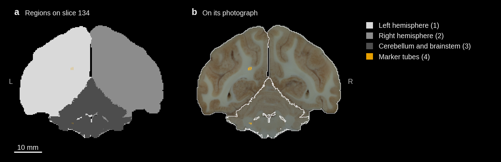
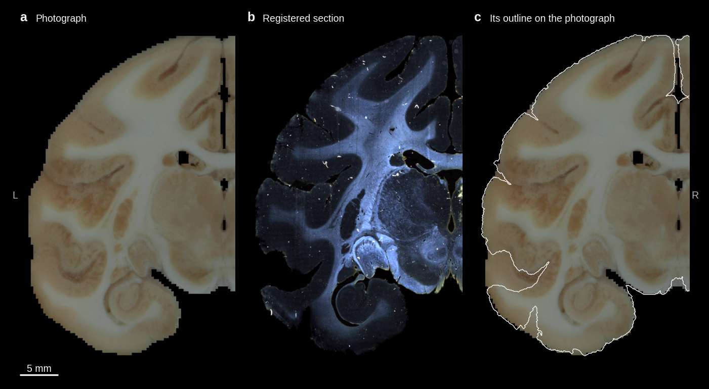
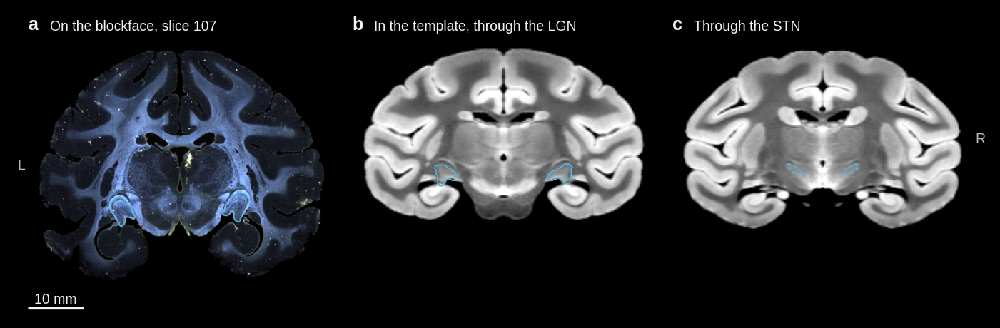
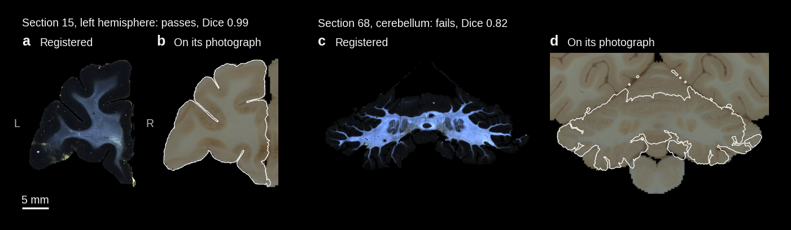

# 03. Histology

This tutorial covers histology sections: each one registered to the blockface photograph of its own section, and the labels drawn on the sections carried onto the blockface volume and into the template.
The example brain is MR243 (MM1 in the paper); from here on it is named by its ID, as every folder and file is.

Read [00_start_here.md](00_start_here.md) first, and [02_blockface.md](02_blockface.md) for the blockface volume and its registration, which this part builds on.

## 1. What this part does

A histology section is registered to the blockface photograph taken as that section was cut, because the photograph shows the tissue before it was mounted, stained and distorted.
Each section is divided into components (the two hemispheres, or the cerebellum with the brainstem, when they were mounted apart), and each component is registered on its own, with TIRL, in four stages: rotation, rigid, affine and nonlinear.
The registered sections, placed at their slices of the blockface volume, then follow that volume's own chain into the template (02, and 01 for the last link).
Labels drawn on the sections, such as tracer charts or the LGN and STN, follow the same registrations onto the blockface, are filled in between the sections, and are carried into the template in one resampling.


*Figure 1. The histology part on MR243.
(a) Section 36 as scanned (`brains/sub-MR243/inputs/histology/sections/mr243LY_c18_s36nDF.jp2`, read at a reduced level and brightened for display).
(b) The blockface photograph of the same section, slice 107 (`outputs/MR243_blockface_L2.nii.gz`).
(c) The section registered onto it (`outputs/MR243_histology_blockface.nii.gz`).
(d) The LGN and STN drawn on MR243's sections, carried into the template (`outputs/MR243_lgn_stn_template.nii.gz`, outlined on `template/outputs/template_b0.nii.gz`): LGN solid, STN dashed, on the one coronal plane that cuts both.*

## 2. Inputs

| File | Where in the data tree | What it is |
|---|---|---|
| `mr243LY_c18_s<NN>nDF.jp2` | `brains/sub-MR243/inputs/histology/sections/` | the 76 sections, in cutting order, as JPEG 2000 (42 GB); dark field; `ASCII_files/` holds the chart tracings |
| `<class>.ome.zarr` | `brains/sub-MR243/inputs/histology/tracer_annotations/` | the tracer labels drawn from the charts, one store per class: bundles and terminal fields by density, the injection site, single fibers, the tissue outline |
| `MR243_section_match.txt` | `brains/sub-MR243/inputs/manual_annotations/` | the match table, made by hand: which photograph each section's components go with |
| `sub-MR243_histo_L6.nii.gz` and `_lhLGN`, `_rhLGN`, `_lhSTN`, `_rhSTN` | `brains/sub-MR243/inputs/manual_annotations/` | the histology stack the LGN and STN were drawn on, and the four drawings |
| `MR243_blockface.ome.zarr` | `brains/sub-MR243/intermediate/volume/` | the blockface volume in cutting order, which the histology steps read (02) |
| `MR243_regions_t2.nii.gz`, `.tsv` | `brains/sub-MR243/intermediate/histology/` | the regions volume on the blockface: 1 left, 2 right, 3 cerebellum and brainstem, 4 marker tubes (step A makes it) |
| `MR243_LY.tsv` | `paper/analysis/labels/section_maps/` | the section map: which section each image of the annotation stack is |

The sections are also in LINC dataset 000003, so `brains/sub-MR243/inputs/histology/README.txt` names their source.


*Figure 2. The input.
(a) Section 36 as scanned (`inputs/histology/sections/mr243LY_c18_s36nDF.jp2`, every 64th pixel, brightened for display).
(b) The blockface photograph of the same section, slice 107 of the cutting order (`outputs/MR243_blockface_L2.nii.gz`).
The match table gives the slice: sections 16 to 40 go with photograph 3 × section + 4758, here 4866, and the first photograph is number 4759.*

## 3. Steps

Every command runs from the top of the code folder, in the shell of [00_start_here.md](00_start_here.md).

The brain must already have its blockface volume and its registration to the template (02, and 01 for a brain with MRI).
The histology steps use no GPU.

### Step A. The regions volume

```bash
H=$LINC_DATA/sub-<ID>/histology; mkdir -p $H
$PY -m shared.xfm apply --from mri-template --to bf-native --subject <ID> --nearest \
    --ref $LINC_DATA/sub-<ID>/blockface/<ID>_blockface_L2.nii.gz \
    $LINC_TEMPLATE/labels/regions_in_t2.nii.gz $H/regions.nii.gz
```

Then set the voxels of the left hemisphere's marker tubes in `regions.nii.gz` to 4 (the brain's tubes are `$LINC_DATA/sub-<ID>/blockface/<ID>_holes.nii.gz`, from 02; for the paper's brains, `outputs/<ID>_tubes.nii.gz` in the data folder).

- **What it does:** carries the template's left, right and cerebellum regions into the brain's blockface volume, through the brain's own registration.
  The later steps divide each photograph into the section's components with it.
- **Runs on:** CPU; seconds.
- **Writes:** `$LINC_DATA/sub-<ID>/histology/regions.nii.gz`.



*Figure 3. MR243's regions volume (`intermediate/histology/MR243_regions_t2.nii.gz`) on blockface slice 134, where all four labels are present, beside the photograph of that slice (`outputs/MR243_blockface_L2.nii.gz`) with the regions' outlines.
MR243's regions were made on its volume before the section step was calibrated (at 400 µm instead of 366 µm); the figure, like the code, scales them along the section axis to match.*

### Step B. The match table

```bash
STORE=$LINC_DATA/sub-<ID>/blockface/<ID>_blockface.ome.zarr
$PY_TIRL code/histology/linc-histology propose --subject <ID> --store $STORE \
    --histology <sections folder> --regions $H/regions.nii.gz --out $H/registration
```

- **What it does:** proposes which photograph each section's components go with.
  It splits each section into its tissue components, compares their outlines with every photograph's whole brain, hemispheres and cerebellum, registers each component to the photographs near its place, and fits a line of fixed spacing through the sections of each cutting run, so that a component follows its run, not its own best-looking photograph.
  A component that scores too low on its run's line stays unmatched instead of being guessed.
- **Runs on:** CPU; about 10 minutes and 14 GB of RAM for MR243 in the release's test of this step.
- **Writes:** in `$H/`: `match_table_proposed.txt` (one row per section), `match_review.csv` (one row per component: its photograph, its score, a flag, the next-best photographs) and `match_review/` (an image of each flagged component beside its proposed photograph).

Then check the proposal row by row, starting with the flagged rows:

```bash
cp $H/match_table_proposed.txt $H/match_table_edited.txt      # correct the numbers here; nothing overwrites this file
```

Every later step uses, in this order: a table given with `--table`, `match_table_edited.txt`, `match_table.txt`, `match_table_proposed.txt`. Each step prints which one it used.

On the five brains with hand-made tables, the proposal put 28 of 319 kept components more than one section away from the hand-made table, and flagged 20 of the 33 components that were farthest off. On MR243: 2 of 91 kept components more than one section off, and its 3 large disagreements were all flagged.
So the flags set the order of the review; they do not replace it.

### Step C. The registration

```bash
$PY_TIRL code/histology/linc-histology all --subject <ID> --store $STORE --threads 12 --jobs 2 \
    --histology <sections folder> --regions $H/regions.nii.gz --out $H/registration
```

For MR243 on the paper's data: `$PY run.py --run --only histology-MR243`, which uses MR243's hand-made match table and checks every section against the paper's.

- **What it does:** runs, for each section: `match` (the photograph of each component), `pieces` (each photograph divided into the section's components by the regions volume), `masks` (each histology component's tissue mask), `prepare` (TIRL's moving and fixed images, on one pixel grid: half the blockface slice's pixel, 0.040 mm for MR243), `register` (TIRL: rotation, rigid, affine, nonlinear) and `rgb` (the registered sections in color).
  The nonlinear stage is stiffer for components that already fit well: a component whose tissue Dice coefficient after the affine stage is at least 0.85 takes a regularization weight of 0.45, the others 0.30.
- **Runs on:** CPU, 24 cores (12 threads for each of 2 components at a time), 32 GB of RAM; about 3 hours for MR243's 97 components, 8 GB of disk.
- **Writes:** in `$H/registration/`: `matched/`, `pieces/`, `tissue_masks/`, `moving/`, `fixed/` (PNG), and `tirl/<component>/` (TIRL's transforms and the registered image) for each component, each step with a `provenance.json`.

A run that stops resumes where it stopped: a component whose `tirl/<component>/fixed4_nonlinear.timg` exists is done.
Use 12 threads per component: TIRL's result depends on the thread count, and 12 threads reproduce the paper's registrations.


*Figure 4. One section's components.
(a) Section 5 as scanned (`inputs/histology/sections/mr243LY_c18_s05nDF.jp2`): its hemispheres were mounted apart.
(b, c) The photograph of its section, slice 14, divided by the regions volume into the left and right hemispheres, each registered on its own (`tirl/mr243LY_c18_s05nDF_0001` and `_0002`).*



*Figure 5. Section 36 after registration, its left half: (a) the photograph (`outputs/MR243_blockface_L2.nii.gz`, slice 107), (b) the registered section (`outputs/MR243_histology_blockface.nii.gz`), (c) the registered section's tissue outline on the photograph.
This is the check by eye: the outline should follow the photograph's edges and its sulci.*

Once every component is registered, the code places the sections at their slices of the blockface volume and fills the slices between two sections by interpolation, which gives one color volume of the histology on the blockface grid.


*Figure 6. The registered histology as a volume, one sagittal plane through the left LGN: (a) the photographs (`outputs/MR243_blockface_L2.nii.gz`), (b) the registered histology (`outputs/MR243_histology_blockface.nii.gz`), (c) which slices hold a registered section (white) and which are interpolated between two (orange; `intermediate/histology/provenance_L2.nii.gz`: 1 registered, 2 interpolated).
MR243 has a section on every third slice.*

### Step D. Tracer labels

```bash
$PY_TIRL code/labels/linc-labels push        --subject <ID>
$PY      code/labels/linc-labels interpolate --subject <ID>
$PY      code/labels/linc-labels carry       --subject <ID>
$PY      code/labels/linc-labels connect     --subject <ID>
```

They read, in the brain's histology folder: the labels, one OME-Zarr per class, in `$H/annotations/<class>.ome.zarr`; `$H/section_map.tsv`, which says which section each image of the label stack is; the match table; the regions volume; and step C's registration.

- **What they do:**
  - `push` moves each label class through each component's registration onto its blockface slice.
  - `interpolate` fills the slices between charted sections, with demons registration between each pair of sections in each hemisphere; the bundle classes are filled as one group and the terminal classes as another, each density class kept as a part of its group.
  - `carry` resamples the labels into the template in one resampling, through the brain's chain of registrations (02, 01).
  - `connect` joins the carried bundles into one pathway and marks each join as inferred.
- **Runs on:** CPU.
  `push` about 3 minutes; `interpolate` 20 to 35 minutes on 16 cores, 16 GB of RAM; `carry` 3 to 5 minutes on 4 cores; `connect` under a minute.
- **Writes:** `$LINC_DATA/sub-<ID>/labels/blockface/tracer/` (`<ID>_<class>_bfnative_L2.nii.gz`, then `_demons` for the interpolated ones) and `$LINC_DATA/sub-<ID>/labels/template/tracer/` (`_mri-template`, `_density`, `_footprint`, and the connected pathway `<ID>_Bundles_mri-template_connected.nii.gz`).

In the file names, density is the fraction of each voxel, solid is where the density exceeds 0.5, and connected has 1 for charted and 2 for inferred voxels.
For MR243 on the paper's data, `run.py` reruns the last three from the paper's pushed labels (`labels-interpolate-MR243`, `labels-carry-MR243`, `labels-connect-MR243`), and checks each file against the paper's.


*Figure 7. MR243's tracer labels.
(a) On the blockface, slice 50, over the registered section (`outputs/MR243_tracer_bundles_blockface.nii.gz`, `_terminals_blockface`, `_injection_site_blockface`).
(b, c) In the template, a sagittal and an axial plane through the pathway's center, with the labels within 2.5 mm of the plane (`outputs/MR243_tracer_bundles_connected_template.nii.gz`, `_terminals_template`, `_injection_site_template`, on `template/outputs/template_T2w.nii.gz`).*

### Step E. LGN and STN

```bash
$PY_TIRL code/labels/linc-labels push --subject <ID> --kind structures
```

- **What it does:** the LGN and STN were drawn on another rendering of the sections, an image stack.
  Each drawn frame first goes onto its component's moving image through the frame's own fitted transform, then through the component's registration onto the blockface, as in step D.
  The labels then go into the template as in step D (`carry`, with `--labels` naming the four files).
- **Runs on:** CPU.
- **Writes:** `$LINC_DATA/sub-<ID>/labels/blockface/structures/`.

It reads, in `$H/structures/`: the stack (`histo_L6.nii.gz`), one drawing per nucleus (`histo_L6_<nucleus>.nii.gz`), `frame_map.json` (each frame's section), and each frame's transform onto its component (`transforms/f<frame>_<piece>.tfm`, with the moving image it was fitted on in `fitted_moving/`).

The data folder has MR243's LGN and STN in four spaces, one file each with its `.tsv` key (1 left LGN, 2 right LGN, 3 left STN, 4 right STN): `outputs/MR243_lgn_stn_histology`, `_blockface`, `_b0` and `_template`.
`run.py` does not rerun them.



*Figure 8. MR243's LGN (solid) and STN (dashed).
(a) On the blockface, slice 107, over the registered section 36 (`outputs/MR243_lgn_stn_blockface.nii.gz`).
(b, c) In the template, through each nucleus (`outputs/MR243_lgn_stn_template.nii.gz` on `template/outputs/template_b0.nii.gz`).*

## 4. Checks

**The registration check** scores each component by the Dice coefficient of the registered section's tissue and the photograph's, after each stage.
A component passes when its Dice coefficient after the nonlinear stage is at least 0.85.
On MR243, 93 of 97 components passed; the median Dice coefficient was 0.945 after the affine stage and 0.960 after the nonlinear stage.
The other five histology brains: MR252 46 of 47, MR256 53 of 53, MF278 77 of 79, MF275 58 of 62, MF191 55 of 57.

A failed component is not dropped: it stays in the registered histology, and the check says where to look.
MR243's four failures are at the two ends of the series: section 3's left hemisphere (slice 8), and the cerebellum of sections 64, 67 and 68 (slices 149 to 158).



*Figure 9. The check on MR243's best and worst components.
(a, b) Section 15's left hemisphere passes, with a Dice coefficient of 0.99 (slice 44).
(c, d) Section 68's cerebellum fails, with 0.82 (slice 155): the registered tissue does not follow the photograph's outline at the top.
Each is shown registered (`outputs/MR243_histology_blockface.nii.gz`, cut to the component's region) and as its tissue outline on its photograph (`outputs/MR243_blockface_L2.nii.gz`).
The Dice coefficients are those of the check's record.*

**Looking** is the other check: open the registered section over its photograph (Figure 5) and page through `outputs/<ID>_histology_blockface.nii.gz` with the photographs (Figure 6).

**`run.py`'s check**, on the paper's brains, compares every registered section with the paper's.
Reruns are identical to each other, but some components differ from the paper's own run by round-off in TIRL's last stage, so a component passes when it is identical or when its transform stays within 3 pixels of the paper's on TIRL's grid (0.12 mm of MR243's tissue).
On MR243 in the lab's rerun: 63 of 97 components identical, the other 34 within 1.5 pixels (0.06 mm of tissue); every input of TIRL identical to the paper's.

## 5. When something goes wrong

| What you see | Why | What to do |
|---|---|---|
| A registered section lies on the wrong anatomy, or its outline fits but its sulci do not | the match table pairs the component with the wrong photograph (neighboring photographs look alike) | correct its row in `match_table_edited.txt` and run `all` again into a new `--out` folder: a folder that already holds a registration is resumed, not redone |
| `propose` leaves a component unmatched (-1) | its score on its run's line was too low, so it was not guessed | find its photograph by eye (`match_review/`) and write it into `match_table_edited.txt`, or leave it out |
| A registration differs slightly from the paper's on rerun | TIRL's result depends on the thread count | use `--threads 12` (the default) |
| A run stopped | the machine went down, or a component crashed | run the same command again: it resumes where it stopped |
| `all` stops at one component with "Matrix does not exist on the same manifold" | TIRL's rotation search failed on that component. It happened on one component of MF275, as in the paper's run, which has no result for it | run `linc-histology rgb` with the same options, to make the color images of the components that did register |
| The labels of one section sit about a millimeter off on one side, while the section's registration looks right | the drawn frame's fitted transform onto its component is wrong (step E). This happened on MR252's frame 36: the left LGN and STN 1.1 mm off on the section | fit that frame's transform again (`$H/structures/transforms/f<frame>_<piece>.tfm`, a SimpleITK transform) and push the labels again. The data folder's MR252 LGN and STN files carry the refit frame |
| A section's tissue mask takes in another object, or misses tissue | the contrast of that section is unusual: on one of MF191's sections, with the contrast saturated, the mask took in another object | check `tissue_masks/` by eye; if a mask is wrong, leave that component out of the table (-1) |
| No photograph for a section | the section was not photographed, or the volume stops before it | the section cannot be registered; leave it out of the table (-1) |

## 6. What it cannot do

- It registers a histology section only through the blockface photograph of its own section.
  Sections without photographs cannot be used.
- Between two sections, the histology and the labels are interpolated, not measured.
  `intermediate/histology/provenance_L2.nii.gz` marks which slices are which, and the interpolated labels say so in their names (`_demons`).
- A failed component stays in the products; the check flags it but does not remove it.
- The paper's tracer groups leave out the single-fiber strokes (the `Fibers` class): they are carried into the template, but too sparse for its solid-label rule.
  In MR243 the template file is empty.
- On MR243, MR256 and MF191, `run.py` reruns the labels from the paper's pushed labels, because the paper's labels used components masked again in a way the release's `masks` step does not repeat.
  Only MR252's push is rerun from its registrations.
- Labels carried into the template belong to the current template.
  If the template were rebuilt with new members, they would have to be carried again into the new one.
  See "Adding a new brain: two different things" in [00_start_here.md](00_start_here.md).

## 7. Where everything lands

| What | Path |
|---|---|
| The regions volume and the match table | `$LINC_DATA/sub-<ID>/histology/regions.nii.gz`, `match_table_*.txt` |
| Each component's registration and the registered images | `$LINC_DATA/sub-<ID>/histology/registration/` (`tirl/<component>/` and the step folders) |
| The match proposal's review | `$LINC_DATA/sub-<ID>/histology/match_review.csv`, `match_review/` |
| Labels on the blockface | `$LINC_DATA/sub-<ID>/labels/blockface/tracer/`, `structures/` |
| Labels in the template | `$LINC_DATA/sub-<ID>/labels/template/tracer/` |
| The paper's histology on the blockface, in color, and which slices are interpolated | `brains/sub-<ID>/outputs/<ID>_histology_blockface.nii.gz`, `intermediate/histology/provenance_L2.nii.gz` |
| The paper's labels | `brains/sub-<ID>/outputs/<ID>_tracer_*` and `<ID>_lgn_stn_*` (each with its `.tsv` key) |
| The paper's registrations, one folder per component | `brains/sub-<ID>/intermediate/histology/tirl/` |
