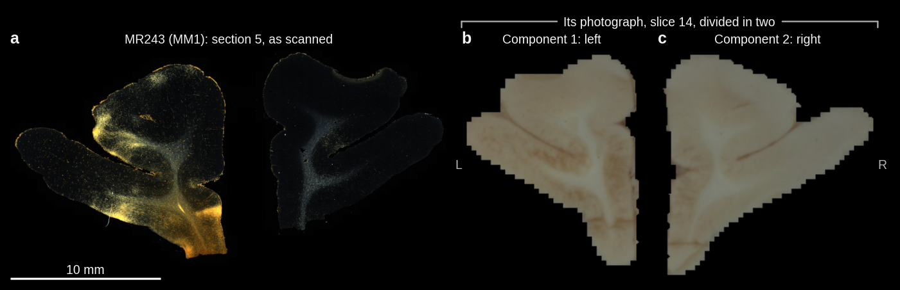
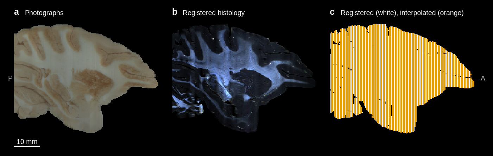

# 03. Histology

This part registers histology sections to the blockface photographs of their own sections and carries the labels drawn on them into the template.
The example is MR243 (MM1).
It starts from the blockface volume and registration made in 02; run every command from the top of the repository, in a shell set up as in [00_start_here.md](00_start_here.md).

## 1. What this part does

Each section is registered with TIRL to the photograph taken as it was cut: rotation, rigid, affine, then nonlinear.
Where the hemispheres, or the cerebellum with the brainstem, were mounted apart, each of these components is registered on its own.
Placed at their slices of the blockface volume, the sections then follow the volume's chain into the template.
Labels drawn on the sections, such as tracer charts or the LGN and STN, follow the same registrations, are filled in between the sections, and are carried into the template in one resampling.


*Figure 1. MR243: (a) section 36 as scanned, brightened; (b) the photograph of the same section, slice 107; (c) the section registered onto it; (d) the LGN (solid) and STN (dashed) drawn on MR243's sections, in the template.*

## 2. Inputs

MR243's files are in the data folder's `brains/sub-MR243/`, except the section map:

| File | What it is |
|---|---|
| `inputs/histology/sections/mr243LY_c18_s<NN>nDF.jp2` | the 76 sections, in cutting order, as dark-field JPEG 2000 (42 GB), also in LINC dataset 000003; `ASCII_files/` holds the chart tracings |
| `inputs/histology/tracer_annotations/<class>.ome.zarr` | the tracer labels drawn from the charts, one store per class: bundles and terminal fields by density, the injection site, single fibers, the tissue outline |
| `inputs/manual_annotations/MR243_section_match.txt` | the match table, made manually: which photograph each section's components go with |
| `inputs/manual_annotations/sub-MR243_histo_L6.nii.gz` and `_lhLGN`, `_rhLGN`, `_lhSTN`, `_rhSTN` | the histology stack the LGN and STN were drawn on, and the four drawings |
| `intermediate/volume/MR243_blockface.ome.zarr` | the blockface volume in cutting order (02) |
| `intermediate/histology/MR243_regions_t2.nii.gz`, `.tsv` | the regions volume on the blockface: 1 left, 2 right, 3 cerebellum and brainstem, 4 fiducial markers (Step A) |
| `paper/analysis/labels/section_maps/MR243_LY.tsv`, at the top of the data folder | the section map: which section each image of the label stack is |


*Figure 2. (a) Section 36 as scanned (every 64th pixel, brightened) and (b) the photograph of the same section, slice 107 of the cutting order.
The match table gives the slice: sections 16 to 40 go with photograph 3 × section + 4758, here 4866, and the first photograph is number 4759.*

## 3. Steps

The brain must already have its blockface volume and its registration to the blockface template, refined at 0.15 mm ([02](02_blockface.md), Steps 1 and 4).
For MR243, or any other paper brain that `$LINC_DATA` does not hold yet, `$PY run.py --run --only data-folders` adds the paper's 21 brains to the working folders, as links to the data folder's files.
A brain with MRI needs that registration too: the labels reach the template through it.
The paper also reports them through the brain's own b0 ([01](01_mri.md)), the other route.
None of the histology steps uses a GPU.

### Step A. The regions volume

```bash
H=$LINC_DATA/sub-<ID>/histology; mkdir -p $H
$PY -m shared.xfm apply --from mri-template --to bf-native --subject <ID> --nearest \
    --ref $LINC_DATA/sub-<ID>/blockface/<ID>_blockface_L2.nii.gz \
    $LINC_TEMPLATE/labels/regions_in_t2.nii.gz $H/regions.nii.gz
```

This carries the template's left, right and cerebellum regions onto the blockface volume in seconds on the CPU, and the later steps use it to divide each photograph into the section's components.
Then set the voxels of the left hemisphere's fiducial markers in `regions.nii.gz` to 4.
The markers are in `$LINC_DATA/sub-<ID>/blockface/<ID>_holes.nii.gz` from 02, or, for a paper brain, in the data folder's `brains/sub-<ID>/outputs/<ID>_tubes.nii.gz`.


*Figure 3. MR243's regions volume on slice 134, where all four labels are present, and their outlines on that slice's photograph.
MR243's regions were made before its section step was calibrated (400 µm instead of 366 µm), so the figure, like the code, scales them to match.*

### Step B. The match table

```bash
H=$LINC_DATA/sub-<ID>/histology
STORE=$LINC_DATA/sub-<ID>/blockface/<ID>_blockface.ome.zarr
$PY_TIRL code/histology/linc-histology propose --subject <ID> --store $STORE \
    --histology <sections folder> --regions $H/regions.nii.gz --out $H/registration
```

For MR243, the sections folder is `$LINC_DATA_TREE/brains/sub-MR243/inputs/histology/sections`.
`propose` suggests a photograph for each section's components.
It compares each component's outline with every photograph's, registers the component to the photographs near its place, and fits a line of fixed spacing through the sections of each cutting run, so that a component follows its run rather than its own best-looking photograph.
A component that scores too low on its run's line is left unmatched rather than guessed.
For MR243 it took about 10 to 20 minutes on the CPU (the longer time on a busy host) and 14 GB of RAM in the release's tests of this step.

It writes three things to `$LINC_DATA/sub-<ID>/histology/`, beside the `--out` folder: `match_table_proposed.txt` (one row per section), `match_review.csv` (one row per component, with its photograph, its score, a flag and the next-best photographs) and `match_review/` (an image of each flagged component beside its proposed photograph).

Then check the proposal row by row, flagged rows first, in your own copy:

```bash
H=$LINC_DATA/sub-<ID>/histology
cp $H/match_table_proposed.txt $H/match_table_edited.txt      # correct the numbers here; nothing overwrites this file
```

Every later step uses the first of these that exists, and prints which one it used: a table given with `--table`, `match_table_edited.txt`, `match_table.txt`, `match_table_proposed.txt`.

The flags set the order of the review; they do not replace it.
On the five brains with manual tables, the proposal put 28 of 319 kept components more than one section off and flagged 20 of the 33 farthest off; on MR243 it put 2 of 91 more than one section off, and flagged all 3 of its large disagreements.

### Step C. The registration

```bash
H=$LINC_DATA/sub-<ID>/histology
STORE=$LINC_DATA/sub-<ID>/blockface/<ID>_blockface.ome.zarr
$PY_TIRL code/histology/linc-histology all --subject <ID> --store $STORE --threads 12 --jobs 2 \
    --histology <sections folder> --regions $H/regions.nii.gz --out $H/registration
```

The sections folder is the one of Step B.
For MR243 on the paper's data, `$PY run.py --run --only histology-MR243` uses MR243's manual match table and checks every section against the paper's registration.

For each section, `all` runs `match` (each component's photograph), `pieces` (each photograph divided into the components by the regions volume), `masks` (each component's tissue mask), `prepare` (TIRL's images, with a pixel half the blockface slice's, 0.040 mm for MR243), `register` (TIRL) and `rgb` (the registered sections in color).
A component whose tissue Dice coefficient after the affine stage is at least 0.85 gets a stiffer nonlinear stage, with a regularization weight of 0.45 instead of 0.30.

MR243's 97 components took about 3 hours on the CPU.
The results go to `$LINC_DATA/sub-<ID>/histology/registration/`: `matched/`, `pieces/`, `tissue_masks/`, `moving/`, `fixed/` (PNG) and `tirl/<component>/` (TIRL's transforms and the registered image), each step with a `provenance.json`.

A stopped run resumes, and a component whose `tirl/<component>/fixed4_nonlinear.timg` exists counts as done.
Keep 12 threads per component: TIRL's result depends on the thread count, and 12 reproduce the original results.
The registered sections, placed at their slices and interpolated in between, make one color volume of the histology on the blockface grid.



*Figure 4. (a) MR243 (MM1)'s section 5 as scanned, its hemispheres mounted apart (hence no orientation letters); (b, c) the photograph of its section, slice 14, divided by the regions volume into the two hemispheres, each registered on its own (`tirl/mr243LY_c18_s05nDF_0001` and `_0002`).*


*Figure 5. Section 36's left half: (a) the photograph, slice 107, (b) the registered section (the data folder's `brains/sub-MR243/outputs/MR243_histology_blockface.nii.gz`), and (c) its tissue outline on the photograph, the check by eye: the outline should follow the photograph's edges and sulci.*



*Figure 6. One sagittal plane through the left LGN: (a) the photographs, (b) the registered histology, and (c) the slices that hold a registered section (white) and those interpolated (orange; `intermediate/histology/provenance_L2.nii.gz`).
MR243 has a section on every third slice.*

### Step D. Tracer labels

```bash
$PY_TIRL code/labels/linc-labels push        --subject <ID>
$PY      code/labels/linc-labels interpolate --subject <ID>
$PY      code/labels/linc-labels carry       --subject <ID>
$PY      code/labels/linc-labels connect     --subject <ID>
```

These read, from the brain's histology folder: the labels, one OME-Zarr per class, in `$LINC_DATA/sub-<ID>/histology/annotations/<class>.ome.zarr`; the section map, `$LINC_DATA/sub-<ID>/histology/section_map.tsv`; the match table; the regions volume; and the registration from step C.

- `push` moves each label class through each component's registration onto its blockface slice (about 3 minutes).
- `interpolate` fills the slices between charted sections by demons registration between neighboring sections, treating the bundle classes as one group and the terminal classes as another (20 to 35 minutes).
  Each section's brightness is scaled to its own tissue before the registration; a section whose scale is more than 3.5 times the median of the brain's sections (two of MR252's, which carry a saturated fold) takes that median instead (`settings/labels.yaml`, `scale_max_over_median`).
- `carry` resamples the labels into the template on the brain's route (3 to 5 minutes): through the blockface template, or through the brain's own MRI where `settings/labels.yaml` (`template_routes`) says so; `--route` chooses.
- `connect` joins the carried bundles into one pathway and marks each join as inferred (under a minute).

All four run on the CPU.
The labels on the blockface go to `$LINC_DATA/sub-<ID>/labels/blockface/tracer/` (`<ID>_<class>_bfnative_L2.nii.gz`, and `_demons` for the interpolated ones), and those in the template to `$LINC_DATA/sub-<ID>/labels/template/tracer/` (`_mri-template`, `_density`, `_footprint`, and the pathway, `<ID>_Bundles_mri-template_connected.nii.gz`).
In these names, density is the fraction of each voxel, solid is where the density exceeds 0.5, and connected has 1 for charted and 2 for inferred voxels.

On the paper's data, `run.py` reruns the last three steps (`labels-interpolate-MR243` and so on) and checks each file against the original, on both routes the paper reports: `labels-carry-route-MR243` through the blockface template, `labels-carry-MR243` through the brain's own MRI.
For MR243, MR256 and MF191 it starts from the paper's pushed labels, because their components were masked again in a way the release's `masks` step does not repeat; only MR252's push is rerun from its registrations.
MF191 and MR243 each have one more bundle class, drawn on their charts but missing from the tracer annotations of LINC dataset 000003: MF191's `Fiber_bundles`, the one outline its chart names "fiber bundles" (section 12), and MR243's `Unnamed_outline`, three outlines drawn under the software's default names ("User Line 1" on sections 13 and 14, "User Line 5" on section 16) where the neighboring sections chart a named bundle.
Each was fitted to its section and pushed onto the blockface through the section's registration; the results are in `inputs/manual_annotations/` (`MF191_Fiber_bundles_bfnative_L2.nii.gz`, `MR243_Unnamed_outline_bfnative_L2.nii.gz`), and `labels-interpolate` reads them with the other pushed labels.
Both are counted with the bundles, like MR252's ungraded `Bundle`.


*Figure 7. MR243 (MM1)'s tracer labels: (a) on the blockface, slice 50, over the registered section (`outputs/MR243_tracer_*_blockface.nii.gz`); (b, c) in the template, sagittal and axial through the pathway's center, showing the labels within 2.5 mm of the plane (`outputs/MR243_tracer_*_template.nii.gz` on `template/outputs/template_T2w.nii.gz`).
In the axial view anterior is up.*

### Step E. LGN and STN

```bash
$PY_TIRL code/labels/linc-labels push --subject <ID> --kind structures
```

The LGN and STN were drawn on a different rendering of the sections, an image stack.
Each drawn frame goes onto its component through the frame's own fitted transform, then onto the blockface as in step D.
This runs on the CPU and writes to `$LINC_DATA/sub-<ID>/labels/blockface/structures/`.

```bash
$PY code/labels/linc-labels carry --subject <ID> --kind structures
$PY code/labels/linc-labels carry --subject <ID> --kind structures --dense
```

These take them into the template and, for a brain with MRI, into its b0, one resampling each, and keep a voxel where more than half of it is labeled: the first the labels as drawn, rebuilt in 3D between sections, the second (`--dense`) the demons-interpolated labels (`<ID>_<nucleus>_bfnative_L2_demons.nii.gz`), as the paper does.
Into the template they go on the brain's route in `settings/labels.yaml` (`template_routes`): through the blockface template for MR243, MR252 and MR256, as in the paper; `--route mri` takes the brain's own b0 instead, the paper's other route.
It writes to `$LINC_DATA/sub-<ID>/labels/template/structures/` in 1 to 3 minutes per brain on the CPU.

It reads, from `$LINC_DATA/sub-<ID>/histology/structures/`: the stack (`histo_L6.nii.gz`), one drawing per nucleus (`histo_L6_<nucleus>.nii.gz`), `frame_map.json` (each frame's section), and each frame's transform onto its component (`transforms/f<frame>_<piece>.tfm`, with the moving image it was fitted on in `fitted_moving/`).
For the paper's three brains, the data folder keeps the drawings (`inputs/manual_annotations/sub-<ID>_histo_L6*.nii.gz`) but not the frame map and the frame transforms, which were computed in the analysis project, so this step cannot be rerun from it; the labels it made are in the data folder (`paper/analysis/labels/push_current_h9*/`).

The data folder has MR243's LGN and STN in four spaces, `brains/sub-MR243/outputs/MR243_lgn_stn_histology`, `_blockface`, `_b0` and `_template`, each with a `.tsv` key (1 left LGN, 2 right LGN, 3 left STN, 4 right STN); `run.py` does not rerun them.


*Figure 8. MR243's LGN (solid) and STN (dashed): (a) on the blockface, slice 107, over section 36; (b, c) in the template, through each nucleus, on the template's b0 (`template/outputs/template_b0.nii.gz`).*

## 4. Checks

**The registration check** scores each component by the Dice coefficient of the registered section's tissue with the photograph's, after each stage, and passes it when the Dice coefficient after the nonlinear stage is at least 0.85.
On MR243, 93 of 97 components passed, with a median of 0.945 after the affine stage and 0.960 after the nonlinear stage.
On the other five histology brains, MR252 passed 46 of 47, MR256 53 of 53, MF278 77 of 79, MF275 58 of 62 and MF191 55 of 57.

A failed component is not dropped: it stays in the registered histology, and the check tells you where to look.
MR243's four failures are at the two ends of the series: section 3's left hemisphere (slice 8) and the cerebellum of sections 64, 67 and 68 (slices 149 to 158).


*Figure 9. MR243's best and worst components, registered and as their tissue outline on the photograph: (a, b) section 15's left hemisphere passes with a Dice coefficient of 0.99 (slice 44); (c, d) section 68's cerebellum fails with 0.82 (slice 155), since the registered tissue does not follow the photograph's outline at the top.*

**Look** at each registered section over its photograph (Figure 5), and page through the registered sections stacked on the blockface, for a paper brain the data folder's `brains/sub-<ID>/outputs/<ID>_histology_blockface.nii.gz`, together with the photographs (Figure 6).

**`run.py`'s check** compares every registered section with the original.
It must be identical, or its transform within 3 pixels of the original on TIRL's grid (0.12 mm of MR243's tissue), because some components differ from the original run by round-off in TIRL's last stage.
In the lab's rerun of MR243, 63 of 97 components were identical and the other 34 within 1.5 pixels, with every input of TIRL identical to the paper's.

## 5. When something goes wrong

See [troubleshooting](../troubleshooting.md#histology), and the [overview](../overview.md#what-the-package-cannot-do) for what this part cannot do.
