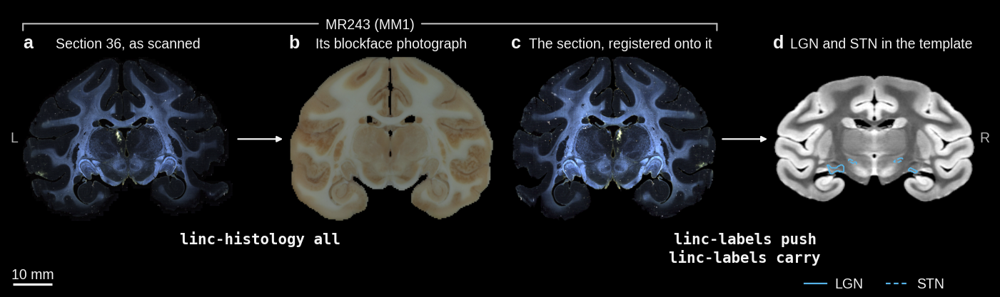
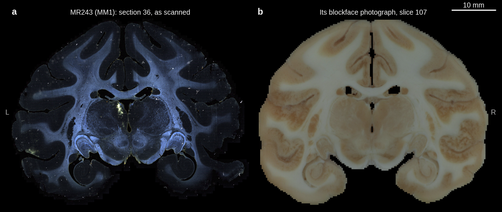
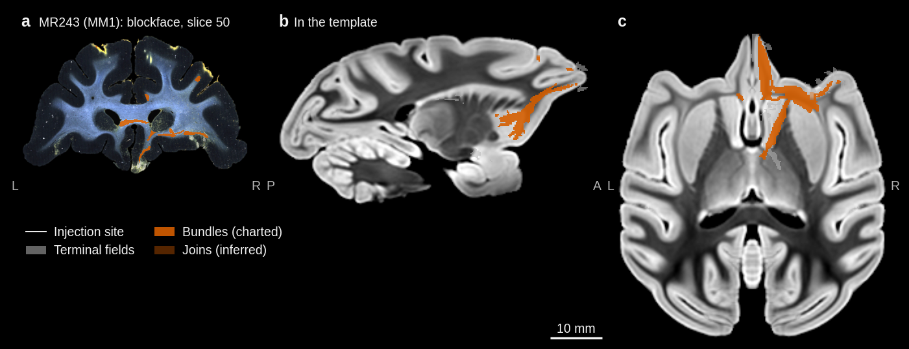

# 03. Histology

Histology sections registered to the blockface photographs of their own sections, and the labels drawn on them carried into the template.
The example is MR243 (MM1 in the paper).
Read [00_start_here.md](00_start_here.md) first; this part starts from 02's blockface volume and its registration.

## 1. What this part does

Each section's components (its hemispheres, or the cerebellum with the brainstem, when they were mounted apart) are registered with TIRL, each on its own, to the photograph taken as the section was cut: rotation, rigid, affine, then nonlinear.
Placed at their slices of the blockface volume, the sections follow the volume's chain into the template.
Labels drawn on the sections, such as tracer charts or the LGN and STN, follow the same registrations, are filled in between the sections, and are carried into the template in one resampling.



*Figure 1. MR243: (a) section 36 as scanned (`brains/sub-MR243/inputs/histology/sections/mr243LY_c18_s36nDF.jp2`, brightened); (b) the photograph of the same section, slice 107 (`outputs/MR243_blockface_L2.nii.gz`); (c) the section registered onto it (`outputs/MR243_histology_blockface.nii.gz`); (d) the LGN (solid) and STN (dashed) drawn on MR243's sections, in the template (`outputs/MR243_lgn_stn_template.nii.gz` on `template/outputs/template_b0.nii.gz`).*

## 2. Inputs

| File | Where in the data folder | What it is |
|---|---|---|
| `mr243LY_c18_s<NN>nDF.jp2` | `brains/sub-MR243/inputs/histology/sections/` | the 76 sections, in cutting order, as JPEG 2000 (42 GB), dark field; `ASCII_files/` holds the chart tracings. Also in LINC dataset 000003 |
| `<class>.ome.zarr` | `brains/sub-MR243/inputs/histology/tracer_annotations/` | the tracer labels drawn from the charts, one store per class: bundles and terminal fields by density, the injection site, single fibers, the tissue outline |
| `MR243_section_match.txt` | `brains/sub-MR243/inputs/manual_annotations/` | the match table, made manually: which photograph each section's components go with |
| `sub-MR243_histo_L6.nii.gz` and `_lhLGN`, `_rhLGN`, `_lhSTN`, `_rhSTN` | `brains/sub-MR243/inputs/manual_annotations/` | the histology stack the LGN and STN were drawn on, and the four drawings |
| `MR243_blockface.ome.zarr` | `brains/sub-MR243/intermediate/volume/` | the blockface volume in cutting order (02) |
| `MR243_regions_t2.nii.gz`, `.tsv` | `brains/sub-MR243/intermediate/histology/` | the regions volume on the blockface: 1 left, 2 right, 3 cerebellum and brainstem, 4 marker tubes (Step A) |
| `MR243_LY.tsv` | `paper/analysis/labels/section_maps/` | the section map: which section each image of the label stack is |



*Figure 2. (a) Section 36 as scanned (every 64th pixel, brightened) and (b) the photograph of the same section, slice 107 of the cutting order.
The match table gives the slice: sections 16 to 40 go with photograph 3 × section + 4758, here 4866, and the first photograph is number 4759.*

## 3. Steps

The brain must already have its blockface volume and its transform to the template (02, and 01 for a brain with MRI).
The histology steps use no GPU.

### Step A. The regions volume

```bash
H=$LINC_DATA/sub-<ID>/histology; mkdir -p $H
$PY -m shared.xfm apply --from mri-template --to bf-native --subject <ID> --nearest \
    --ref $LINC_DATA/sub-<ID>/blockface/<ID>_blockface_L2.nii.gz \
    $LINC_TEMPLATE/labels/regions_in_t2.nii.gz $H/regions.nii.gz
```

Then set the voxels of the left hemisphere's marker tubes in `regions.nii.gz` to 4 (the tubes are `$LINC_DATA/sub-<ID>/blockface/<ID>_holes.nii.gz`, from 02; for a paper brain, `outputs/<ID>_tubes.nii.gz` in the data folder).

This carries the template's left, right and cerebellum regions onto the blockface volume (CPU, seconds); the later steps divide each photograph into the section's components with it.


*Figure 3. MR243's regions volume (`intermediate/histology/MR243_regions_t2.nii.gz`) on slice 134, where all four labels are present, and their outlines on that slice's photograph.
MR243's regions were made before its section step was calibrated (400 µm instead of 366 µm); the figure, like the code, scales them to match.*

### Step B. The match table

```bash
STORE=$LINC_DATA/sub-<ID>/blockface/<ID>_blockface.ome.zarr
$PY_TIRL code/histology/linc-histology propose --subject <ID> --store $STORE \
    --histology <sections folder> --regions $H/regions.nii.gz --out $H/registration
```

- **What it does:** proposes the photograph of each section's components: it compares each component's outline with every photograph's, registers it to the photographs near its place, and fits a line of fixed spacing through the sections of each cutting run, so that a component follows its run rather than its own best-looking photograph. A component that scores too low on its run's line stays unmatched instead of being guessed.
- **Runs on:** CPU; about 10 to 20 minutes (the second on a busy host) and 14 GB of RAM for MR243, in the release's tests of this step (5 and 14 Nov 2026).
- **Writes:** in `$H/`: `match_table_proposed.txt` (one row per section), `match_review.csv` (one row per component: its photograph, its score, a flag, the next-best photographs) and `match_review/` (an image of each flagged component beside its proposed photograph).

Then check the proposal row by row, flagged rows first, in your own copy:

```bash
cp $H/match_table_proposed.txt $H/match_table_edited.txt      # correct the numbers here; nothing overwrites this file
```

Every later step uses the first of these that exists: a table given with `--table`, `match_table_edited.txt`, `match_table.txt`, `match_table_proposed.txt`; it prints which one it used.

On the five brains with manual tables, the proposal put 28 of 319 kept components more than one section off, and flagged 20 of the 33 farthest off (MR243: 2 of 91, its 3 large disagreements all flagged): the flags set the order of the review, they do not replace it.

### Step C. The registration

```bash
$PY_TIRL code/histology/linc-histology all --subject <ID> --store $STORE --threads 12 --jobs 2 \
    --histology <sections folder> --regions $H/regions.nii.gz --out $H/registration
```

For MR243 on the paper's data: `$PY run.py --run --only histology-MR243`, which uses MR243's manual match table and checks every section against the paper's.

- **What it does:** for each section, `match` (each component's photograph), `pieces` (each photograph divided into the components by the regions volume), `masks` (each component's tissue mask), `prepare` (TIRL's images, on a pixel half the blockface slice's: 0.040 mm for MR243), `register` (TIRL) and `rgb` (the registered sections in color). A component whose tissue Dice coefficient after the affine stage is at least 0.85 gets a stiffer nonlinear stage (regularization weight 0.45, otherwise 0.30).
- **Runs on:** CPU, 24 cores (12 threads for each of 2 components at a time), 32 GB of RAM; about 3 hours for MR243's 97 components, 8 GB of disk.
- **Writes:** in `$H/registration/`: `matched/`, `pieces/`, `tissue_masks/`, `moving/`, `fixed/` (PNG), and `tirl/<component>/` (TIRL's transforms and the registered image), each step with a `provenance.json`.

A stopped run resumes: a component whose `tirl/<component>/fixed4_nonlinear.timg` exists is done.
Keep 12 threads per component: TIRL's result depends on the thread count, and 12 reproduce the paper's.
The registered sections, placed at their slices and interpolated between, make one color volume of the histology on the blockface grid.


*Figure 4. (a) MR243 (MM1)'s section 5 as scanned, its hemispheres mounted apart (so without orientation letters); (b, c) the photograph of its section, slice 14, divided by the regions volume into the two hemispheres, each registered on its own (`tirl/mr243LY_c18_s05nDF_0001` and `_0002`).*


*Figure 5. Section 36's left half: (a) the photograph, slice 107, (b) the registered section (`outputs/MR243_histology_blockface.nii.gz`), (c) its tissue outline on the photograph, the check by eye: the outline should follow the photograph's edges and sulci.*


*Figure 6. One sagittal plane through the left LGN: (a) the photographs, (b) the registered histology, (c) the slices that hold a registered section (white) and those interpolated (orange; `intermediate/histology/provenance_L2.nii.gz`). MR243 has a section on every third slice.*

### Step D. Tracer labels

```bash
$PY_TIRL code/labels/linc-labels push        --subject <ID>
$PY      code/labels/linc-labels interpolate --subject <ID>
$PY      code/labels/linc-labels carry       --subject <ID>
$PY      code/labels/linc-labels connect     --subject <ID>
```

They read, in the brain's histology folder: the labels, one OME-Zarr per class, in `$H/annotations/<class>.ome.zarr`; the section map, `$H/section_map.tsv`; the match table; the regions volume; and step C's registration.

- **What they do:** `push` moves each label class through each component's registration onto its blockface slice. `interpolate` fills the slices between charted sections by demons registration between neighboring sections, the bundle classes as one group and the terminal classes as another. `carry` resamples the labels into the template through the brain's chain of transforms. `connect` joins the carried bundles into one pathway and marks each join as inferred.
- **Runs on:** CPU. `push` about 3 minutes; `interpolate` 20 to 35 minutes on 16 cores, 16 GB of RAM; `carry` 3 to 5 minutes on 4 cores; `connect` under a minute.
- **Writes:** `$LINC_DATA/sub-<ID>/labels/blockface/tracer/` (`<ID>_<class>_bfnative_L2.nii.gz`, and `_demons` for the interpolated ones) and `$LINC_DATA/sub-<ID>/labels/template/tracer/` (`_mri-template`, `_density`, `_footprint`, and the pathway, `<ID>_Bundles_mri-template_connected.nii.gz`).

In the file names, density is the fraction of each voxel, solid is where the density exceeds 0.5, and connected has 1 for charted and 2 for inferred voxels.
On the paper's data, `run.py` reruns the last three (`labels-interpolate-MR243` and so on) and checks each file against the paper's.
For MR243, MR256 and MF191 it starts from the paper's pushed labels, because their components were masked again in a way the release's `masks` step does not repeat; only MR252's push is rerun from its registrations.



*Figure 7. MR243 (MM1)'s tracer labels: (a) on the blockface, slice 50, over the registered section (`outputs/MR243_tracer_*_blockface.nii.gz`); (b, c) in the template, sagittal and axial through the pathway's center, the labels within 2.5 mm of the plane (`outputs/MR243_tracer_*_template.nii.gz` on `template/outputs/template_T2w.nii.gz`); axial views: anterior is up.*

### Step E. LGN and STN

```bash
$PY_TIRL code/labels/linc-labels push --subject <ID> --kind structures
```

The LGN and STN were drawn on another rendering of the sections, an image stack.
Each drawn frame goes onto its component through the frame's own fitted transform, then onto the blockface as in step D, and `carry --labels <the four files>` takes them into the template.
It runs on the CPU and writes `$LINC_DATA/sub-<ID>/labels/blockface/structures/`.

It reads, in `$H/structures/`: the stack (`histo_L6.nii.gz`), one drawing per nucleus (`histo_L6_<nucleus>.nii.gz`), `frame_map.json` (each frame's section), and each frame's transform onto its component (`transforms/f<frame>_<piece>.tfm`, with the moving image it was fitted on in `fitted_moving/`).

The data folder has MR243's LGN and STN in four spaces, each with its `.tsv` key (1 left LGN, 2 right LGN, 3 left STN, 4 right STN): `outputs/MR243_lgn_stn_histology`, `_blockface`, `_b0` and `_template`; `run.py` does not rerun them.


*Figure 8. MR243's LGN (solid) and STN (dashed): (a) on the blockface, slice 107, over section 36 (`outputs/MR243_lgn_stn_blockface.nii.gz`); (b, c) in the template, through each nucleus (`outputs/MR243_lgn_stn_template.nii.gz` on `template/outputs/template_b0.nii.gz`).*

## 4. Checks

**The registration check** scores each component by the Dice coefficient of the registered section's tissue with the photograph's, after each stage, and passes it when the Dice coefficient after the nonlinear stage is at least 0.85.
On MR243, 93 of 97 components passed, with a median of 0.945 after the affine stage and 0.960 after the nonlinear stage.
The other five histology brains: MR252 46 of 47, MR256 53 of 53, MF278 77 of 79, MF275 58 of 62, MF191 55 of 57.

A failed component is not dropped: it stays in the registered histology, and the check says where to look.
MR243's four failures are at the two ends of the series: section 3's left hemisphere (slice 8), and the cerebellum of sections 64, 67 and 68 (slices 149 to 158).


*Figure 9. MR243's best and worst components, registered and as their tissue outline on the photograph: (a, b) section 15's left hemisphere passes, Dice coefficient 0.99 (slice 44); (c, d) section 68's cerebellum fails, 0.82 (slice 155): the registered tissue does not follow the photograph's outline at the top.*

**Look** at each registered section over its photograph (Figure 5), and page through `outputs/<ID>_histology_blockface.nii.gz` with the photographs (Figure 6).

**`run.py`'s check** compares every registered section with the paper's: identical, or its transform within 3 pixels of the paper's on TIRL's grid (0.12 mm of MR243's tissue), because some components differ from the paper's own run by round-off in TIRL's last stage.
On MR243, in the lab's rerun, 63 of 97 components were identical and the other 34 within 1.5 pixels, with every input of TIRL identical to the paper's.

## 5. When something goes wrong

What you may see in this part, why, and what to do: [troubleshooting, histology](../troubleshooting.md#histology).
What it cannot do: [overview](../overview.md#what-the-package-cannot-do).
